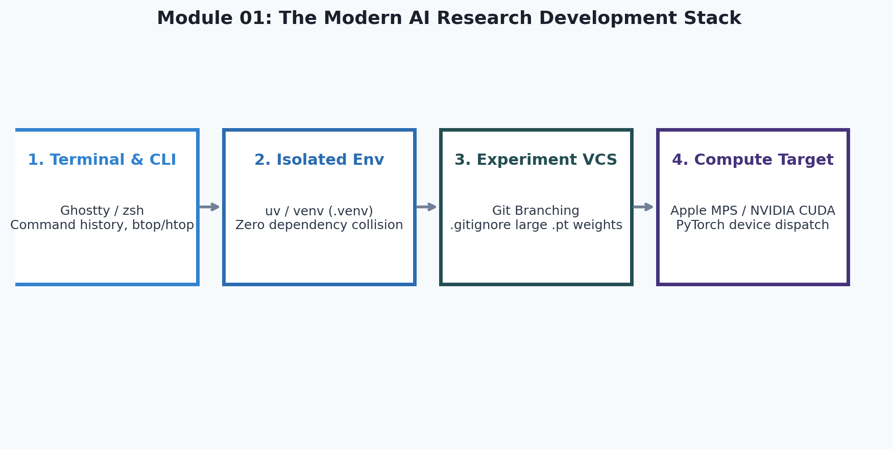
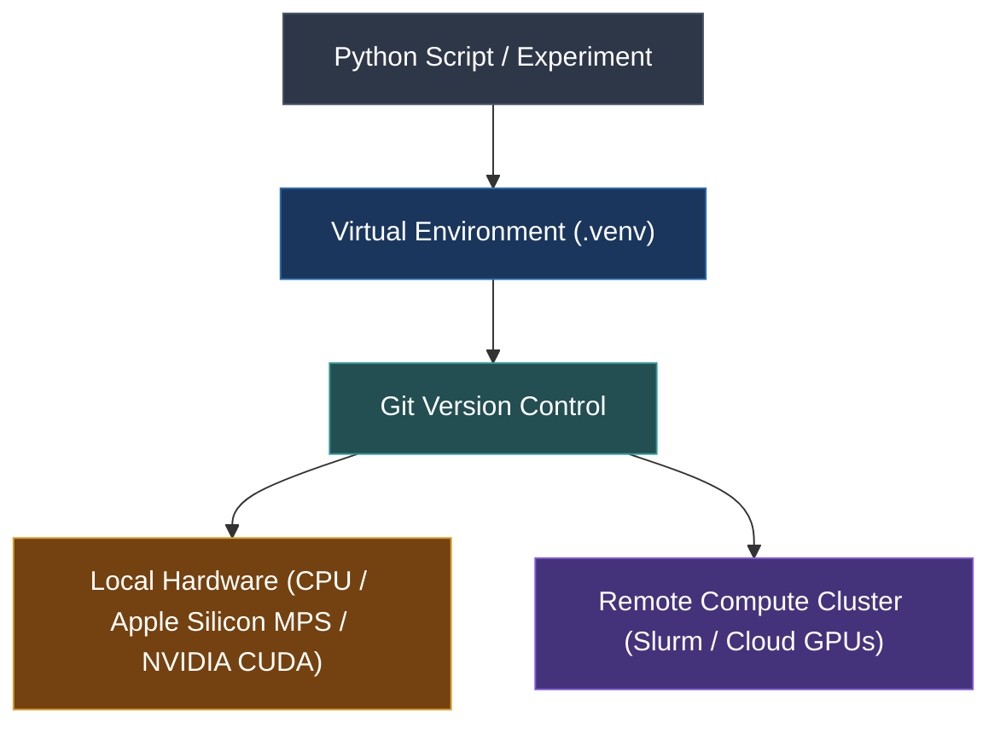

# 1. Python & Research Tooling

<p align="center">
  
</p>


Welcome to the first module of **AI Research Foundations**. In this chapter, we establish the essential programming and command-line habits required to conduct reproducible machine learning research.

---

## 🎯 Learning Objectives

By the end of this module, you will:
- Master advanced Python constructs *(idiomatic patterns that make research code cleaner and faster)*.
- Configure isolated virtual environments using `venv` or `uv` *(isolated directory trees containing specific versions of Python packages to prevent dependency conflicts)*.
- Navigate the Unix command line (`zsh` in modern terminals like Ghostty) like a professional AI researcher.
- Track experiments using Git while avoiding common AI research pitfalls *(like accidentally committing gigabyte weights or API tokens)*.
- Use interactive debuggers (`pdb` / `ipdb`) to inspect tensor shapes and intermediate states during model training.

---

## 🧭 Why Tooling Matters in AI Research

AI research differs from typical software engineering. You will often train models for hours or days, run dozens of hyperparameter sweeps *(explorations of different training settings like learning rate, batch size, and weight decay)*, and execute code across remote GPU clusters.

A messy environment leads to:
1. **Unreproducible results**: "It worked on my machine yesterday, but crashed today."
2. **Silent bugs**: Shape mismatches, broadcasting accidents, or mutated global dictionaries that corrupt gradients without throwing an explicit error.
3. **Wasted compute**: Crashes halfway through a 10-hour training run because of an unhandled exception or missing path.



---

## 🐍 Essential Python Patterns for AI

### 1. Type Annotations & Static Checking
Type hints *(optional annotations specifying the expected data type of variables, function arguments, and return values)* turn subtle shape bugs into obvious errors before running expensive models.

```python
from typing import List, Tuple, Dict, Optional
import torch

def create_training_batch(
    token_ids: List[int], 
    block_size: int = 128
) -> Tuple[torch.Tensor, torch.Tensor]:
    """
    Slices input token sequence into context (x) and target (y) tensors.
    """
    x = torch.tensor(token_ids[:-1], dtype=torch.long)
    y = torch.tensor(token_ids[1:], dtype=torch.long)
    return x[:block_size], y[:block_size]
```

### 2. Variable Unpacking (`*args` and `**kwargs`)
In deep learning frameworks, you frequently pass variable hyperparameter dictionaries into model layers:

```python
def configure_transformer_block(*layers, **hyperparams):
    """
    *layers: variable positional arguments (packed into a tuple).
    **hyperparams: variable keyword arguments (packed into a dictionary).
    """
    n_heads: int = hyperparams.get("n_heads", 8)
    hidden_dim: int = hyperparams.get("hidden_dim", 512)
    dropout_rate: float = hyperparams.get("dropout", 0.1)
    
    print(f"Constructing block with {len(layers)} sub-modules:")
    print(f" -> Heads: {n_heads}, Dim: {hidden_dim}, Dropout: {dropout_rate}")
    return {"n_heads": n_heads, "dim": hidden_dim, "layers": layers}
```

### 3. Dataclasses for Research Configurations
Instead of messy dictionaries, modern AI repos use `@dataclass` *(a Python decorator that automatically generates boilerplate methods like `__init__` and `__repr__` for data-storing classes)* to define hyperparameter configs:

```python
from dataclasses import dataclass, field

@dataclass
class ModelConfig:
    vocab_size: int = 50257          # Number of unique tokens in vocabulary
    max_seq_len: int = 1024          # Maximum context window length
    n_layer: int = 12                # Number of transformer blocks
    n_head: int = 12                 # Number of attention heads
    n_embd: int = 768                # Hidden embedding dimension
    dropout: float = 0.1             # Dropout probability for regularization
    bias: bool = False               # Whether to include linear layer biases
    device: str = "cpu"              # Target compute device

config = ModelConfig(n_layer=6, n_head=6, n_embd=384)
print(config)
```

### 4. Generators for Large Datasets
When dealing with billions of tokens, you cannot load the entire text corpus into memory. You must stream data using generator functions *(functions that produce values on-the-fly using the `yield` keyword, saving RAM)*:

```python
from typing import Generator

def stream_tokens_from_file(filepath: str) -> Generator[str, None, None]:
    """Yields one word/token at a time without reading the entire file into RAM."""
    with open(filepath, "r", encoding="utf-8") as f:
        for line in f:
            for token in line.strip().split():
                yield token
```

---

## 🛠️ The Research Environment & Tooling

### 1. Virtual Environments: `venv` and `uv`
Never install research dependencies directly into your system's global Python. Always use a dedicated `.venv`:

```bash
# Standard Python venv
python3 -m venv .venv
source .venv/bin/activate       # macOS / Linux
# or .venv\Scripts\activate     # Windows

# Lightning-fast alternative: uv (Astral)
curl -LsSf https://astral.sh/uv/install.sh | sh
uv venv .venv
source .venv/bin/activate
uv pip install torch numpy pandas matplotlib
```

### 2. Modern Terminal & Shell (`ghostty` / `zsh`)
A fast terminal like **Ghostty** paired with `zsh` boosts research efficiency:
- `Ctrl + R`: Reverse history search to quickly find past training commands.
- `htop` / `btop`: Monitor CPU and RAM utilization in real-time.
- `watch -n 1 nvidia-smi`: Monitor GPU VRAM *(video random access memory: the onboard memory of the graphics card)* and compute utilization on NVIDIA machines.
- `sudo powermetrics --samplers gpu_power`: Monitor GPU power draw on Apple Silicon Macs.

### 3. Git for AI Experiments: Avoiding Disasters
AI research generates large files: dataset `.jsonl` files, checkpoint `.pt` or `.bin` files, and experiment logs. 

Create a bulletproof `.gitignore` in every project:
```gitignore
# Python artifacts
__pycache__/
*.py[cod]
.venv/

# AI Model Checkpoints & Large Data
*.pt
*.pth
*.ckpt
*.bin
*.safetensors
data/
downloads/
wandb/
runs/
*.log

# Jupyter Notebook checkpoints
.ipynb_checkpoints/

# Secrets & API Keys
.env
```

> [!TIP]
> **Pro Tip**: Use `git status` before every single `git add .` to verify that no large binary files (like a 2GB model weight) are accidentally staged!

### 4. Interactive Debugging with `pdb`
When your neural net throws `RuntimeError: The size of tensor a (64) must match the size of tensor b (128)`, don't guess with print statements. Drop into an interactive debugger *(a tool that halts program execution at a specific line and lets you inspect variables in real time)*:

```python
import torch

def bad_layer_forward(x: torch.Tensor, w: torch.Tensor) -> torch.Tensor:
    # Set an interactive breakpoint right before the suspicious operation
    # breakpoint() drops into pdb
    breakpoint()
    return torch.matmul(x, w)

# In the pdb terminal prompt:
# (Pdb) p x.shape       -> Prints the shape of tensor x
# (Pdb) p w.shape       -> Prints the shape of tensor w
# (Pdb) n               -> Executes the next line
# (Pdb) c               -> Continues execution
```

---

## 📚 Curated References

1. **CS50P: Harvard's Introduction to Programming with Python**: [cs50.harvard.edu/python](https://cs50.harvard.edu/python/)
2. **Automate the Boring Stuff with Python (Al Sweigart)**: [automatetheboringstuff.com/2e/](https://automatetheboringstuff.com/2e/)
3. **The Missing Semester of Your CS Education (MIT)**: [missing.csail.mit.edu](https://missing.csail.mit.edu)
4. **Learn Git Branching (Interactive)**: [learngitbranching.js.org](https://learngitbranching.js.org)

---

## 🏋️ Revision Exercises

### Level 1: Recall & Conceptual
1. Explain the difference between `python -m venv .venv` and installing packages globally with `pip install`. Why is this crucial for reproducible research?
2. What does the term **broadcasting** mean in computational libraries? Give a one-sentence definition.
3. What is the danger of committing a `.pt` model checkpoint file to a standard GitHub repository?

### Level 2: Hands-On Implementation
1. Write a Python script `config_manager.py` that defines a `@dataclass` called `ExperimentConfig` containing fields for:
   - `model_name` (string)
   - `learning_rate` (float, default 3e-4)
   - `batch_size` (int, default 32)
   - `max_steps` (int, default 1000)
   - `seed` (int, default 42)
   Add a method `to_dict()` and a method `save_json(filepath: str)` that serializes the configuration to disk.
2. Write a generator function `batch_sampler(data_list: list, batch_size: int)` that yields chunks of the list of size `batch_size` without duplicating the entire list in memory.

### Level 3: Research Deep Dive
1. Open your terminal and create a small dummy git repository. Create a 50MB dummy binary file (`head -c 50M </dev/urandom > dummy_weights.pt`). 
   - Attempt to commit it and inspect `git log -p`.
   - Now write a `.gitignore` to ignore `*.pt`.
   - Remove the staged file using `git rm --cached dummy_weights.pt` and verify that `git status` shows the repository clean.
2. Write a script containing a simulated tensor dimension mismatch. Insert `breakpoint()` immediately before the operation. Launch the script from the command line, use `pdb` commands (`p`, `locals()`, `whatis`) to inspect the variables, and fix the mismatch dynamically in the debugger.
