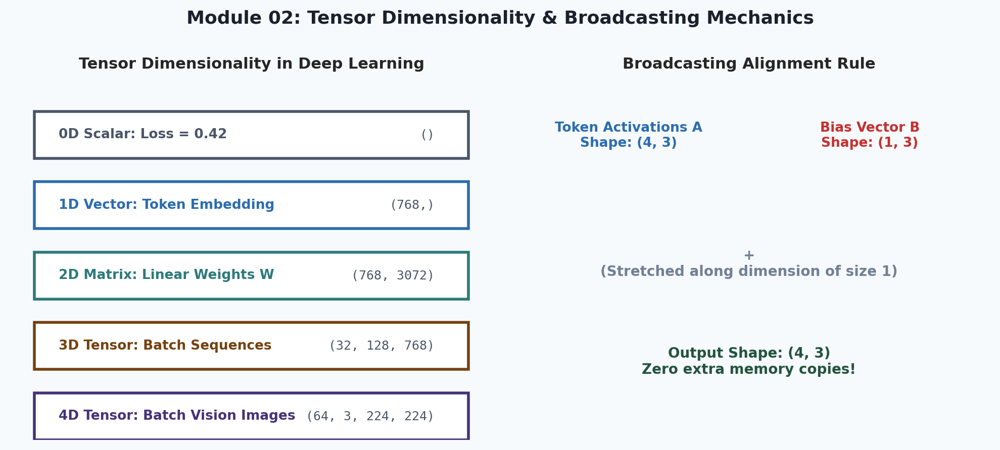
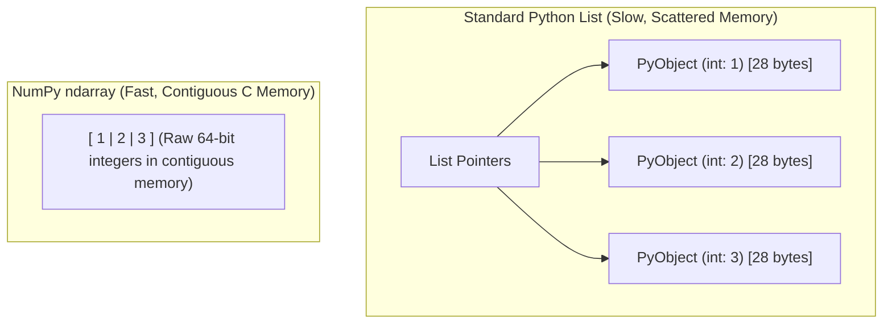

# 2. NumPy, Vectorization & Data Foundations

<p align="center">
  
</p>

<p align="center">
  <a href="https://colab.research.google.com/github/amirlankalm/ai-research-foundations/blob/main/02_NumPy_Vectorization_and_Data/module_02.ipynb"></a>
</p>

> [!NOTE]
> ⏱️ **Estimated Study Time**: ~2.5 hours reading + ~2 hours exercises  
> 🎯 **What "Done" Looks Like**:
> - [ ] You can explain contiguous memory strides and why vectorized NumPy avoids Python interpreter loop overhead.
> - [ ] You can predict resulting broadcast shapes for arbitrary array dimensions.
> - [ ] You ran `python3 -m pytest tests/test_core.py -v` and verified that Module 02 tests pass.
> - [ ] You attempted Level 1 & Level 2 exercises and verified them against [`solutions.md`](solutions.md).


Welcome to Module 02 of **AI Research Foundations**. In this module, we transition from standard Python to high-performance vectorized numerical computation using **NumPy**, along with data manipulation via **Pandas** and visualization with **Matplotlib**.

---

## 🎯 Learning Objectives

By the end of this module, you will:
- Understand how `np.ndarray` stores contiguous memory blocks in C, achieving 50x–100x speedups over pure Python lists.
- Master **broadcasting rules** *(the mathematical alignment protocol allowing operations between arrays of different shapes)*.
- Manipulate tensor dimensions with slicing, reshaping, transposing, and boolean indexing.
- Clean and prepare real datasets using **Pandas**.
- Plot professional research graphics *(loss curves, learning rate schedules, distribution histograms)* with **Matplotlib**.

---

## ⚡ Why NumPy? Memory Layout & Vectorization

In standard Python, a list `[1, 2, 3]` is an array of **pointers** to scattered Python integer objects, each with heavy metadata overhead *(around 28 bytes per integer!)*. 

NumPy stores data in a **contiguous block of raw memory** *(continuous sequential memory addresses without pointer indirections)*, allowing your CPU to leverage **SIMD** *(Single Instruction, Multiple Data: modern hardware capability to execute one arithmetic operation across multiple numbers simultaneously)*.



### The Speed Difference: Python Loop vs. Vectorized NumPy

```python
import time
import numpy as np

# Create 10 million numbers
size = 10_000_000
python_list = list(range(size))
numpy_array = np.arange(size)

# Benchmark 1: Python Loop
start = time.perf_counter()
res_list = [x * 2 for x in python_list]
python_time = time.perf_counter() - start

# Benchmark 2: NumPy Vectorized Operation
start = time.perf_counter()
res_np = numpy_array * 2
numpy_time = time.perf_counter() - start

print(f"Python Loop Time: {python_time:.4f}s")
print(f"NumPy Vectorized Time: {numpy_time:.4f}s")
print(f"🚀 NumPy is {python_time / numpy_time:.1f}x faster!")
# Typically ~50x to 100x faster!
```

---

## 📐 Dimensions, Shapes & Strides

In machine learning, you will constantly navigate tensors of varying dimensions:

| Term | Dimensionality | Example in Deep Learning | Typical Shape |
|---|---|---|---|
| **Scalar** | 0D *(single value)* | Loss value, learning rate | `()` |
| **Vector** | 1D *(1D list of numbers)* | Token embedding vector, layer bias | `(dim,)` e.g. `(768,)` |
| **Matrix** | 2D *(table with rows and columns)* | Weight matrix, linear projection | `(in_features, out_features)` e.g. `(768, 3072)` |
| **3D Tensor** | 3D | Sequence of token embeddings | `(batch_size, seq_len, embed_dim)` e.g. `(32, 128, 768)` |
| **4D Tensor** | 4D | Batch of RGB images | `(batch_size, channels, height, width)` e.g. `(64, 3, 224, 224)` |

---

## 🎛️ Broadcasting Demystified

**Broadcasting** is NumPy's protocol for performing arithmetic between arrays of different shapes without making unnecessary memory copies.

### The Broadcasting Rules
To determine if two shapes are compatible:
1. Align the shapes from **right to left** (trailing dimensions first).
2. Two dimensions are compatible if:
   - They are **equal**, OR
   - One of them is **1**.
3. If a dimension is 1, it is conceptually "stretched" along that axis to match the other array.

```
Example: Adding a bias vector (B) to a hidden layer output (A)

Array A:  Shape (32, 128, 768)  -> (Batch, Sequence Length, Hidden Dimension)
Array B:  Shape (      1, 768)  -> (Bias per hidden feature)
---------------------------------
Result:   Shape (32, 128, 768)  -> Compatible! Dimension 1 is broadcast across the 128 tokens.
```

```python
import numpy as np

# A batch of 4 token embeddings of size 3
tokens = np.array([
    [1.0, 2.0, 3.0],
    [4.0, 5.0, 6.0],
    [7.0, 8.0, 9.0],
    [2.0, 4.0, 6.0]
])  # Shape: (4, 3)

bias = np.array([0.1, 0.2, 0.3])  # Shape: (3,) -> Automatically aligns to (1, 3)

# Broadcasted addition:
output = tokens + bias
print("Output shape:", output.shape)
print("Result:\n", output)
```

---

## 📊 Tabular Data with Pandas

Before feeding data into neural networks, research datasets often begin as tabular `.csv` or `.parquet` files. **Pandas** is the standard library for data wrangling.

```python
import pandas as pd

# Load dataset
data = {
    "passenger_id": [1, 2, 3, 4, 5],
    "pclass": [3, 1, 3, 1, 3],
    "age": [22.0, 38.0, 26.0, 35.0, None], # Contains missing value
    "fare": [7.25, 71.28, 7.92, 53.10, 8.05],
    "survived": [0, 1, 1, 1, 0]
}
df = pd.DataFrame(data)

# 1. Inspect missing values
print("Missing values per column:\n", df.isnull().sum())

# 2. Impute (fill) missing numerical values with median
median_age = df["age"].median()
df["age"] = df["age"].fillna(median_age)

# 3. GroupBy analysis: Survival rate by passenger class
class_survival = df.groupby("pclass")["survived"].mean()
print("\nSurvival rate by ticket class:\n", class_survival)

# 4. Extract raw NumPy matrices ready for ML models
X = df[["pclass", "age", "fare"]].to_numpy()
y = df["survived"].to_numpy()
print("\nFeature Matrix X shape:", X.shape)
print("Target vector y shape:", y.shape)
```

---

## 📈 Visualizing Research Experiments with Matplotlib

Visual feedback is vital when training models. You need to inspect training vs. validation loss curves to diagnose underfitting or overfitting.

```python
import matplotlib.pyplot as plt
import numpy as np

# Simulated training curves
epochs = np.arange(1, 21)
train_loss = 2.5 * np.exp(-0.2 * epochs) + 0.1 * np.random.normal(0, 0.1, len(epochs))
val_loss = 2.7 * np.exp(-0.18 * epochs) + 0.3 + 0.05 * np.random.normal(0, 0.1, len(epochs))

plt.figure(figsize=(8, 5), dpi=100)
plt.plot(epochs, train_loss, label="Training Loss", color="#3182CE", lw=2)
plt.plot(epochs, val_loss, label="Validation Loss", color="#E53E3E", lw=2, linestyle="--")

plt.title("Model Convergence: Training vs. Validation Loss", fontsize=14, fontweight="bold")
plt.xlabel("Epochs", fontsize=12)
plt.ylabel("Cross-Entropy Loss", fontsize=12)
plt.grid(True, linestyle=":", alpha=0.6)
plt.legend(frameon=True, fontsize=11)
plt.tight_layout()
plt.savefig("loss_curve.png")
print("Saved loss curve plot to loss_curve.png")
```

---

## 📚 Curated References

1. **Python Data Science Handbook (Jake VanderPlas)**: [jakevdp.github.io/PythonDataScienceHandbook](https://jakevdp.github.io/PythonDataScienceHandbook/)
2. **Python for Data Analysis, 3rd ed. (Wes McKinney)**: [wesmckinney.com/book](https://wesmckinney.com/book/)
3. **Kaggle Learn: Python & Pandas**: [kaggle.com/learn](https://www.kaggle.com/learn)
4. **NumPy Visual Guide**: [numpy.org/doc/stable/user/basics.broadcasting.html](https://numpy.org/doc/stable/user/basics.broadcasting.html)

---

## 🏋️ Revision Exercises

> [!TIP]
> **Worked Solutions**: Once you've attempted these exercises, check your implementations and answers in [`solutions.md`](solutions.md).

### Level 1: Recall & Conceptual
1. Define the following terms in your own words:
   - **Contiguous memory**: *(why is it faster than linked list pointers?)*
   - **Axis**: *(what is axis 0 vs axis 1 in a 2D matrix?)*
   - **Broadcasting**: *(state the two conditions required for dimension compatibility)*
2. Given two arrays with shapes `(16, 1, 64)` and `(16, 32, 1)`, will their element-wise multiplication succeed? If yes, what is the resulting shape?

### Level 2: Hands-On Implementation
1. Write a function `cosine_similarity_matrix(A: np.ndarray, B: np.ndarray) -> np.ndarray` that takes two 2D matrices `A` of shape `(N, D)` and `B` of shape `(M, D)` and computes the pairwise cosine similarity between all vectors using pure vectorized NumPy without a single `for` loop.
2. Given a 2D matrix representing attention scores of shape `(8, 8)`:
   - Apply a causal mask *(set all entries above the diagonal to $-\infty$)*.
   - Compute the `softmax` across the last axis:
     $$\text{softmax}(z_i) = \frac{e^{z_i - \max(z)}}{\sum_j e^{z_j - \max(z)}}$$
   - Verify that every row sums to $1.0$.

### Level 3: Research Deep Dive
1. **Memory Strides Investigation**: Create a $1000 \times 1000$ array of 64-bit floats. Use `arr.strides` to inspect how many bytes the CPU jumps to move to the next row vs. the next column.
   - Benchmark row-wise summation `arr.sum(axis=1)` vs column-wise summation `arr.sum(axis=0)`.
   - Explain the performance discrepancy using CPU cache lines *(the fixed-size blocks of memory transferred from RAM to the CPU cache)*.
