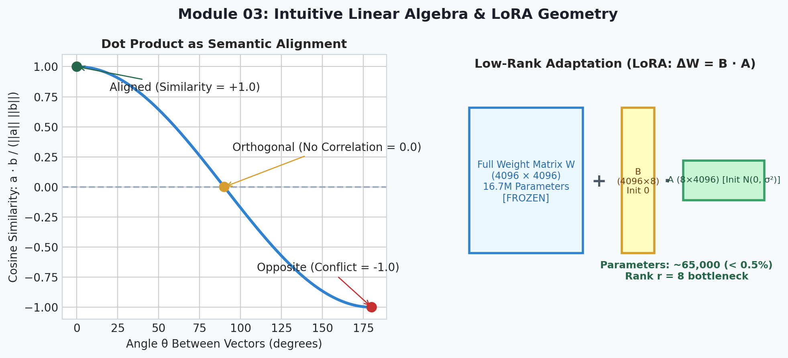
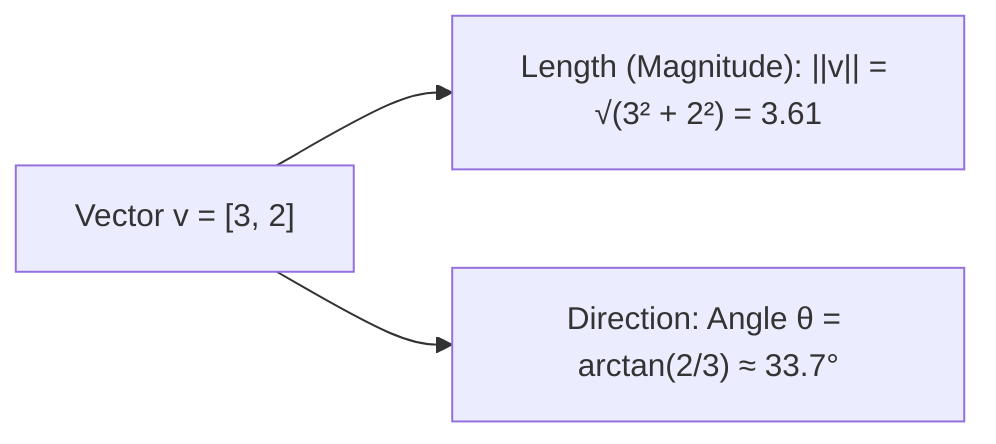
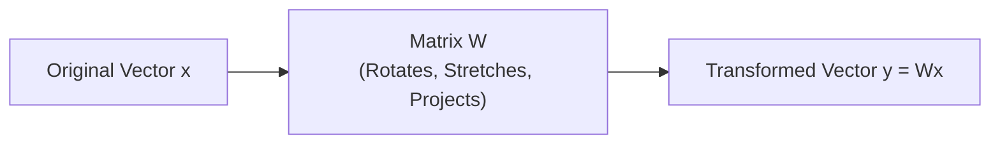
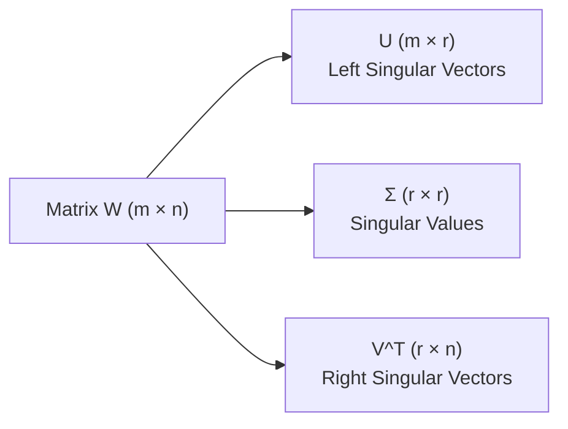

# 3. Intuitive Linear Algebra for AI

<p align="center">
  
</p>


Welcome to Module 03 of **AI Research Foundations**. Linear algebra is the native language of artificial intelligence. In this module, we remove the cold, dry abstraction and build a vivid **spatial and geometric intuition** for every linear algebraic concept used in deep learning.

---

## 🎯 Learning Objectives

By the end of this module, you will:
- Visualize vectors as arrows in coordinate space and as feature representations.
- Understand the **dot product** as a geometric measure of alignment and semantic similarity.
- View **matrices** not as static spreadsheets of numbers, but as dynamic **spatial transformation machines**.
- Understand **matrix multiplication** as the composition of sequential transformations.
- Demystify **eigenvalues, eigenvectors**, and **Singular Value Decomposition (SVD)**, the mathematical foundation of modern **LoRA** *(Low-Rank Adaptation)*.

---

## 🧭 What is a Vector?

In AI research, a vector has two complementary perspectives:

1. **The Computer Scientist's Perspective**: A vector is an ordered list of numbers representing attributes *(e.g., a person's age, income, and education level, or a 768-dimensional token embedding)*.
2. **The Physicist / Geometric Perspective**: A vector is an arrow sitting in space with a specific **direction** and **magnitude** *(length)*, anchored at the origin $(0, 0)$.



### Vector Addition & Scalar Multiplication
- **Vector Addition** ($\vec{v} + \vec{w}$): Place the tail of $\vec{w}$ at the tip of $\vec{v}$. In semantic embeddings, this enables analogies: $\text{King} - \text{Man} + \text{Woman} \approx \text{Queen}$.
- **Scalar Multiplication** ($c \cdot \vec{v}$): Stretching or shrinking the vector without altering its angle *(a scalar is a single real number)*.

---

## 🎯 The Dot Product: Measuring Alignment & Similarity

The **dot product** *(also called the inner product: an algebraic operation that takes two equal-length sequences of numbers and returns a single scalar)* is the engine inside modern **Transformer Self-Attention**.

$$\vec{a} \cdot \vec{b} = \sum_{i=1}^n a_i b_i = \|\vec{a}\| \|\vec{b}\| \cos(\theta)$$

### Geometric Intuition:
The dot product answers one question: **"How much do these two arrows point in the same direction?"**

```
Case 1: Same Direction (θ = 0°)       -> cos(0) = 1  -> Maximum Positive Alignment!
Case 2: Perpendicular / Orthogonal (θ = 90°) -> cos(90) = 0 -> Zero Correlation (Completely Independent)
Case 3: Opposite Direction (θ = 180°) -> cos(180) = -1 -> Maximum Negative Conflict!
```

```python
import numpy as np

# Word embedding vectors (3 dimensions for illustration)
king  = np.array([0.9, 0.8, 0.1])
queen = np.array([0.85, 0.82, 0.15])
apple = np.array([0.05, 0.1, 0.95])

dot_king_queen = np.dot(king, queen)
dot_king_apple = np.dot(king, apple)

print(f"Dot(King, Queen): {dot_king_queen:.3f} (High semantic alignment)")
print(f"Dot(King, Apple): {dot_king_apple:.3f} (Low semantic alignment)")
```

> [!NOTE]
> **Cosine Similarity**: If you divide the dot product by the lengths of both vectors:
> $$\text{cosine\_similarity}(\vec{a}, \vec{b}) = \frac{\vec{a} \cdot \vec{b}}{\|\vec{a}\| \|\vec{b}\|}$$
> The score is normalized between $-1.0$ and $+1.0$, completely independent of vector magnitude.

---

## 🔄 Matrices as Spatial Transformations

Do not think of a matrix as an inert table of numbers. **A matrix is a dynamic coordinate transformation machine.**

When you multiply a matrix $W$ by a vector $\vec{x}$ ($W\vec{x}$), you are asking: **"Where does vector $\vec{x}$ land after the entire coordinate space is rotated, stretched, sheared, or reflected?"**

Every 2D transformation is defined entirely by where it moves the standard basis vectors *(the fundamental unit vectors along the axes)*:
- $\hat{i} = \begin{bmatrix} 1 \\ 0 \end{bmatrix}$ (Unit step along X-axis)
- $\hat{j} = \begin{bmatrix} 0 \\ 1 \end{bmatrix}$ (Unit step along Y-axis)

If a transformation moves $\hat{i}$ to $\begin{bmatrix} 2 \\ 1 \end{bmatrix}$ and $\hat{j}$ to $\begin{bmatrix} -1 \\ 3 \end{bmatrix}$, the transformation matrix is simply:

$$W = \begin{bmatrix} 2 & -1 \\ 1 & 3 \end{bmatrix}$$



### Matrix Multiplication: Chaining Transformations
Multiplying two matrices $A \cdot B$ means applying transformation $B$ first, followed by transformation $A$.
Because rotating then shearing does not yield the same outcome as shearing then rotating:
$$A \cdot B \neq B \cdot A \quad \text{(Matrix multiplication is non-commutative)}$$

---

## 🧊 Determinants: Scaling Volume

The **determinant** of a square matrix ($\det(A)$) tells you **how much area or volume expands or contracts** under that transformation:
- If $\det(A) = 3$, any shape's area triples after applying $A$.
- If $\det(A) = 1$, the transformation preserves area perfectly *(e.g., pure rotations)*.
- If $\det(A) = 0$, space is flattened into a lower dimension *(e.g., a 2D plane crushed into a 1D line)*. When $\det(A) = 0$, information is permanently lost and the matrix **cannot be inverted**.

---

## 🧬 Eigenvectors & Eigenvalues: The Unshakable Axes

When a matrix transforms space, almost every vector is knocked off its original span *(direction)*. 

However, a few special vectors keep pointing in their exact original direction—they only get stretched or squished!
- **Eigenvector**: A vector whose direction does not change during the transformation.
- **Eigenvalue** ($\lambda$): The scaling factor by which that eigenvector is stretched or shrunk.

$$A\vec{v} = \lambda \vec{v}$$

```
In AI & Data Science:
- Principal Component Analysis (PCA): The eigenvectors with the largest eigenvalues 
  represent the directions of maximum variance in high-dimensional data!
```

---

## 🧩 Singular Value Decomposition (SVD) & LoRA

Every real matrix $W \in \mathbb{R}^{m \times n}$ can be decomposed into three simpler geometric transformations:

$$W = U \Sigma V^T$$

1. $V^T$: Rotation in input space.
2. $\Sigma$: Scaling along orthogonal axes *(contains singular values in decreasing order)*.
3. $U$: Rotation in output space.



### Why AI Researchers Care: Low-Rank Adaptation (LoRA)
A large weight matrix $W$ with $4096 \times 4096 \approx 16.7\text{ million parameters}$ often has an **intrinsic rank** *(the number of independent dimensions carrying real information)* far smaller than 4096.

Instead of fine-tuning all 16.7 million weights, **LoRA** decomposes the weight update $\Delta W$ into two tiny low-rank matrices:
$$\Delta W = B \cdot A$$
Where $A \in \mathbb{R}^{r \times 4096}$ and $B \in \mathbb{R}^{4096 \times r}$, with rank $r=8$ or $16$.
This cuts trainable parameters by **over 99%** while preserving accuracy!

---

## 📚 Curated References

1. **3Blue1Brown: Essence of Linear Algebra**: [YouTube Playlist](https://www.youtube.com/playlist?list=PLZHQObOWTQDPD3MizzM2xVFitgF8hE_ab)
2. **Mathematics for Machine Learning (Deisenroth et al.) - Chapters 2 & 3**: [mml-book.github.io](https://mml-book.github.io/)
3. **StatQuest: PCA step-by-step**: [YouTube Video](https://www.youtube.com/watch?v=FgakZw6K1QQ)
4. **LoRA Paper (Hu et al., 2021)**: [arxiv.org/abs/2106.09685](https://arxiv.org/abs/2106.09685)

---

## 🏋️ Revision Exercises

### Level 1: Recall & Conceptual
1. If two vectors $\vec{u}$ and $\vec{v}$ have a dot product of $0$, what is the geometric relationship between them?
2. What does a determinant of $0$ imply about our ability to reverse (invert) a linear transformation?
3. In plain English, what is an **eigenvector**? Give an analogy.

### Level 2: Hands-On Implementation
1. Write a function `low_rank_approx(W: np.ndarray, rank: int) -> np.ndarray` that takes a 2D matrix $W$, performs SVD using `np.linalg.svd`, retains only the top `rank` singular values, and reconstructs the low-rank approximation $\hat{W}$.
2. Compute the reconstruction error:
   $$\text{Error} = \|W - \hat{W}\|_F = \sqrt{\sum_{i,j} (W_{i,j} - \hat{W}_{i,j})^2}$$
   for ranks $r=1, 2, 4, 8, 16$ on a $64 \times 64$ random matrix and plot the error curve.

### Level 3: Research Deep Dive
1. **Self-Attention Query-Key Geometry**: In Transformers, attention weights are computed as:
   $$A = \text{softmax}\left(\frac{Q K^T}{\sqrt{d_k}}\right)$$
   Why do the authors divide by $\sqrt{d_k}$ *(the square root of the head dimension)*? 
   - Write a simulation in NumPy generating random Gaussian vectors of dimension $d_k=64$ vs $d_k=1024$.
   - Calculate their dot products and observe how variance scales with dimension.
   - Explain what happens to the softmax gradients when the dot products grow very large.
