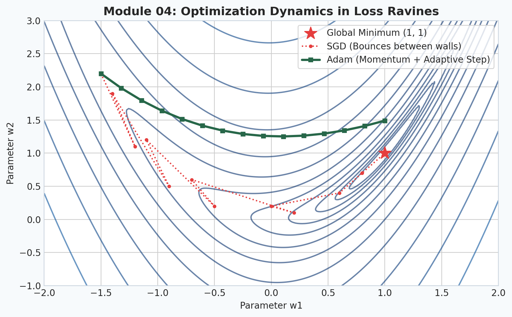
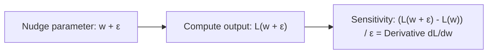
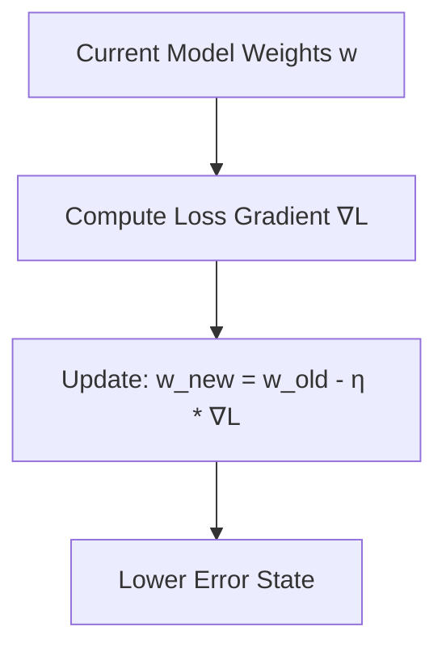
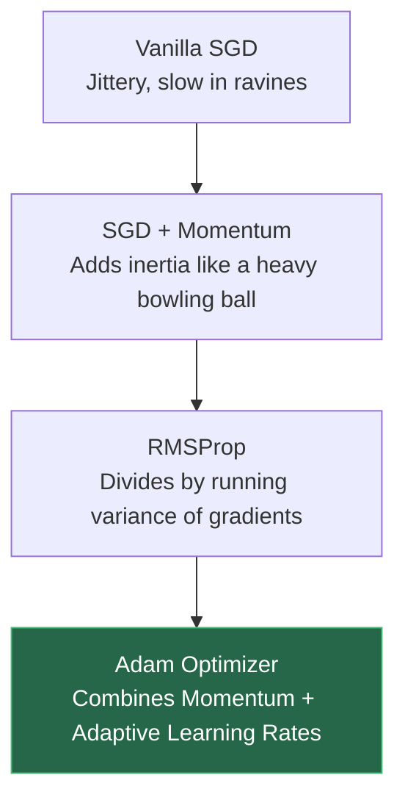

# 4. Intuitive Calculus & Optimization

  

> [!NOTE]
> ⏱️ **Estimated Study Time**: ~3 hours reading + ~2 hours exercises  
> 🎯 **What "Done" Looks Like**:
> - [ ] You can explain derivatives, gradients, and chain rule with intuitive geometric mental models.
> - [ ] You understand why Adam's first and second moments solve ravine oscillations and vanishing gradients.
> - [ ] You ran `python3 -m pytest tests/test_core.py -v` and verified that Module 04 tests pass.
> - [ ] You attempted Level 1 & Level 2 exercises and verified them against [`solutions.md`](solutions.md).

Welcome to Module 04 of **AI Research Foundations**. Deep learning models learn by adjusting millions or billions of parameters to minimize an objective function *(a mathematical formula quantifying how wrong the model's predictions are)*. In this module, we build an intuitive understanding of **derivatives, gradients, the chain rule, and modern optimizers**.

---

## 🎯 Learning Objectives

By the end of this module, you will:
- Understand the **derivative** as a sensitivity probe: "If I nudge this parameter by a tiny fraction, how much does the error change?"
- Visualize the **gradient** as a compass pointing toward steepest ascent on a multidimensional loss surface.
- Unpack the **chain rule** using the physical intuition of interlocking mechanical gears.
- Trace backward propagation through a **computational graph**.
- Compare optimization algorithms from basic **SGD** to **Momentum** and **Adam** *(Adaptive Moment Estimation)*.

---

## 🏔️ The Derivative: A Sensitivity Nudge

Forget dry calculus rules for a moment. In artificial intelligence, **the derivative is simply a sensitivity test**.

Suppose you are tuning a knob $w$ that affects the loss $L$. If you nudge $w$ forward by a tiny amount $\epsilon = 0.001$:
- If $L$ increases by $0.005$, then the derivative $\frac{dL}{dw} \approx \frac{0.005}{0.001} = +5.0$.
- If $L$ decreases by $0.002$, then $\frac{dL}{dw} \approx \frac{-0.002}{0.001} = -2.0$.

$$\frac{dL}{dw} = \lim_{\epsilon \to 0} \frac{L(w + \epsilon) - L(w)}{\epsilon}$$

If $\frac{dL}{dw} > 0$, turning the knob up makes the error worse $\rightarrow$ **decrease $w$**.  
If $\frac{dL}{dw} < 0$, turning the knob up reduces the error $\rightarrow$ **increase $w$**.

---

## 🧭 The Gradient: Compass on the Loss Mountain

When a model has millions of weights $\vec{w} = [w_1, w_2, \dots, w_n]$, the **gradient** ($\nabla L$) is a vector collecting the partial derivative for every single weight:

$$\nabla L = \begin{bmatrix} \frac{\partial L}{\partial w_1} \\ \frac{\partial L}{\partial w_2} \\ \vdots \\ \frac{\partial L}{\partial w_n} \end{bmatrix}$$

- **Partial Derivative** ($\frac{\partial L}{\partial w_i}$): The rate of change of loss when nudging parameter $w_i$ while keeping all other parameters completely frozen.
- **Direction of Steepest Ascent**: The gradient vector points directly **uphill**, toward the direction that increases the loss the fastest.
- **Direction of Steepest Descent**: To minimize error, we step in the exact opposite direction: $-\nabla L$.

---

## ⚙️ The Chain Rule: Multiplying Gear Ratios

In deep neural networks, predictions travel through a chain of layers:
$$\text{Input } x \xrightarrow{\quad} \text{Layer 1 } (h) \xrightarrow{\quad} \text{Layer 2 } (\hat{y}) \xrightarrow{\quad} \text{Loss } (L)$$

How does a weight $w_1$ inside Layer 1 affect the final loss $L$? 
Think of interlocking gears:
- If gear $B$ turns twice as fast as gear $A$ ($\frac{\partial B}{\partial A} = 2$).
- And gear $C$ turns three times as fast as gear $B$ ($\frac{\partial C}{\partial B} = 3$).
- Then gear $C$ turns $2 \times 3 = 6$ times as fast as gear $A$!

$$\frac{\partial L}{\partial w_1} = \frac{\partial L}{\partial \hat{y}} \cdot \frac{\partial \hat{y}}{\partial h} \cdot \frac{\partial h}{\partial w_1}$$

This multiplication of local sensitivities is the **Chain Rule**. In deep learning, calculating this backwards from output to inputs is called **backpropagation** *(reverse-mode automatic differentiation)*.

---

## 🏃 Optimization Algorithms: From SGD to Adam

How do we actually step down the loss mountain?

### 1. Stochastic Gradient Descent (SGD)
$$w_{t+1} = w_t - \eta \nabla L(w_t)$$
Where $\eta$ is the **learning rate** *(the step size determining how far to jump along the negative gradient)*.
- **Problem**: If the loss landscape has steep walls and a gentle floor (a ravine), SGD bounces wildly between walls rather than rolling down the valley floor.

### 2. SGD with Momentum (The Heavy Bowling Ball)
Instead of reacting only to the current instantaneous gradient, we maintain a running velocity vector $v$:
$$v_{t+1} = \beta v_t + \nabla L(w_t)$$
$$w_{t+1} = w_t - \eta v_{t+1}$$
Where $\beta \approx 0.9$ is the momentum coefficient. Opposing oscillations cancel out, while consistent downhill momentum builds speed!

### 3. Adam (Adaptive Moment Estimation)
The undisputed workhorse of deep learning and LLM training. Adam tracks two running statistics for every single parameter:
1. **First Moment** ($m_t$): Moving average of gradients *(momentum / direction)*.
2. **Second Moment** ($v_t$): Moving average of squared gradients *(variance / uncentered variance)*.

$$m_t = \beta_1 m_{t-1} + (1 - \beta_1) g_t \quad (\beta_1 \approx 0.9)$$
$$v_t = \beta_2 v_{t-1} + (1 - \beta_2) g_t^2 \quad (\beta_2 \approx 0.999)$$
$$\hat{m}_t = \frac{m_t}{1 - \beta_1^t}, \quad \hat{v}_t = \frac{v_t}{1 - \beta_2^t} \quad \text{(Bias correction for step 0)}$$
$$w_{t+1} = w_t - \frac{\eta}{\sqrt{\hat{v}_t} + \epsilon} \hat{m}_t$$

> [!NOTE]
> **Intuition for $\frac{\eta}{\sqrt{\hat{v}_t} + \epsilon}$**: If a parameter's gradients are consistently huge and erratic, $\hat{v}_t$ is large, so its effective step size is dialed down. If a parameter's gradients are sparse or tiny, $\hat{v}_t$ is small, so its step size is boosted!

---

## 📉 Learning Rate Schedules

Setting a constant learning rate throughout training often leads to divergence or sub-optimal plateaus. Modern research models use:
- **Warmup**: Linearly increasing $\eta$ from 0 to $\eta_{\text{max}}$ over the first few thousand steps to stabilize early random weights.
- **Cosine Annealing**: Gradually decaying $\eta$ following a smooth cosine curve down to $\approx 10\%$ of its peak value.

---

## 📚 Curated References

1. **3Blue1Brown: Essence of Calculus**: [YouTube Playlist](https://www.youtube.com/playlist?list=PLZHQObOWTQDMsr9K-rj53DwVRMYO3t5Yr)
2. **Karpathy: Micrograd & Backpropagation Intuition**: [YouTube Video](https://www.youtube.com/watch?v=VMj-3S1tku0)
3. **Kingma & Ba (2014): Adam: A Method for Stochastic Optimization**: [arxiv.org/abs/1412.6980](https://arxiv.org/abs/1412.6980)
4. **Distill.pub: Why Momentum Really Works**: [distill.pub/2017/momentum](https://distill.pub/2017/momentum/)

---

## 🏋️ Revision Exercises

> [!TIP]
> **Worked Solutions**: Once you've attempted these exercises, check your implementations and answers in [`solutions.md`](solutions.md).

### Level 1: Recall & Conceptual
1. In plain English, what is the geometric difference between a **derivative** and a **gradient**?
2. If the gradient with respect to weight $w_1$ is $+4.5$, should you increase or decrease $w_1$ to reduce loss? Why?
3. Why does the Adam optimizer divide the gradient by $\sqrt{\hat{v}_t} + \epsilon$? What is the physical role of $\epsilon$?

### Level 2: Hands-On Implementation
1. Write a Python function `numerical_gradient(f, x, eps=1e-5)` that computes the gradient of an arbitrary function $f(\vec{x})$ using the finite difference approximation:
   $$\frac{\partial f}{\partial x_i} \approx \frac{f(x + \epsilon \cdot e_i) - f(x - \epsilon \cdot e_i)}{2\epsilon}$$
2. Implement vanilla SGD, SGD with Momentum, and Adam from scratch in Python to minimize the 2D Rosenbrock "banana" function:
   $$f(x, y) = (1 - x)^2 + 100(y - x^2)^2$$
   Track the trajectory of $(x, y)$ coordinates over 500 steps and plot their convergence paths.

### Level 3: Research Deep Dive
1. **Weight Decay vs. L2 Regularization in Adam**:
   In Loshchilov & Hutter (2017), the authors showed that L2 regularization ($L_{\text{reg}} = L + \frac{\lambda}{2}\|w\|^2$) breaks when used with adaptive learning rate optimizers like Adam, and introduced **AdamW**.
   - Explain mathematically why adding $\lambda w$ directly to the gradient before dividing by $\sqrt{\hat{v}}$ alters the intended weight decay penalty.
   - Show how decoupled weight decay ($w \leftarrow w(1 - \eta \lambda) - \dots$) solves this problem.
