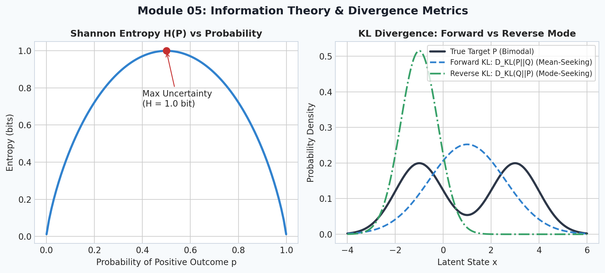
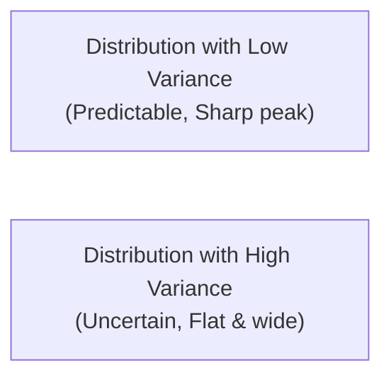
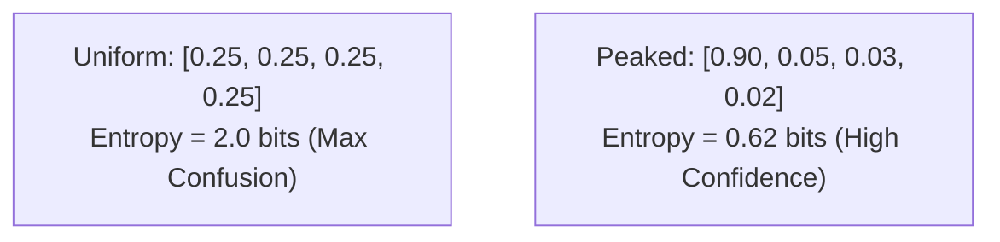

# 5. Intuitive Probability & Information Theory

<p align="center">
  
</p>

> [!NOTE]
> ⏱️ **Estimated Study Time**: ~3 hours reading + ~2 hours exercises  
> 🎯 **What "Done" Looks Like**:
> - [ ] You understand probability distributions, Bayes' Theorem, and Maximum Likelihood Estimation.
> - [ ] You can calculate Shannon entropy, Cross-Entropy loss, and KL divergence by hand and in code.
> - [ ] You ran `python3 -m pytest tests/test_core.py -v` and verified that Module 05 tests pass.
> - [ ] You attempted Level 1 & Level 2 exercises and verified them against [`solutions.md`](solutions.md).


Welcome to Module 05 of **AI Research Foundations**. Machine learning models operate under uncertainty. When an LLM generates the next word, it doesn't give a single deterministic answer—it outputs a probability distribution across 50,000 vocabulary tokens. In this module, we demystify **probability distributions, Bayes' Theorem, Cross-Entropy loss, and KL Divergence**.

---

## 🎯 Learning Objectives

By the end of this module, you will:
- Understand probability distributions as profiles of uncertainty.
- Internalize **Bayes' Theorem** as the mathematical formula for updating beliefs with new evidence.
- Derive **Maximum Likelihood Estimation (MLE)** and see how it leads directly to training neural nets.
- Understand **Entropy** as the measure of surprise and uncertainty.
- Master **Cross-Entropy Loss** and **Kullback-Leibler (KL) Divergence**, the mathematical pillar of modern **RLHF** and **GRPO** *(Group Relative Policy Optimization)*.

---

## 🎲 Probability: Quantifying Uncertainty

### 1. Probability Mass vs. Density
- **Discrete Random Variable**: Takes on distinct values *(e.g., rolling a die $\{1, 2, 3, 4, 5, 6\}$, predicting the next token ID)*. Its distribution is called a **Probability Mass Function (PMF)** where all probabilities sum to $1.0$:
  $$\sum_x P(X = x) = 1.0$$
- **Continuous Random Variable**: Takes on values along a continuum *(e.g., temperature, bounding box coordinates)*. Its distribution is a **Probability Density Function (PDF)** where the area under the curve integrates to $1.0$.

### 2. Expectation & Variance
- **Expectation** ($\mathbb{E}[X]$): The probability-weighted average value *(the center of mass of the distribution)*.
  $$\mathbb{E}[X] = \sum_x x \cdot P(X = x)$$
- **Variance** ($\text{Var}(X)$): The spread or dispersion of values around the mean.
  $$\text{Var}(X) = \mathbb{E}[(X - \mathbb{E}[X])^2]$$



---

## 🔍 Bayes' Theorem: Updating Beliefs

**Bayes' Theorem** tells us how to rationally update our confidence in a hypothesis $H$ upon observing new evidence $E$:

$$P(H \mid E) = \frac{P(E \mid H) \cdot P(H)}{P(E)}$$

| Component | Term Name | Plain-English Intuition |
|---|---|---|
| $P(H)$ | **Prior** | What we believed about the hypothesis *before* seeing the evidence. |
| $P(E \mid H)$ | **Likelihood** | How likely we would be to observe this evidence *if* the hypothesis were true. |
| $P(E)$ | **Marginal Evidence** | The total probability of observing this evidence under all possible worlds. |
| $P(H \mid E)$ | **Posterior** | Our updated belief about the hypothesis *after* observing the evidence. |

---

## 🎯 Maximum Likelihood Estimation (MLE)

How does a neural network learn from data?
Suppose we have a dataset $\mathcal{D} = \{x_1, x_2, \dots, x_N\}$. We want to find model parameters $\theta$ that make this real-world data **as probable as possible**:

$$\theta^* = \arg\max_\theta \prod_{i=1}^N P_\theta(x_i)$$

Because multiplying thousands of tiny decimals causes numerical underflow *(rounding to zero in floating point)*, we take the natural logarithm. Since $\log(a \cdot b) = \log(a) + \log(b)$:

$$\theta^* = \arg\max_\theta \sum_{i=1}^N \log P_\theta(x_i)$$

To turn this into a minimization problem for gradient descent, we add a negative sign:
$$\mathcal{L}_{\text{NLL}}(\theta) = -\sum_{i=1}^N \log P_\theta(x_i) \quad \text{(Negative Log-Likelihood)}$$

> [!IMPORTANT]
> **Key Realization**: Training a language model to predict the next token by minimizing Negative Log-Likelihood is **identical** to Maximum Likelihood Estimation!

---

## 📡 Information Theory: Surprise, Entropy & Divergence

Claude Shannon founded information theory with a simple intuition: **unlikely events carry more information (surprise) than expected events**.

If someone says "The sun rose today," surprise is near zero.  
If someone says "A meteor struck downtown," surprise is massive!

### 1. Self-Information (Surprise)
For an event $x$ with probability $P(x)$, its information content is:
$$I(x) = -\log_2 P(x) \quad \text{(measured in bits)}$$

```
- P(x) = 1.0 (certain) -> I(x) = -log2(1) = 0 bits of information
- P(x) = 0.5 (fair coin flip) -> I(x) = -log2(0.5) = 1 bit of information
- P(x) = 0.001 (rare event) -> I(x) = -log2(0.001) ≈ 9.97 bits of information
```

### 2. Shannon Entropy ($H(P)$)
The **Entropy** of a distribution is its **average surprise**:
$$H(P) = -\sum_x P(x) \log_2 P(x)$$
- Maximum entropy occurs when all outcomes are equally likely *(uniform distribution: maximum uncertainty)*.
- Zero entropy occurs when one outcome is guaranteed *(100% certainty: zero surprise)*.



### 3. Cross-Entropy Loss ($H(P, Q)$)
In classification or next-token prediction:
- $P$ is the **true distribution** *(one-hot target vector: 1.0 for the correct token, 0.0 for others)*.
- $Q$ is the **model's predicted distribution** *(softmax output probabilities)*.

$$H(P, Q) = -\sum_x P(x) \log Q(x)$$

Because $P(x) = 1$ only at the true target index $y$, Cross-Entropy simplifies to:
$$\text{Loss} = -\log Q(y_{\text{target}})$$
If the model assigned probability $0.99$ to the true word, $\text{Loss} = -\log(0.99) \approx 0.01$ (tiny error).  
If the model assigned probability $0.001$ to the true word, $\text{Loss} = -\log(0.001) \approx 6.91$ (heavy penalty!).

### 4. Kullback-Leibler (KL) Divergence ($D_{KL}(P \parallel Q)$)
**KL Divergence** *(relative entropy)* measures **how much distribution $P$ diverges from distribution $Q$**:

$$D_{KL}(P \parallel Q) = \sum_x P(x) \log\left(\frac{P(x)}{Q(x)}\right) = H(P, Q) - H(P)$$

```
Properties of KL Divergence:
1. D_KL(P || Q) >= 0 (Always non-negative; 0 only if P == Q identical)
2. D_KL(P || Q) != D_KL(Q || P) (Asymmetric! It is a divergence, not a true distance metric)
```

> [!TIP]
> **Why KL Divergence is Crucial in Modern AI (RLHF & GRPO)**:
> When fine-tuning an LLM using reinforcement learning (RLHF or DeepSeek GRPO), the model might cheat the reward function by producing degenerate gibberish. We add a **KL penalty** between the active policy $\pi_\theta$ and the frozen base model $\pi_{\text{ref}}$:
> $$\text{Penalty} = D_{KL}(\pi_\theta \parallel \pi_{\text{ref}})$$
> This prevents the RL model from drifting too far away from coherent, grammatical language!

---

## 📚 Curated References

1. **Harvard Stat 110: Introduction to Probability (Joe Blitzstein)**: [stat110.net](https://stat110.net/)
2. **StatQuest: Maximum Likelihood & Cross Entropy**: [statquest.org](https://www.statquest.org)
3. **Mathematics for Machine Learning (Deisenroth et al.) - Chapter 6**: [mml-book.github.io](https://mml-book.github.io/)
4. **Lil'Log: The Markov Decision Process & Information Theory**: [lilianweng.github.io](https://lilianweng.github.io/)

---

## 🏋️ Revision Exercises

> [!TIP]
> **Worked Solutions**: Once you've attempted these exercises, check your implementations and answers in [`solutions.md`](solutions.md).

### Level 1: Recall & Conceptual
1. Why does Maximum Likelihood Estimation use the **sum of log probabilities** rather than the **product of raw probabilities**?
2. If an AI weather model assigns a 100% probability to rain tomorrow, what is the entropy of its prediction? What if it assigns 50% rain and 50% sun?
3. In RLHF and GRPO alignment, what disaster happens if we remove the KL divergence penalty?

### Level 2: Hands-On Implementation
1. Write a function `kl_divergence(p: np.ndarray, q: np.ndarray) -> float` from scratch in NumPy. Add a small epsilon $\epsilon = 10^{-12}$ to avoid division by zero or $\log(0)$.
   - Verify that $D_{KL}(P \parallel P) = 0.0$.
   - Demonstrate asymmetry by showing $D_{KL}(P \parallel Q) \neq D_{KL}(Q \parallel P)$ on two arbitrary probability distributions.
2. Simulate a language model outputting logits for a 5-token vocabulary: `[2.0, 1.0, 0.5, -1.0, 3.5]`.
   - Apply softmax to convert logits to probabilities.
   - Calculate Cross-Entropy Loss assuming the true token index is index `4`.

### Level 3: Research Deep Dive
1. **Forward KL vs. Reverse KL**:
   - $D_{KL}(P \parallel Q)$ is known as **Forward KL** *(zero-avoiding / mean-seeking)*.
   - $D_{KL}(Q \parallel P)$ is known as **Reverse KL** *(zero-forcing / mode-seeking)*.
   - Write a short mathematical proof showing what happens to each divergence when $P(x) > 0$ but $Q(x) \to 0$, versus when $Q(x) > 0$ and $P(x) \to 0$.
   - Why do modern knowledge distillation and reasoning models favor Reverse KL?
