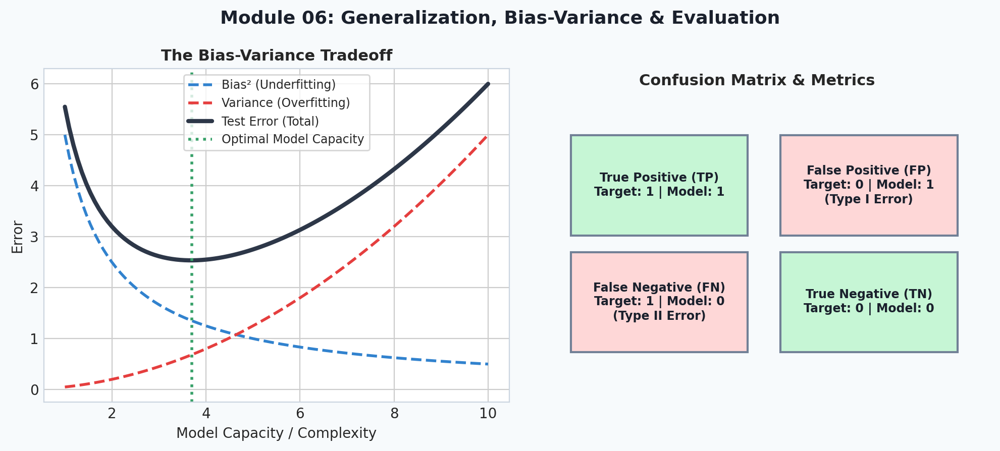
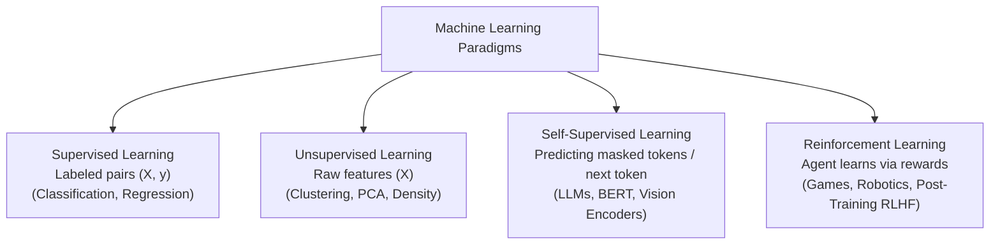
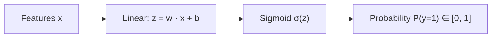
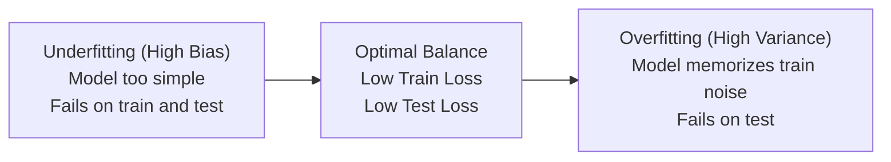

# 6. Classical Machine Learning

<p align="center">
  
</p>

> [!NOTE]
> ⏱️ **Estimated Study Time**: ~2.5 hours reading + ~2 hours exercises  
> 🎯 **What "Done" Looks Like**:
> - [ ] You can explain the bias-variance tradeoff and how L1/L2 regularization prevents overfitting.
> - [ ] You understand precision, recall, F1, and why accuracy fails on imbalanced classes.
> - [ ] You ran `python3 -m pytest tests/test_core.py -v` and verified that Module 06 tests pass.
> - [ ] You attempted the Level 1 & Level 2 exercises.


Welcome to Module 06 of **AI Research Foundations**. Before diving into deep neural networks and trillion-parameter transformers, every serious AI researcher must understand **classical machine learning**. The core principles of generalization, evaluation metrics, overfitting, and data splitting were pioneered here.

---

## 🎯 Learning Objectives

By the end of this module, you will:
- Categorize machine learning problems: **Supervised**, **Unsupervised**, and **Self-Supervised**.
- Understand **Linear Regression** and **Logistic Regression** as the simplest single-neuron models.
- Master **Decision Trees** and ensemble methods like **Random Forests**.
- Navigate the **Bias-Variance Tradeoff** *(balancing underfitting vs overfitting)*.
- Evaluate models with **Precision, Recall, F1-score**, and **ROC-AUC**.
- Train and evaluate a complete baseline model on the classic **Kaggle Titanic competition** using **scikit-learn**.

---

## 🗺️ The Taxonomy of Machine Learning



---

## 📈 Linear & Logistic Regression

### 1. Linear Regression (Predicting Continuous Values)
Given input features $\vec{x}$, predict a continuous scalar output $\hat{y}$:
$$\hat{y} = \vec{w} \cdot \vec{x} + b = w_1 x_1 + w_2 x_2 + \dots + b$$
- **Mean Squared Error (MSE) Loss**:
  $$\mathcal{L}_{\text{MSE}} = \frac{1}{N} \sum_{i=1}^N (y_i - \hat{y}_i)^2$$

### 2. Logistic Regression (Binary Classification)
When the target is binary ($y \in \{0, 1\}$), we pass the linear output through the **Sigmoid function** *(an S-shaped activation function that compresses any real number into a valid probability between 0 and 1)*:

$$\sigma(z) = \frac{1}{1 + e^{-z}}$$



> [!NOTE]
> **Single Neuron Connection**: A logistic regression unit is mathematically identical to a single artificial neuron with a sigmoid activation!

---

## 🌲 Decision Trees & Random Forests

### 1. Decision Trees
A decision tree splits the dataset along feature thresholds *(e.g., "Age > 30?" or "Ticket Fare < $10")* to maximize **Information Gain** *(the reduction in entropy/disorder after the split)* or minimize **Gini Impurity** *(the probability of misclassifying a randomly chosen element)*.
- **Advantage**: Highly interpretable, handles non-linear relationships naturally.
- **Drawback**: High variance—deep trees memorize noise in the training set *(overfitting)*.

### 2. Random Forests (Ensembling / Bagging)
Instead of relying on one brittle tree, **Random Forests** train hundreds of diverse trees using **Bootstrap Aggregating (Bagging)** *(training each tree on a random sample of rows with replacement, and a random subset of features at each split)*.
Predictions are aggregated by majority vote, dramatically slashing model variance!

---

## ⚖️ The Bias-Variance Tradeoff

Generalization is the central challenge of machine learning: **how well does the model perform on unseen data?**



- **Bias (Underfitting)**: The model makes strong, rigid assumptions that miss real underlying patterns *(e.g., fitting a straight line to quadratic data)*.
- **Variance (Overfitting)**: The model is overly flexible and memorizes training quirks, leading to poor test generalization.
- **Remedies for Overfitting**: Regularization ($L_1$ / $L_2$ penalty), dropout, reducing model depth, gathering more training data.

---

## 🎯 Evaluation Metrics Beyond Raw Accuracy

Accuracy *(percentage of correct predictions)* is dangerously misleading on imbalanced datasets. If 99% of emails are not spam, a dumb model that predicts "Not Spam" for every single email is 99% accurate, but completely useless!

| Metric | Formula | Plain-English Question |
|---|---|---|
| **Precision** | $\frac{\text{True Positives}}{\text{True Positives} + \text{False Positives}}$ | "When the model says it's positive, how often is it right?" |
| **Recall** | $\frac{\text{True Positives}}{\text{True Positives} + \text{False Negatives}}$ | "Out of all actual positive cases, how many did the model catch?" |
| **F1-Score** | $2 \cdot \frac{\text{Precision} \cdot \text{Recall}}{\text{Precision} + \text{Recall}}$ | Harmonic mean balancing precision and recall. |
| **ROC-AUC** | Area under True Positive vs. False Positive curve | Overall ranking quality across all classification thresholds. |

---

## 🚢 First Project: Kaggle Titanic with Scikit-Learn

The classic starting point for applied machine learning is predicting passenger survival on the Titanic from tabular features.

```python
import numpy as np
import pandas as pd
from sklearn.model_selection import train_test_split
from sklearn.ensemble import RandomForestClassifier
from sklearn.metrics import classification_report, roc_auc_score

# 1. Mock dataset structure matching Titanic
data = {
    "Pclass": [3, 1, 3, 1, 3, 3, 1, 3, 2, 2],
    "Age": [22.0, 38.0, 26.0, 35.0, 28.0, 54.0, 2.0, 27.0, 14.0, 4.0],
    "SibSp": [1, 1, 0, 1, 0, 0, 1, 0, 1, 1],       # Number of siblings/spouses aboard
    "Parch": [0, 0, 0, 0, 0, 0, 2, 2, 0, 1],       # Number of parents/children aboard
    "Fare": [7.25, 71.28, 7.92, 53.10, 8.05, 51.86, 21.07, 11.13, 30.07, 16.70],
    "Is_Female": [0, 1, 1, 1, 0, 0, 0, 1, 1, 1],  # Gender encoded as binary
    "Survived": [0, 1, 1, 1, 0, 0, 0, 1, 1, 1]
}
df = pd.DataFrame(data)

# 2. Train / Test Split (Crucial: never train on your evaluation data!)
X = df.drop(columns=["Survived"])
y = df["Survived"]
X_train, X_test, y_train, y_test = train_test_split(X, y, test_size=0.3, random_state=42)

# 3. Train Random Forest Classifier
clf = RandomForestClassifier(n_estimators=50, max_depth=3, random_state=42)
clf.fit(X_train, y_train)

# 4. Evaluate on unseen test data
y_pred = clf.predict(X_test)
y_prob = clf.predict_proba(X_test)[:, 1]

print("=== Model Evaluation on Test Split ===")
print(classification_report(y_test, y_pred))
print(f"ROC-AUC Score: {roc_auc_score(y_test, y_prob):.3f}")
```

---

## 📚 Curated References

1. **Inria scikit-learn MOOC**: [inria.github.io/scikit-learn-mooc](https://inria.github.io/scikit-learn-mooc/)
2. **Kaggle Titanic Competition**: [kaggle.com/competitions/titanic](https://www.kaggle.com/competitions/titanic)
3. **ML-From-Scratch (Erik Linder-Norén)**: [github.com/eriklindernoren/ML-From-Scratch](https://github.com/eriklindernoren/ML-From-Scratch)
4. **Google Machine Learning Crash Course**: [developers.google.com/machine-learning/crash-course](https://developers.google.com/machine-learning/crash-course)

---

## 🏋️ Revision Exercises

> 💡 **Solutions Available**: Stuck on an exercise or want to verify your code? Check out the complete reference solutions in [`solutions.md`](./solutions.md).

### Level 1: Recall & Conceptual
1. What is the fundamental difference between **Supervised** and **Self-Supervised** learning?
2. If an airport facial scanner has a high precision of 99% but a recall of only 20%, what does that mean in practical terms?
3. Why must we never impute missing values using statistics (e.g., mean or median) calculated across the entire dataset before splitting into train/test? *(Define: **data leakage**)*.

### Level 2: Hands-On Implementation
1. Write a Python class `LogisticRegressionScratch` that implements:
   - `fit(X, y, lr=0.01, epochs=1000)` using gradient descent.
   - `predict_proba(X)` using the sigmoid function $\sigma(z)$.
   - `predict(X, threshold=0.5)`.
   Train it on synthetic 2D data generated with `sklearn.datasets.make_classification` and compare its final accuracy with `sklearn.linear_model.LogisticRegression`.
2. Compute the confusion matrix (True Positives, False Positives, True Negatives, False Negatives) by hand from scratch without using scikit-learn.

### Level 3: Research Deep Dive
1. **The Double Descent Phenomenon**:
   Classical ML theory asserts that increasing model complexity beyond the interpolation threshold causes massive overfitting and rising test error (U-shaped curve). However, modern deep learning observes **Deep Double Descent** (Nakkiran et al., 2019), where overparameterized models experience a *second descent* in test error.
   - Summarize the mechanism behind double descent.
   - Why do modern neural networks with billions of parameters not simply overfit to the training set?
