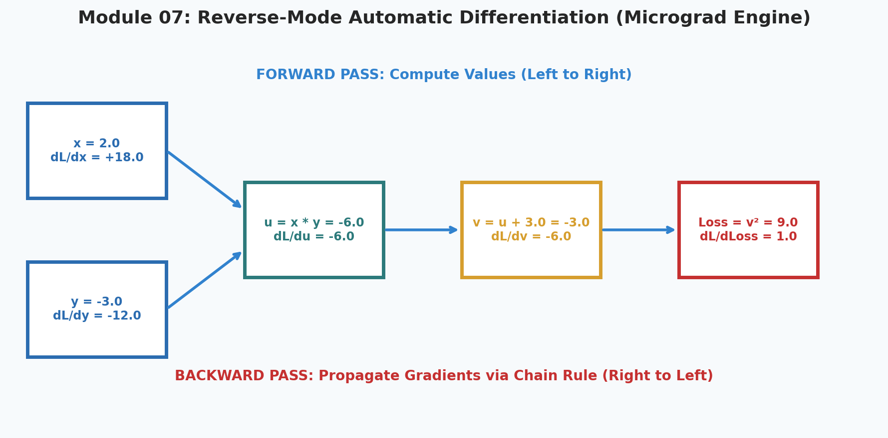
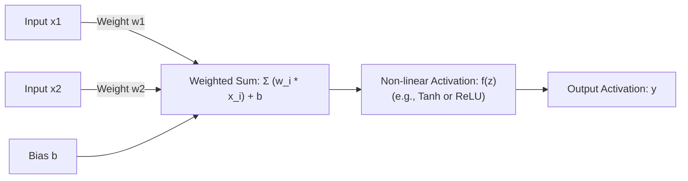
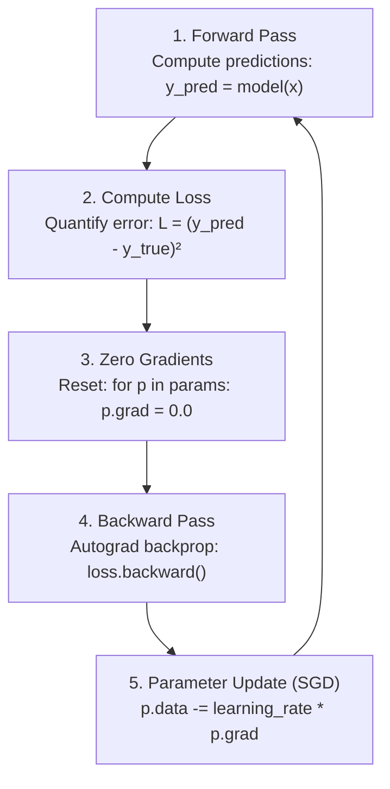

# 7. Neural Networks & Autograd From Scratch (Micrograd)

<p align="center">
  
</p>


Welcome to Module 07 of **AI Research Foundations**. Here we enter deep learning. Following Andrej Karpathy's famous **Zero to Hero** pedagogy, we will not use PyTorch, TensorFlow, or any deep learning framework. Instead, we will construct our own scalar **automatic differentiation engine** *(autograd)* and train a multi-layer neural network from pure Python!

---

## 🎯 Learning Objectives

By the end of this module, you will:
- Understand the mathematical structure of an artificial neuron: $y = f\left(\sum w_i x_i + b\right)$.
- Comprehend why **non-linear activation functions** are mandatory for neural networks to approximate complex functions *(Universal Approximation Theorem)*.
- Build a reverse-mode autograd engine in under 100 lines of Python code.
- Implement forward propagation, topological sorting, and recursive backpropagation.
- Construct `Neuron`, `Layer`, and `MLP` classes and train them to solve a non-linear problem using gradient descent.

---

## 🧠 The Artificial Neuron

A biological neuron receives electrical signals through its dendrites, integrates them in the cell body (soma), and if the threshold is reached, fires a signal down the axon.



### Why Non-Linearity is Mandatory
If our activation function is purely linear ($f(z) = z$), then stacking 50 layers together simply computes:
$$y = W_3(W_2(W_1 x + b_1) + b_2) + b_3 = (W_3 W_2 W_1)x + b_{\text{total}} = W_{\text{new}} x + b_{\text{total}}$$
**Stacking linear layers collapses into a single boring linear model!**  
Non-linear activations *(like Tanh, ReLU, or GELU)* allow the network to bend and fold coordinate space, enabling it to learn arbitrary decision boundaries.

---

## ⚙️ Building the Autograd Engine: The `Value` Object

To compute gradients automatically, we wrap every scalar number in a `Value` class that keeps track of:
1. `.data`: The actual scalar value (e.g., $3.0$).
2. `.grad`: The derivative of the final output with respect to this value ($\frac{\partial L}{\partial \text{self}}$, initialized to $0.0$).
3. `._backward`: A lambda function that applies the local chain rule step.
4. `._prev`: The set of parent `Value` objects that produced this node.

```python
import math

class Value:
    """Stores a single scalar value and its gradient."""
    def __init__(self, data, _children=(), _op=""):
        self.data = float(data)
        self.grad = 0.0
        self._backward = lambda: None
        self._prev = set(_children)
        self._op = _op

    def __repr__(self):
        return f"Value(data={self.data:.4f}, grad={self.grad:.4f})"

    def __add__(self, other):
        other = other if isinstance(other, Value) else Value(other)
        out = Value(self.data + other.data, (self, other), "+")

        def _backward():
            # Addition distributes gradient equally to both inputs!
            self.grad += 1.0 * out.grad
            other.grad += 1.0 * out.grad
        out._backward = _backward
        return out

    def __mul__(self, other):
        other = other if isinstance(other, Value) else Value(other)
        out = Value(self.data * other.data, (self, other), "*")

        def _backward():
            # Chain rule for multiplication: d(u*v)/du = v, d(u*v)/dv = u
            self.grad += other.data * out.grad
            other.grad += self.data * out.grad
        out._backward = _backward
        return out

    def tanh(self):
        """Hyperbolic tangent activation: squashes values between -1 and +1."""
        x = self.data
        t = (math.exp(2*x) - 1) / (math.exp(2*x) + 1)
        out = Value(t, (self,), "tanh")

        def _backward():
            # d(tanh(x))/dx = 1 - tanh(x)^2
            self.grad += (1.0 - t**2) * out.grad
        out._backward = _backward
        return out

    def backward(self):
        """Builds topological sort of computational graph and propagates gradients."""
        topo = []
        visited = set()

        def build_topo(v):
            if v not in visited:
                visited.add(v)
                for child in v._prev:
                    build_topo(child)
                topo.append(v)

        build_topo(self)

        # Base case: d(Loss)/d(Loss) = 1.0
        self.grad = 1.0
        for node in reversed(topo):
            node._backward()
```

---

## 🏗️ Constructing the Neural Network

Now that we have autograd, building a Multi-Layer Perceptron (MLP) is simple:

```python
import random

class Neuron:
    def __init__(self, nin: int):
        # Initialize random weights and a zero bias
        self.w = [Value(random.uniform(-1, 1)) for _ in range(nin)]
        self.b = Value(0.0)

    def __call__(self, x):
        # z = w · x + b
        act = sum((wi * xi for wi, xi in zip(self.w, x)), self.b)
        return act.tanh()

    def parameters(self):
        return self.w + [self.b]

class Layer:
    def __init__(self, nin: int, nout: int):
        self.neurons = [Neuron(nin) for _ in range(nout)]

    def __call__(self, x):
        outs = [n(x) for n in self.neurons]
        return outs[0] if len(outs) == 1 else outs

    def parameters(self):
        return [p for n in self.neurons for p in n.parameters()]

class MLP:
    def __init__(self, nin: int, nouts: list):
        sz = [nin] + nouts
        self.layers = [Layer(sz[i], sz[i+1]) for i in range(len(nouts))]

    def __call__(self, x):
        for layer in self.layers:
            x = layer(x)
        return x

    def parameters(self):
        return [p for layer in self.layers for p in layer.parameters()]
```

---

## 🔄 The Complete Training Loop

Training an MLP to solve a non-linear problem follows the exact 4-step cadence used in modern deep learning:



```python
# 1. Instantiate 2-input, 2-layer MLP: [2 inputs -> 4 hidden -> 4 hidden -> 1 output]
model = MLP(2, [4, 4, 1])

# 2. Toy non-linear dataset (4 points)
xs = [
    [2.0, 3.0],
    [3.0, -1.0],
    [0.5, 1.0],
    [1.0, 1.0]
]
ys = [1.0, -1.0, -1.0, 1.0]  # Targets

# 3. Training Loop for 50 steps
for epoch in range(50):
    # Forward pass
    ypred = [model(x) for x in xs]
    loss = sum((yout - ygt)**2 for ygt, yout in zip(ys, ypred))

    # Zero gradients (Never forget this, or gradients accumulate!)
    for p in model.parameters():
        p.grad = 0.0

    # Backward pass
    loss.backward()

    # Gradient update
    for p in model.parameters():
        p.data -= 0.05 * p.grad

    if epoch % 10 == 0:
        print(f"Epoch {epoch:2d} | Loss: {loss.data:.4f}")
```

---

## 📚 Curated References

1. **Andrej Karpathy - The Spelled-Out Intro to Neural Networks and Backpropagation: Building micrograd**: [YouTube Video](https://www.youtube.com/watch?v=VMj-3S1tku0)
2. **Karpathy's micrograd Repository**: [github.com/karpathy/micrograd](https://github.com/karpathy/micrograd)
3. **Neural Networks and Deep Learning (Michael Nielsen)**: [neuralnetworksanddeeplearning.com](http://neuralnetworksanddeeplearning.com/)
4. **3Blue1Brown - What is a neural network? & Backpropagation calculus**: [YouTube Playlist](https://www.youtube.com/playlist?list=PLZHQObOWTQDNU6R1_67000Dx_ZCJB-3pi)

---

## 🏋️ Revision Exercises

### Level 1: Recall & Conceptual
1. Why must `grad` be accumulated using `+=` rather than assigned with `=` during backpropagation? *(Hint: What happens when a variable is used multiple times in an expression, like $f(x) = x \cdot x + x$?)*
2. What is a **topological sort** in a directed acyclic graph (DAG), and why must backpropagation traverse nodes in reverse topological order?
3. What is the mathematical derivative of the ReLU activation function $\text{ReLU}(x) = \max(0, x)$?

### Level 2: Hands-On Implementation
1. Extend the `Value` class to support the `ReLU` activation:
   - Forward: `out = Value(max(0.0, self.data), (self,), "ReLU")`
   - Backward: `self.grad += (out.data > 0) * out.grad`
2. Extend the `Value` class to support division `a / b` and exponentiation `a ** b`.
3. Train the custom MLP to solve the non-linear **XOR problem**:
   - Inputs: `[[0, 0], [0, 1], [1, 0], [1, 1]]`
   - Targets: `[-1.0, 1.0, 1.0, -1.0]` (using tanh targets)
   - Verify that the network achieves loss $< 0.01$ and correctly classifies all 4 corners.

### Level 3: Research Deep Dive
1. **Vanishing Gradients in Tanh vs ReLU**:
   Observe the derivative of Tanh: $\frac{d}{dx}\tanh(x) = 1 - \tanh(x)^2$.
   - When input $|x|$ is large (e.g., $x = 5.0$), what happens to $\tanh(x)$ and its derivative?
   - Trace what happens when 10 Tanh layers are stacked in series without normalization.
   - Explain why modern transformers and deep networks almost exclusively use **ReLU, GELU, or SwiGLU** instead of Tanh or Sigmoid for hidden layers.
