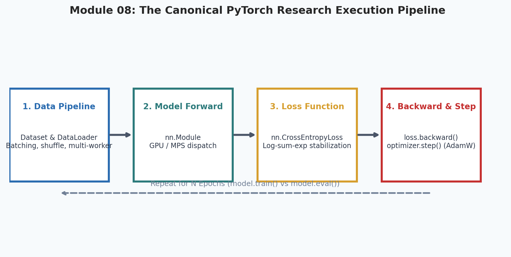
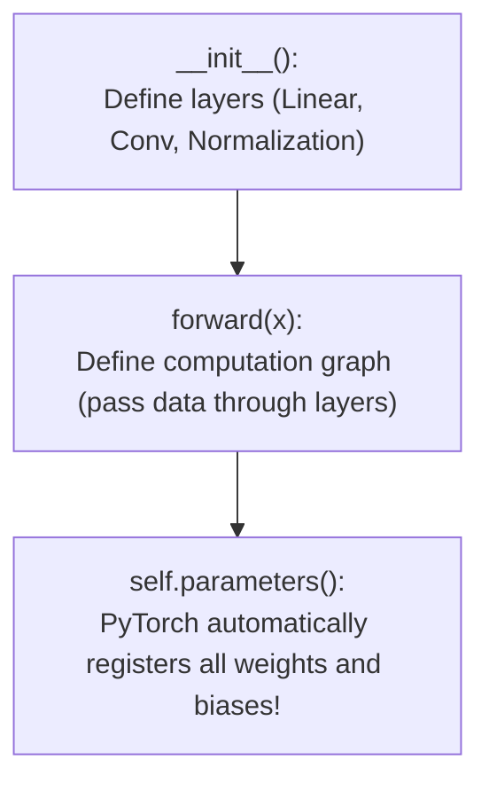
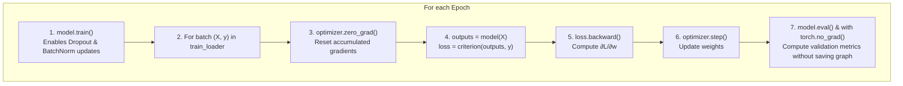

# 8. PyTorch Deep Learning Core

<p align="center">
  
</p>


Welcome to Module 08 of **AI Research Foundations**. In Module 07, you built a scalar autograd engine from scratch. Now that you understand the mechanics of computational graphs and backpropagation, we transition to **PyTorch**, the primary framework of modern AI research.

---

## 🎯 Learning Objectives

By the end of this module, you will:
- Master `torch.Tensor` operations, shape manipulation, and device placement (`cpu`, `cuda`, `mps`).
- Build custom neural architectures by subclassing `torch.nn.Module`.
- Build custom `Dataset` and `DataLoader` pipelines for memory-efficient batching.
- Write the canonical, professional PyTorch training and validation loop with evaluation mode toggling (`model.train()` vs `model.eval()`).
- Save, serialize, and restore model checkpoints (`torch.save` / `torch.load`).

---

## 🧱 The Tensor & Hardware Acceleration

A `torch.Tensor` is the multi-dimensional array foundation of PyTorch, analogous to a NumPy array, but with two superpowers:
1. **Hardware Acceleration**: Executes matrix operations on GPUs *(NVIDIA CUDA)* or Apple Silicon Neural Engines *(Metal Performance Shaders - MPS)*.
2. **Dynamic Autograd**: Tracks the history of operations to automatically compute derivatives via `.backward()`.

```python
import torch

# 1. Device selection: automatically picks fastest accelerator
device = torch.device(
    "cuda" if torch.cuda.is_available() else 
    ("mps" if torch.backends.mps.is_available() else "cpu")
)
print("Using compute device:", device)

# 2. Tensor creation with gradient tracking
x = torch.tensor([[1.0, 2.0], [3.0, 4.0]], requires_grad=True, device=device)
w = torch.tensor([[2.0, 0.0], [0.0, 2.0]], requires_grad=True, device=device)

# 3. Forward pass & backward pass
y = torch.matmul(x, w).sum()
y.backward()

print("dL/dx gradient:\n", x.grad)
```

---

## 🏗️ The `nn.Module` Architecture

In PyTorch, every model, layer, or neural block inherits from `torch.nn.Module`. 



```python
import torch
import torch.nn as nn
import torch.nn.functional as F

class MultiLayerClassifier(nn.Module):
    """A clean 2-layer MLP classifier in PyTorch."""
    def __init__(self, in_features: int, hidden_dim: int, num_classes: int):
        super().__init__()
        # nn.Linear computes: y = x @ W.T + b
        self.fc1 = nn.Linear(in_features, hidden_dim)
        self.dropout = nn.Dropout(p=0.1)  # Regularization: randomly zeroes 10% of features
        self.fc2 = nn.Linear(hidden_dim, num_classes)

    def forward(self, x: torch.Tensor) -> torch.Tensor:
        # x shape: (batch_size, in_features)
        h = F.relu(self.fc1(x))
        h = self.dropout(h)
        logits = self.fc2(h)  # Raw unnormalized prediction scores
        return logits
```

> [!WARNING]
> **Never apply Softmax before `nn.CrossEntropyLoss`**:
> PyTorch's `nn.CrossEntropyLoss()` combines `LogSoftmax` and `NLLLoss` into a single, numerically stable C function using the log-sum-exp trick. Passing already-softmaxed probabilities will distort gradients!

---

## 📦 Data Ingestion: `Dataset` & `DataLoader`

To feed millions of training samples through your GPU without running out of RAM, PyTorch separates data storage (`Dataset`) from batching, shuffling, and multiprocessing (`DataLoader`).

```python
from torch.utils.data import Dataset, DataLoader

class SyntheticResearchDataset(Dataset):
    """Custom dataset yielding (feature_vector, label) pairs."""
    def __init__(self, num_samples: int = 1000, in_features: int = 16):
        self.X = torch.randn(num_samples, in_features)
        self.y = torch.randint(0, 3, (num_samples,))  # 3 target classes

    def __len__(self) -> int:
        return len(self.X)

    def __getitem__(self, idx: int):
        return self.X[idx], self.y[idx]

# Instantiate DataLoader with batch size 32 and shuffling
dataset = SyntheticResearchDataset(num_samples=1000)
loader = DataLoader(dataset, batch_size=32, shuffle=True)
```

---

## 🔄 The Canonical Research Training Loop



```python
def train_one_epoch(model, loader, optimizer, criterion, device):
    model.train()  # Put model in training mode (activates dropout)
    total_loss = 0.0

    for X_batch, y_batch in loader:
        X_batch, y_batch = X_batch.to(device), y_batch.to(device)

        # 1. Zero out old gradients
        optimizer.zero_grad(set_to_none=True)  # set_to_none=True saves memory!

        # 2. Forward pass
        predictions = model(X_batch)
        loss = criterion(predictions, y_batch)

        # 3. Backward pass
        loss.backward()

        # 4. Optional: Gradient clipping to prevent exploding gradients
        torch.nn.utils.clip_grad_norm_(model.parameters(), max_norm=1.0)

        # 5. Step optimizer
        optimizer.step()

        total_loss += loss.item()

    return total_loss / len(loader)

@torch.no_grad()  # Disables gradient computation, cutting memory in half during testing
def evaluate(model, loader, criterion, device):
    model.eval()  # Put model in evaluation mode (freezes dropout & batchnorm)
    total_loss, correct, total = 0.0, 0, 0

    for X_batch, y_batch in loader:
        X_batch, y_batch = X_batch.to(device), y_batch.to(device)
        logits = model(X_batch)
        loss = criterion(logits, y_batch)

        total_loss += loss.item()
        preds = torch.argmax(logits, dim=-1)
        correct += (preds == y_batch).sum().item()
        total += y_batch.size(0)

    return total_loss / len(loader), correct / total
```

---

## 💾 Saving & Loading Checkpoints

In research, always save both the model weights and the optimizer state so training can resume if an instance is interrupted:

```python
# Saving a full checkpoint
checkpoint = {
    "epoch": 25,
    "model_state_dict": model.state_dict(),
    "optimizer_state_dict": optimizer.state_dict(),
    "best_val_loss": 0.421,
}
torch.save(checkpoint, "best_model.pt")

# Resuming from a checkpoint
checkpoint = torch.load("best_model.pt", map_location=device)
model.load_state_dict(checkpoint["model_state_dict"])
optimizer.load_state_dict(checkpoint["optimizer_state_dict"])
print("Restored checkpoint from epoch", checkpoint["epoch"])
```

---

## 📚 Curated References

1. **PyTorch Official Tutorials**: [pytorch.org/tutorials](https://pytorch.org/tutorials/)
2. **Dive into Deep Learning (d2l.ai) - PyTorch Edition**: [d2l.ai](https://d2l.ai/)
3. **fast.ai: Practical Deep Learning for Coders**: [course.fast.ai](https://course.fast.ai/)
4. **The Little Book of Deep Learning (François Fleuret)**: [fleuret.org/public/lbdl.pdf](https://fleuret.org/public/lbdl.pdf)

---

## 🏋️ Revision Exercises

### Level 1: Recall & Conceptual
1. Why does PyTorch require calling `optimizer.zero_grad()` before `loss.backward()`? What happens if you forget it?
2. What is the difference between `model.train()` and `model.eval()`? List two layers whose internal behavior changes between these modes.
3. Why should evaluation and inference always be wrapped in `with torch.no_grad():`?

### Level 2: Hands-On Implementation
1. Write a complete PyTorch script that:
   - Subclasses `Dataset` to generate points from the two concentric circles dataset (`sklearn.datasets.make_circles`).
   - Builds an MLP with 2 hidden layers using `nn.GELU` activations and `nn.Dropout(0.1)`.
   - Trains the model with `AdamW` and `CrossEntropyLoss` for 20 epochs.
   - Evaluates test accuracy and saves the best model checkpoint when validation loss drops.

### Level 3: Research Deep Dive
1. **Dynamic vs Static Computational Graphs**:
   PyTorch uses **eager execution / dynamic computational graphs** *(the graph is constructed on-the-fly as Python executes each line)*, whereas earlier versions of TensorFlow used static graphs.
   - Explain why dynamic graphs make debugging with standard `pdb` and variable-length sequences (like natural language sentences) vastly easier.
   - Investigate `torch.compile()`: how does PyTorch 2.0 capture graph regions to achieve static-graph compilation speedups without sacrificing Python flexibility?
