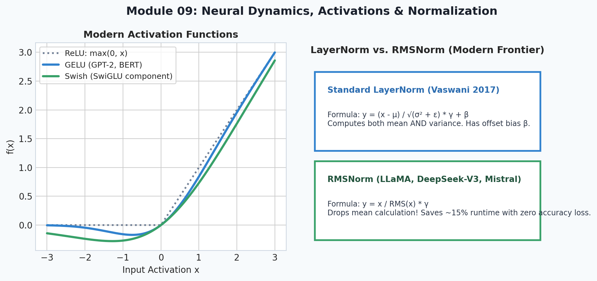
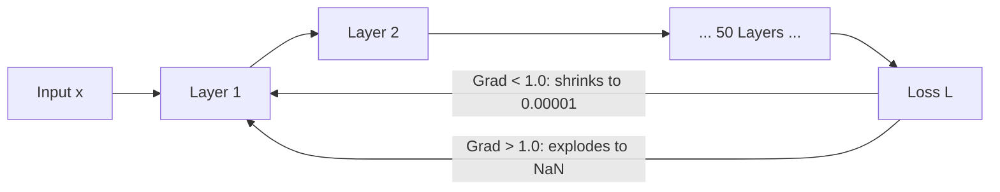
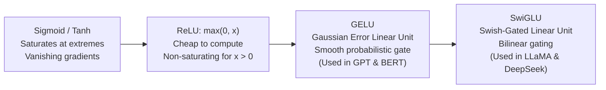
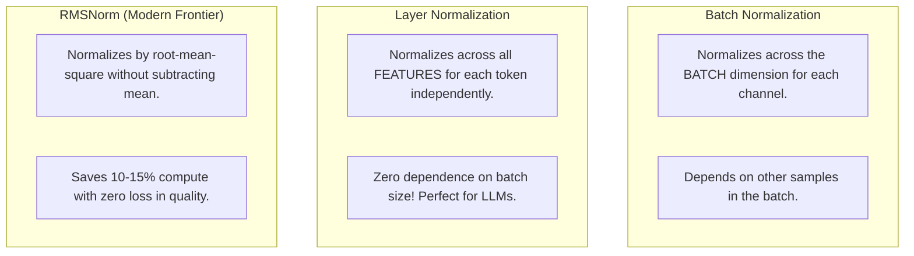
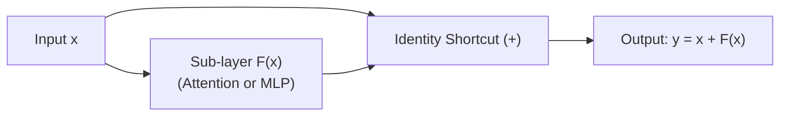

# 9. Deep Learning Dynamics & Architectures

<p align="center">
  
</p>


Welcome to Module 09 of **AI Research Foundations**. In this module, we examine the inner physics of deep neural networks. Why do 50-layer networks fail to train if initialized incorrectly? How do **residual connections**, **LayerNorm**, and modern activations like **SwiGLU** stabilize optimization and enable models with hundreds of layers?

---

## 🎯 Learning Objectives

By the end of this module, you will:
- Understand the mathematical root cause of **vanishing** and **exploding gradients**.
- Master proper **weight initialization** strategies *(Kaiming / He and Xavier / Glorot)*.
- Trace the evolution of activations from **Sigmoid** to **ReLU**, **GELU**, and modern **SwiGLU**.
- Compare **Batch Normalization** with **Layer Normalization** and **RMSNorm** *(the standard in LLaMA and DeepSeek)*.
- Understand how **Residual Connections** create an unobstructed gradient highway.
- Explore **Dilated Causal Convolutions** *(WaveNet architecture)* for sequence modeling.

---

## 💥 Vanishing & Exploding Gradients

Consider a deep linear network of 50 layers where each layer multiplies the hidden state by a weight $W$:
$$h_{50} = W_{50} \cdot W_{49} \dots W_1 \cdot x$$

During backpropagation, gradients propagate backward via repeated matrix multiplications:
$$\frac{\partial L}{\partial h_1} = \frac{\partial L}{\partial h_{50}} \cdot W_{50}^T \cdot W_{49}^T \dots W_2^T$$

```
- If the singular values of W are slightly larger than 1.0 (e.g., 1.2):
  1.2^50 ≈ 9,100 -> EXPLODING GRADIENTS (Weights become NaN!)
- If the singular values of W are slightly smaller than 1.0 (e.g., 0.8):
  0.8^50 ≈ 0.000014 -> VANISHING GRADIENTS (Early layers receive zero gradient and freeze!)
```



---

## ⚖️ Weight Initialization: Kaiming & Xavier

If you initialize weights from a standard normal distribution $\mathcal{N}(0, 1)$, variance grows proportionally with the number of input neurons ($D_{\text{in}}$).

To keep the variance of the activations constant from input to output:
1. **Xavier / Glorot Initialization** *(for symmetric activations like Tanh)*:
   $$W \sim \mathcal{N}\left(0, \frac{1}{D_{\text{in}}}\right) \quad \text{or} \quad \mathcal{N}\left(0, \frac{2}{D_{\text{in}} + D_{\text{out}}}\right)$$
2. **Kaiming / He Initialization** *(for ReLU, which zeroes out half the distribution)*:
   $$W \sim \mathcal{N}\left(0, \frac{2}{D_{\text{in}}}\right)$$

---

## ⚡ The Evolution of Activation Functions



### 1. ReLU (Rectified Linear Unit)
$$\text{ReLU}(x) = \max(0, x)$$
- Gradient is either $1$ (for $x > 0$) or $0$ (for $x < 0$).
- *Problem*: **Dying ReLU**—if a neuron outputs negative values for all training samples, its gradient is permanently zero and it never recovers.

### 2. GELU (Gaussian Error Linear Unit)
Used in GPT-2, GPT-3, and BERT. Instead of a hard cutoff at zero, it scales inputs by their cumulative normal probability:
$$\text{GELU}(x) = x \cdot \Phi(x) \approx 0.5x \left(1 + \tanh\left(\sqrt{\frac{2}{\pi}} (x + 0.044715 x^3)\right)\right)$$

### 3. SwiGLU (Swish Gated Linear Unit)
The gold standard in frontier LLMs *(LLaMA 3, DeepSeek-V3, Mistral)*:
$$\text{SwiGLU}(x) = (\text{Swish}(x W_{\text{gate}})) \odot (x W_{\text{up}}) \cdot W_{\text{down}}$$
Where $\text{Swish}(z) = z \cdot \sigma(z)$. The element-wise multiplication ($\odot$) gives the model a dynamic "information valve" to control feature flow!

---

## 🧼 Normalization: BatchNorm vs. LayerNorm vs. RMSNorm



### LayerNorm Formulation:
$$\mu = \frac{1}{d} \sum_{i=1}^d x_i, \quad \sigma^2 = \frac{1}{d} \sum_{i=1}^d (x_i - \mu)^2$$
$$\text{LayerNorm}(x) = \frac{x - \mu}{\sqrt{\sigma^2 + \epsilon}} \odot \gamma + \beta$$
Where $\gamma$ and $\beta$ are learnable scale and shift parameters.

### RMSNorm Formulation (LLaMA & DeepSeek):
$$\text{RMS}(x) = \sqrt{\frac{1}{d} \sum_{i=1}^d x_i^2 + \epsilon}$$
$$\text{RMSNorm}(x) = \frac{x}{\text{RMS}(x)} \odot \gamma$$

---

## 🛣️ Residual Connections: The Gradient Highway

Introduced by Kaiming He et al. in **ResNet (2015)**, the residual connection is the single most important architectural pattern in deep learning:

$$y = x + \mathcal{F}(x)$$



### Why It Unlocked 100+ Layer Deep Models:
When backpropagating through a residual block:
$$\frac{\partial L}{\partial x} = \frac{\partial L}{\partial y} \cdot \left(1 + \frac{\partial \mathcal{F}(x)}{\partial x}\right) = \frac{\partial L}{\partial y} + \frac{\partial L}{\partial y} \cdot \frac{\partial \mathcal{F}(x)}{\partial x}$$

Notice the **$+ 1$** term! Even if the gradient through the complex sub-layer $\frac{\partial \mathcal{F}}{\partial x}$ vanishes to zero, the gradient flows directly backward through the identity shortcut **completely undamaged**!

---

## 🌊 Sequence Architecture: WaveNet & Dilated Convolutions

Before transformers dominated NLP, DeepMind's **WaveNet (2016)** modeled raw audio waveforms using **Dilated Causal Convolutions** *(convolutions that skip input values at exponentially increasing dilation rates $1, 2, 4, 8, 16\dots$ to expand the receptive field exponentially with depth while respecting temporal causality)*.

```
Dilation = 4:    o . . . o . . . o
Dilation = 2:    o . o . o . o . o
Dilation = 1:    o o o o o o o o o
Inputs:          x x x x x x x x x
```
This historical stepping-stone bridges classic convolutional nets and modern autoregressive sequence models.

---

## 📚 Curated References

1. **Andrej Karpathy: makemore Part 3: Activations & Gradients, BatchNorm**: [YouTube Video](https://www.youtube.com/watch?v=P6sfmUTpUmc)
2. **Deep Residual Learning for Image Recognition (He et al., 2015)**: [arxiv.org/abs/1512.03385](https://arxiv.org/abs/1512.03385)
3. **GLU Variants Improve Transformer (Noam Shazeer, 2020)**: [arxiv.org/abs/2002.05202](https://arxiv.org/abs/2002.05202)
4. **Root Mean Square Layer Normalization (Zhang & Sennrich, 2019)**: [arxiv.org/abs/1910.07467](https://arxiv.org/abs/1910.07467)

---

## 🏋️ Revision Exercises

### Level 1: Recall & Conceptual
1. Why does Kaiming initialization use $\frac{2}{D_{\text{in}}}$ rather than $\frac{1}{D_{\text{in}}}$ for ReLU networks?
2. What is the fundamental difference between **BatchNorm** and **LayerNorm**? Why is LayerNorm preferred for Transformer language models?
3. What is the computational advantage of **RMSNorm** over standard **LayerNorm**?

### Level 2: Hands-On Implementation
1. Write a custom PyTorch module `RMSNorm(d_model: int, eps: float = 1e-6)` from scratch:
   - Calculate $\text{RMS}(x) = \sqrt{\text{mean}(x^2) + \epsilon}$.
   - Scale by learnable parameter $\gamma$.
   - Test it against `torch.nn.LayerNorm` on a random tensor of shape `(2, 16, 64)`.
2. Write a custom `SwiGLU` block in PyTorch:
   $$\text{SwiGLU}(x) = (x W_{\text{gate}} \cdot \sigma(x W_{\text{gate}})) \odot (x W_{\text{up}}) \cdot W_{\text{down}}$$
   Verify input and output tensor shapes match.

### Level 3: Research Deep Dive
1. **Pre-LN vs. Post-LN in Transformers**:
   The original 2017 Transformer paper placed LayerNorm *after* the residual addition:
   $$x_{l+1} = \text{LayerNorm}(x_l + \text{SubLayer}(x_l)) \quad \text{(Post-LN)}$$
   Modern models (LLaMA, GPT-3, DeepSeek) place LayerNorm *before* the sublayer:
   $$x_{l+1} = x_l + \text{SubLayer}(\text{LayerNorm}(x_l)) \quad \text{(Pre-LN)}$$
   - Analyze how gradients propagate backward through the residual connection in Post-LN vs Pre-LN.
   - Why did Post-LN require complex learning rate warmup to avoid early divergence?
