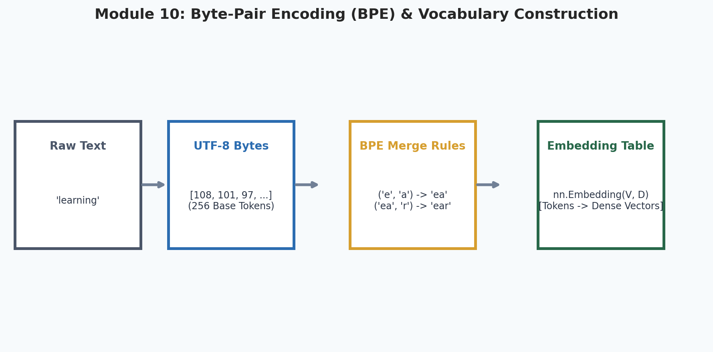
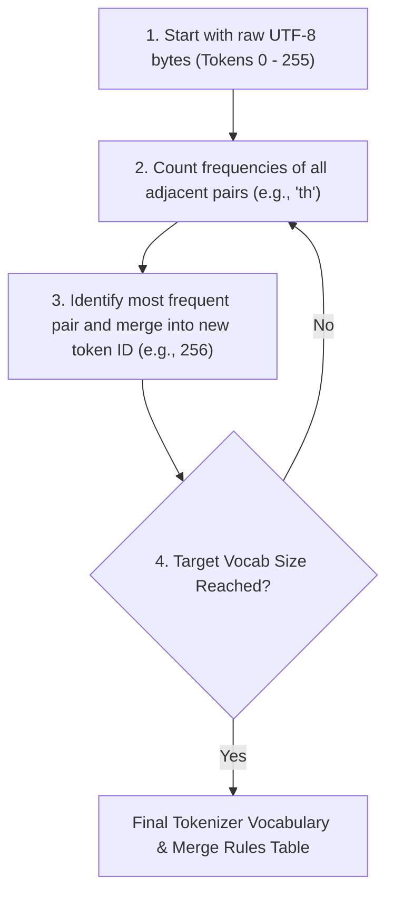
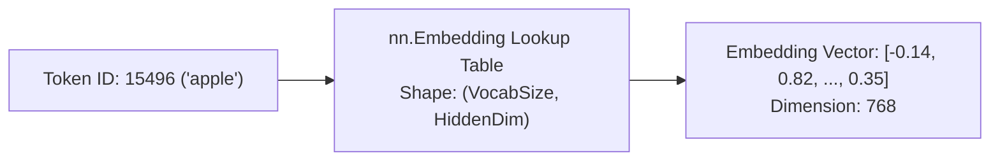

# 10. Tokenization & Byte-Pair Encoding (BPE)

<p align="center">
  
</p>


Welcome to Module 10 of **AI Research Foundations**. Language models do not see text, words, or letters directly. Before a single neural network layer can touch text, strings must be chopped into numerical IDs through **Tokenization**. In this module, we build a **Byte-Pair Encoding (BPE)** tokenizer from scratch.

---

## 🎯 Learning Objectives

By the end of this module, you will:
- Understand the tradeoffs between **character-level**, **word-level**, and **subword tokenization**.
- Implement the **Byte-Pair Encoding (BPE)** merge algorithm from raw UTF-8 byte sequences.
- Manage **vocabularies** and **special tokens** *(like `<|endoftext|>` or `[PAD]`)*.
- Convert discrete token IDs into dense numerical vectors via **Embedding Tables** (`nn.Embedding`).
- Understand why many infamous LLM bugs *(character counting in "strawberry", arithmetic failures, code indentation issues)* are actually **tokenization artifacts**.

---

## 🔡 The Tokenization Dilemma

How should we represent human text for a neural network?

| Approach | Vocab Size | Sequence Length | Major Limitation |
|---|---|---|---|
| **Character-Level** | Tiny ($\sim 256$) | Extremely Long | Requires deep networks just to learn how to spell basic words. |
| **Word-Level** | Massive ($1,000,000+$) | Short | Huge embedding tables; cannot handle Out-Of-Vocabulary (OOV) slang, typos, or new terms. |
| **Subword (BPE)** | Optimal ($32,000 - 100,000$) | Balanced | Breaks frequent words into single tokens, and rare words into subword fragments! |

```
Word: "unbelievable"
- Word-level: ["unbelievable"] (Must be in dictionary or becomes <UNK>)
- Character-level: ['u', 'n', 'b', 'e', 'l', 'i', 'e', 'v', 'a', 'b', 'l', 'e'] (12 steps!)
- Subword (BPE): ["un", "believ", "able"] (3 semantic tokens!)
```

---

## 🧩 The Byte-Pair Encoding (BPE) Algorithm

BPE *(originally a data compression algorithm by Philip Gage in 1994, adapted for NLP by Sennrich et al., 2015)* builds a vocabulary iteratively from data:



### Walkthrough on a Mini Corpus:
Suppose our text is: `"aaabdaaabac"`
1. Initial tokens: `['a', 'a', 'a', 'b', 'd', 'a', 'a', 'a', 'b', 'a', 'c']`
2. Pair counts:
   - `('a', 'a')`: appears 4 times *(most frequent!)*
   - `('a', 'b')`: appears 2 times
3. Merge `('a', 'a')` $\to$ new token `Z`:
   `['Z', 'a', 'b', 'd', 'Z', 'a', 'b', 'a', 'c']`
4. Next pair counts:
   - `('Z', 'a')`: appears 2 times
   - `('a', 'b')`: appears 2 times
5. Merge `('Z', 'a')` $\to$ new token `Y`:
   `['Y', 'b', 'd', 'Y', 'b', 'a', 'c']`
Notice the text length shrank from 11 tokens to 7 tokens!

---

## 🛠️ Implementing BPE From Scratch in Python

```python
def get_stats(ids: list[int]) -> dict[tuple[int, int], int]:
    """Counts frequencies of consecutive token ID pairs."""
    counts = {}
    for pair in zip(ids, ids[1:]):
        counts[pair] = counts.get(pair, 0) + 1
    return counts

def merge(ids: list[int], pair: tuple[int, int], new_id: int) -> list[int]:
    """Replaces all occurrences of pair with new_id."""
    new_ids = []
    i = 0
    while i < len(ids):
        if i < len(ids) - 1 and (ids[i], ids[i+1]) == pair:
            new_ids.append(new_id)
            i += 2
        else:
            new_ids.append(ids[i])
            i += 1
    return new_ids

def train_bpe(text: str, target_vocab_size: int = 260):
    # 1. Convert text to raw UTF-8 byte integers (0 to 255)
    tokens = list(text.encode("utf-8"))
    merges = {}
    
    num_merges = target_vocab_size - 256
    for i in range(num_merges):
        stats = get_stats(tokens)
        if not stats:
            break
        best_pair = max(stats, key=stats.get)
        new_token_id = 256 + i
        tokens = merge(tokens, best_pair, new_token_id)
        merges[best_pair] = new_token_id
        print(f"Merged pair {best_pair} -> New Token ID {new_token_id}")

    return tokens, merges
```

---

## 🪞 From Token IDs to Dense Embeddings

Once text is tokenized into integer IDs (e.g., `[15496, 11, 318]`), the neural network maps each integer to a continuous embedding vector using a lookup table (`nn.Embedding`):



```python
import torch
import torch.nn as nn

vocab_size = 50257  # Standard GPT-2 vocabulary size
hidden_dim = 768    # GPT-2 small embedding dimension

embedding_table = nn.Embedding(vocab_size, hidden_dim)

# Input batch of 2 sequences, each of length 3 tokens
input_ids = torch.tensor([
    [15496, 11, 318],
    [2068, 318, 257]
])  # Shape: (2, 3)

token_embeddings = embedding_table(input_ids)
print("Output tensor shape:", token_embeddings.shape)
# Result: torch.Size([2, 3, 768]) -> (Batch, Sequence Length, Embedding Dimension)
```

---

## 🍓 LLM Quirks Traced to Tokenization

Many strange LLM behaviors are not flaws in reasoning—they are direct consequences of tokenization:

1. **"How many 'r's are in strawberry?"**:
   The word `"strawberry"` is typically split into two subword tokens: `["straw", "berry"]`. The model never inspects the individual letters unless prompted to spell it character by character!
2. **Arithmetic & Number Reversals**:
   If `1234` is tokenized as `["12", "34"]` while `5678` is tokenized as `["567", "8"]`, the model cannot align digits by place-value cleanly. Modern reasoning models often enforce digit-by-digit tokenization for math!
3. **Glitch Tokens (e.g. `SolidGoldMagikarp`)**:
   Certain strings appeared frequently in Reddit or gaming web crawls and got assigned dedicated tokens in GPT's vocabulary, but had zero training data associated with them, causing undefined model behavior when triggered.

---

## 📚 Curated References

1. **Andrej Karpathy - Let's build the GPT Tokenizer**: [YouTube Video](https://www.youtube.com/watch?v=zduSFxRajkE)
2. **Byte Pair Encoding Paper (Sennrich et al., 2015)**: [arxiv.org/abs/1508.07909](https://arxiv.org/abs/1508.07909)
3. **Tiktoken (Fast BPE tokenizer by OpenAI)**: [github.com/openai/tiktoken](https://github.com/openai/tiktoken)
4. **Hugging Face Tokenizers Documentation**: [huggingface.co/docs/tokenizers](https://huggingface.co/docs/tokenizers)

---

## 🏋️ Revision Exercises

### Level 1: Recall & Conceptual
1. Why does modern NLP use **byte-level** BPE *(starting from 256 raw UTF-8 bytes)* instead of character-level BPE?
2. Explain why an LLM might fail to reverse the string `"computer"` if it only sees token ID `15201`.
3. What is an **Embedding Table**, and how does it differ from a standard Linear layer mathematically?

### Level 2: Hands-On Implementation
1. Write a complete encoding and decoding function for the custom BPE trainer:
   - `encode(text: str, merges: dict) -> list[int]`
   - `decode(token_ids: list[int], vocab: dict) -> str`
   Test it on the string `"The quick brown fox jumps over the lazy dog."`
2. Install `tiktoken` (`pip install tiktoken`) and inspect how OpenAI's `cl100k_base` tokenizer breaks down:
   - `"apple"`
   - `" strawberry"`
   - `" 123456789"`
   - Print the token IDs and their decoded string fragments.

### Level 3: Research Deep Dive
1. **Token-Free Language Modeling (ByT5 / Mamba-Byte)**:
   Recent research investigates token-free models operating directly on raw bytes to eliminate tokenization artifacts.
   - What is the computational bottleneck of training transformers directly on raw byte sequences?
   - How does context window scaling ($O(N^2)$ attention memory) punish token-free architectures?
