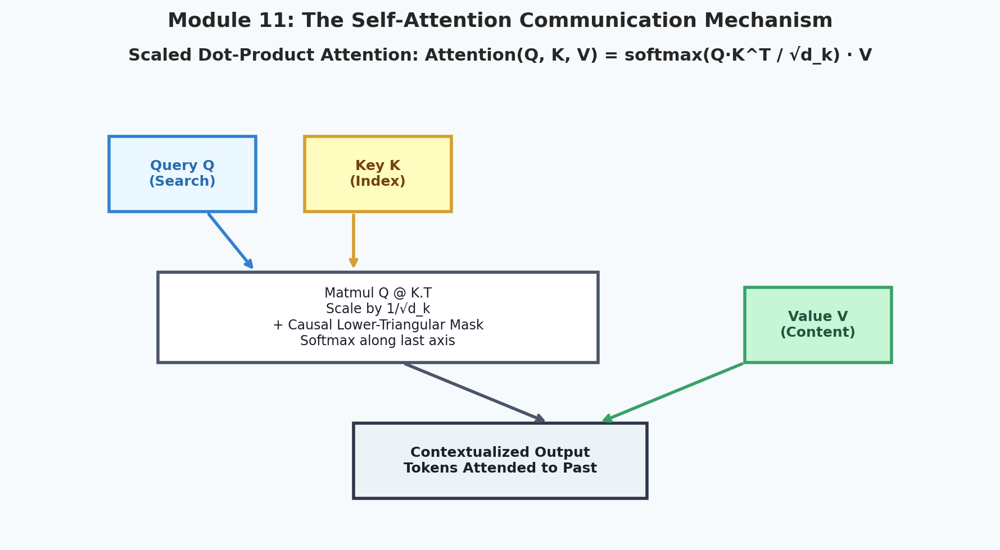
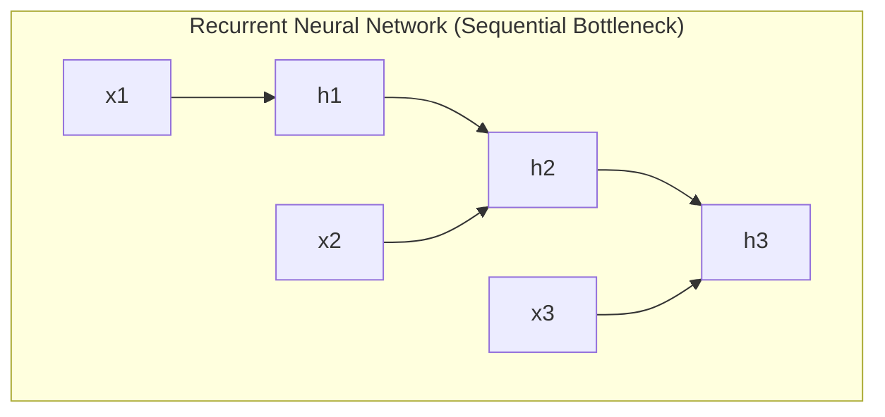
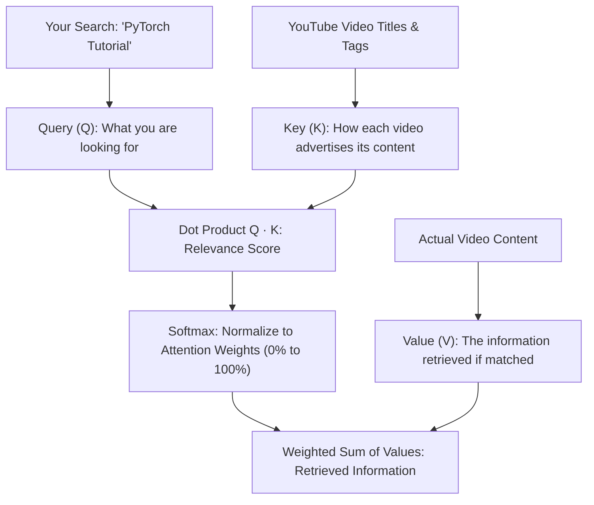
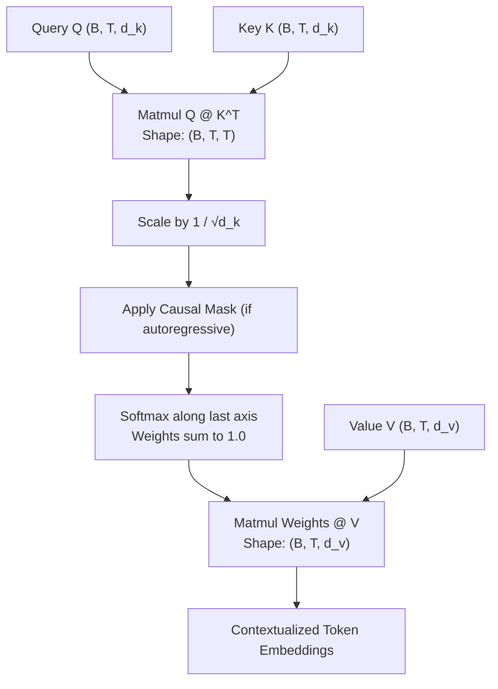

# 11. Attention & The Transformer Architecture

<p align="center">
  
</p>

<p align="center">
  <a href="https://colab.research.google.com/github/amirlankalm/ai-research-foundations/blob/main/11_Attention_and_The_Transformer/module_11.ipynb"></a>
</p>

> [!NOTE]
> ⏱️ **Estimated Study Time**: ~3.5 hours reading + ~2.5 hours exercises  
> 🎯 **What "Done" Looks Like**:
> - [ ] You can explain Query, Key, and Value roles using the retrieval intuition.
> - [ ] You can implement scaled dot-product attention with causal masking from raw tensor operations.
> - [ ] You understand how Rotary Position Embeddings (RoPE) encode relative token distance.
> - [ ] You solved Level 1 & Level 2 exercises and verified them against [`solutions.md`](solutions.md).


Welcome to Module 11 of **AI Research Foundations**. In 2017, the landmark paper *"Attention Is All You Need"* revolutionized artificial intelligence. In this module, we dissect the core mechanism powering every modern foundation model: **Self-Attention**.

---

## 🎯 Learning Objectives

By the end of this module, you will:
- Understand why Recurrent Neural Networks (RNNs) failed to scale and why Attention succeeded.
- Master the **Query, Key, and Value ($Q, K, V$)** database intuition.
- Trace **Scaled Dot-Product Attention** step-by-step with raw tensor shapes.
- Build **Multi-Head Attention (MHA)** from scratch.
- Understand modern **Rotary Position Embeddings (RoPE)**.
- Implement **Causal Masking** and understand the **KV Cache** *(caching keys and values for lightning-fast token generation)*.

---

## 📜 Why Attention Replaced RNNs

Before 2017, sequence modeling relied on Recurrent Neural Networks (RNNs) and LSTMs.
In an RNN, token $t$ cannot be computed until token $t-1$ finishes:
$$h_t = \tanh(W_{hh} h_{t-1} + W_{xh} x_t)$$



### The Two Fatal Flaws of RNNs:
1. **Sequential Bottleneck**: Cannot be parallelized across the time dimension on GPUs. Training on 4,000 tokens requires 4,000 sequential forward steps.
2. **Information Forgetting**: Information from token 1 must pass through hundreds of bottleneck compressions to reach token 4,000, causing loss of distant context.

### The Transformer Solution:
Transformers discard recurrence completely. **Every token attends directly to every other token simultaneously** with a communication path length of exactly **$O(1)$**!

---

## 🔍 The Query, Key, Value ($Q, K, V$) Intuition

Think of self-attention like a **YouTube search engine**:



In a sentence: *"The animal didn't cross the street because it was too tired."*
- When processing the word **"it"**:
  - The **Query** asks: *"What noun does this pronoun refer to?"*
  - The **Keys** for all previous words advertise what they are (*"animal" says "I am a noun", "street" says "I am a noun"*).
  - The dot product matches `"it"` strongly with `"animal"`.
  - The model retrieves the **Value** of `"animal"` and merges it into the representation of `"it"`!

---

## 📐 Scaled Dot-Product Attention Walkthrough

$$\text{Attention}(Q, K, V) = \text{softmax}\left(\frac{Q K^T}{\sqrt{d_k}} + M\right) V$$



### Step-by-Step Dimensions:
- $B$: Batch size (e.g., $4$)
- $T$: Sequence length (e.g., $8$ tokens)
- $d_k$: Head dimension (e.g., $64$)

1. **Compute Attention Scores**: $S = Q K^T \in \mathbb{R}^{B \times T \times T}$
   Every row $i$ contains the raw compatibility score of token $i$ with all tokens $j$.
2. **Scale**: Divide by $\sqrt{d_k}$ to prevent large dot products from pushing softmax into saturation *(zero gradient region)*.
3. **Causal Mask** ($M$): For language generation, token $i$ cannot look at future tokens $j > i$. We set future positions to $-\infty$ so $\text{softmax}(-\infty) = 0.0$.
4. **Softmax**: Normalizes scores into probabilities summing to $1.0$.
5. **Weighted Sum**: Multiply by $V$ to produce the new contextualized representations!

---

## 🤹 Multi-Head Attention (MHA)

A single attention head only looks at one type of relationship at a time.  
**Multi-Head Attention** splits the hidden dimension $d_{\text{model}}$ across $h$ independent heads:

$$\text{MHA}(Q, K, V) = \text{Concat}(\text{head}_1, \dots, \text{head}_h) W^O$$

- Head 1 might track **grammatical subject-verb agreement**.
- Head 2 might resolve **pronoun antecedents**.
- Head 3 might look for **rhymes or rhythmic meter**.
- Head 4 might track **punctuation and sentence boundaries**.

```python
import torch
import torch.nn as nn
import math

class MultiHeadAttention(nn.Module):
    def __init__(self, d_model: int = 768, n_heads: int = 12, is_causal: bool = True):
        super().__init__()
        assert d_model % n_heads == 0, "d_model must be divisible by n_heads"
        self.d_model = d_model
        self.n_heads = n_heads
        self.head_dim = d_model // n_heads
        self.is_causal = is_causal

        # Projections for Q, K, V combined into a single linear layer
        self.qkv_proj = nn.Linear(d_model, 3 * d_model, bias=False)
        self.out_proj = nn.Linear(d_model, d_model, bias=False)

    def forward(self, x: torch.Tensor) -> torch.Tensor:
        B, T, C = x.shape  # Batch, Sequence Length, Channels (d_model)

        # 1. Project to Q, K, V and split
        qkv = self.qkv_proj(x)  # (B, T, 3 * C)
        q, k, v = qkv.chunk(3, dim=-1)

        # 2. Reshape into (B, n_heads, T, head_dim)
        q = q.view(B, T, self.n_heads, self.head_dim).transpose(1, 2)
        k = k.view(B, T, self.n_heads, self.head_dim).transpose(1, 2)
        v = v.view(B, T, self.n_heads, self.head_dim).transpose(1, 2)

        # 3. Scaled dot product
        att_scores = (q @ k.transpose(-2, -1)) / math.sqrt(self.head_dim)

        # 4. Causal masking
        if self.is_causal:
            mask = torch.triu(torch.ones(T, T, device=x.device), diagonal=1).bool()
            att_scores = att_scores.masked_fill(mask, float("-inf"))

        att_weights = torch.softmax(att_scores, dim=-1)
        out = att_weights @ v  # (B, n_heads, T, head_dim)

        # 5. Concatenate heads back to (B, T, C)
        out = out.transpose(1, 2).contiguous().view(B, T, C)
        return self.out_proj(out)
```

---

## 🧭 Positional Information: From Sinusoids to RoPE

Because self-attention is **permutation-invariant** *(reordering the words in a sentence produces the exact same attention outputs without positional info)*, we must inject position signals:

1. **Sinusoidal Positional Encoding (Vaswani 2017)**: Fixed sine and cosine waves of different frequencies added to the input embeddings.
2. **Learned Absolute Embeddings (GPT-2)**: A learnable matrix `nn.Embedding(max_seq_len, d_model)`.
3. **Rotary Position Embeddings (RoPE) (Su et al., 2021)**: The modern frontier standard *(used in LLaMA, DeepSeek, Gemma, Qwen)*. RoPE rotates pairs of coordinates in the complex plane by an angle proportional to their position $m$:
   $$R_{\Theta, m} \vec{x}$$
   This guarantees that the dot product between $q_m$ and $k_n$ depends **only on their relative distance $m - n$**, allowing seamless context window extension!

---

## ⚡ The KV Cache: Fast Autoregressive Inference

When generating token 100, do we need to recompute keys and values for tokens 1 through 99? **No!**  
Past keys and values never change because of causal masking.

The **KV Cache** stores $K_{1..t-1}$ and $V_{1..t-1}$ in GPU VRAM, so when generating the next token, the model only passes the single newest token ($T=1$) through the query projection, concatenating it with the cached keys and values:

```
Without KV Cache: Generating N tokens costs O(N²) compute (re-evaluating full history every step).
With KV Cache:    Generating N tokens costs O(N) compute per step!
```

---

## 📚 Curated References

1. **The Illustrated Transformer (Jay Alammar)**: [jalammar.github.io/illustrated-transformer](https://jalammar.github.io/illustrated-transformer/)
2. **Attention Is All You Need (Vaswani et al., 2017)**: [arxiv.org/abs/1706.03762](https://arxiv.org/abs/1706.03762)
3. **The Annotated Transformer (Harvard NLP)**: [nlp.seas.harvard.edu/annotated-transformer](https://nlp.seas.harvard.edu/annotated-transformer/)
4. **RoFormer: Enhanced Transformer with Rotary Position Embedding (Su et al., 2021)**: [arxiv.org/abs/2104.09864](https://arxiv.org/abs/2104.09864)

---

## 🏋️ Revision Exercises

> [!TIP]
> **Worked Solutions**: Once you've attempted these exercises, check your custom attention implementation, RoPE verification, and FlashAttention analysis in [`solutions.md`](solutions.md).

### Level 1: Recall & Conceptual
1. In plain English, what are the distinct roles of **Query**, **Key**, and **Value** in self-attention?
2. Why is self-attention permutation-invariant without positional encodings?
3. What is a **Causal Mask**, and why is it mandatory for autoregressive language modeling?

### Level 2: Hands-On Implementation
1. Write a function `scaled_dot_product_attention(Q, K, V, mask=None)` in PyTorch and verify that it matches `torch.nn.functional.scaled_dot_product_attention` within a numerical tolerance of $10^{-5}$.
2. Implement a 2D RoPE rotation function:
   $$\begin{bmatrix} x_1' \\ x_2' \end{bmatrix} = \begin{bmatrix} \cos(m\theta) & -\sin(m\theta) \\ \sin(m\theta) & \cos(m\theta) \end{bmatrix} \begin{bmatrix} x_1 \\ x_2 \end{bmatrix}$$
   and verify that the dot product between two rotated vectors depends strictly on $(m - n)$.

### Level 3: Research Deep Dive
1. **FlashAttention: Hardware-Aware Fast Attention (Dao et al., 2022)**:
   Standard attention materializes the $N \times N$ attention matrix in slow GPU High Bandwidth Memory (HBM), creating an $O(N^2)$ memory bottleneck.
   - Explain how FlashAttention uses **tiling** and **online softmax** to compute exact attention inside fast on-chip SRAM without ever writing the $N \times N$ matrix to GPU memory.
   - Why did FlashAttention enable scaling context lengths from 2,048 to 128,000+ tokens?
