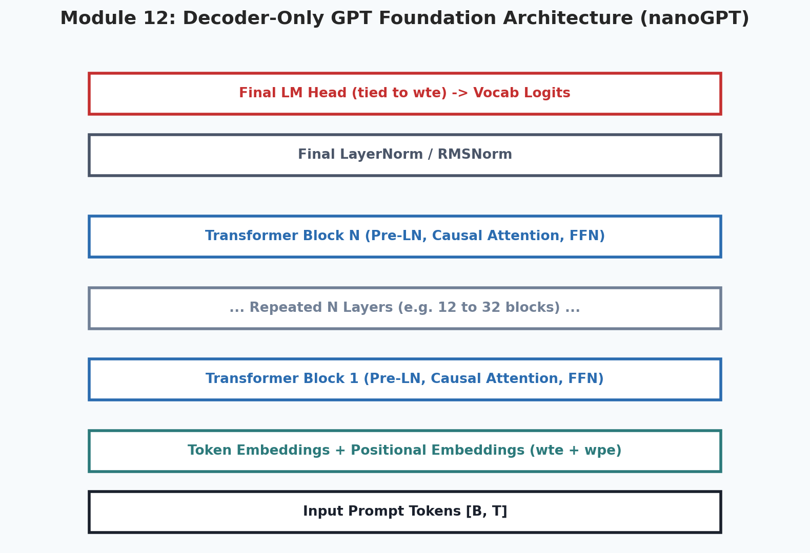
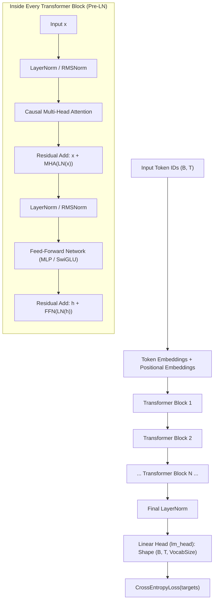
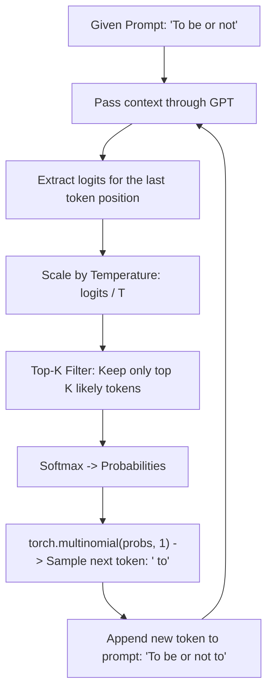

# 12. Building GPT From Scratch (Decoder-Only LLM)

<p align="center">
  
</p>

<p align="center">
  <a href="https://colab.research.google.com/github/amirlankalm/ai-research-foundations/blob/main/12_Building_GPT_From_Scratch/module_12.ipynb"></a>
</p>

> [!NOTE]
> ⏱️ **Estimated Study Time**: ~4 hours reading + ~3 hours exercises  
> 🎯 **What "Done" Looks Like**:
> - [ ] You understand Pre-LN Transformer blocks and weight tying between embeddings and `lm_head`.
> - [ ] You can implement the autoregressive generation loop with temperature scaling and top-k filtering.
> - [ ] You ran `python3 12_Building_GPT_From_Scratch/nanogpt_model.py` and reproduced the loss drop beating the uniform baseline.
> - [ ] You attempted the Level 1 & Level 2 exercises.


Welcome to Module 12 of **AI Research Foundations**. In this module, we assemble all the components we have learned—embeddings, multi-head attention, layer normalization, residual connections, and softmax—into a complete, functional **Generative Pre-trained Transformer (GPT)** modeled after Andrej Karpathy's famous **nanoGPT**.

---

## 🎯 Learning Objectives

By the end of this module, you will:
- Understand the full architecture of a modern **decoder-only foundation model**.
- Construct the `TransformerBlock` and assemble the full `GPT` class in PyTorch.
- Master **weight tying** between token embeddings and the final language modeling head.
- Implement autoregressive generation with **temperature scaling** and **top-k sampling**.
- Train your miniature GPT on a character-level text corpus and observe how next-token prediction loss decreases as the model learns spelling and spacing (with an optional command to scale up to Karpathy's full tiny-shakespeare corpus).

---

## 🏛️ The Full GPT Architecture

Unlike the original 2017 Transformer *(which had an Encoder and a Decoder for language translation)*, modern LLMs like GPT-4, LLaMA, and DeepSeek are **Decoder-Only models**. They take a sequence of tokens and autoregressively predict the single next token.



---

## 🧱 Assembling the Model in PyTorch

```python
import math
import torch
import torch.nn as nn
import torch.nn.functional as F
from dataclasses import dataclass

@dataclass
class GPTConfig:
    block_size: int = 128    # Maximum context window length
    vocab_size: int = 65     # Number of unique tokens
    n_layer: int = 4         # Number of stacked transformer blocks
    n_head: int = 4          # Number of attention heads
    n_embd: int = 128        # Embedding dimension (d_model)
    dropout: float = 0.1     # Dropout rate

class CausalSelfAttention(nn.Module):
    def __init__(self, config: GPTConfig):
        super().__init__()
        assert config.n_embd % config.n_head == 0
        self.n_head = config.n_head
        self.head_dim = config.n_embd // config.n_head
        self.c_attn = nn.Linear(config.n_embd, 3 * config.n_embd, bias=False)
        self.c_proj = nn.Linear(config.n_embd, config.n_embd, bias=False)
        self.dropout = nn.Dropout(config.dropout)
        
        # Causal mask buffer (not a trainable parameter)
        self.register_buffer(
            "bias", 
            torch.tril(torch.ones(config.block_size, config.block_size))
            .view(1, 1, config.block_size, config.block_size)
        )

    def forward(self, x: torch.Tensor) -> torch.Tensor:
        B, T, C = x.shape
        q, k, v = self.c_attn(x).chunk(3, dim=-1)
        
        q = q.view(B, T, self.n_head, self.head_dim).transpose(1, 2)
        k = k.view(B, T, self.n_head, self.head_dim).transpose(1, 2)
        v = v.view(B, T, self.n_head, self.head_dim).transpose(1, 2)

        # Attention calculation
        att = (q @ k.transpose(-2, -1)) * (1.0 / math.sqrt(self.head_dim))
        att = att.masked_fill(self.bias[:, :, :T, :T] == 0, float("-inf"))
        att = F.softmax(att, dim=-1)
        att = self.dropout(att)
        
        y = att @ v
        y = y.transpose(1, 2).contiguous().view(B, T, C)
        return self.c_proj(y)

class MLP(nn.Module):
    """Feed-Forward Network expanding dimension by 4x."""
    def __init__(self, config: GPTConfig):
        super().__init__()
        self.c_fc = nn.Linear(config.n_embd, 4 * config.n_embd)
        self.gelu = nn.GELU()
        self.c_proj = nn.Linear(4 * config.n_embd, config.n_embd)
        self.dropout = nn.Dropout(config.dropout)

    def forward(self, x: torch.Tensor) -> torch.Tensor:
        return self.dropout(self.c_proj(self.gelu(self.c_fc(x))))

class Block(nn.Module):
    """Single Transformer Block with Pre-LayerNorm."""
    def __init__(self, config: GPTConfig):
        super().__init__()
        self.ln_1 = nn.LayerNorm(config.n_embd)
        self.attn = CausalSelfAttention(config)
        self.ln_2 = nn.LayerNorm(config.n_embd)
        self.mlp = MLP(config)

    def forward(self, x: torch.Tensor) -> torch.Tensor:
        x = x + self.attn(self.ln_1(x))  # Residual addition
        x = x + self.mlp(self.ln_2(x))   # Residual addition
        return x

class GPT(nn.Module):
    def __init__(self, config: GPTConfig):
        super().__init__()
        self.config = config
        self.transformer = nn.ModuleDict(dict(
            wte = nn.Embedding(config.vocab_size, config.n_embd),
            wpe = nn.Embedding(config.block_size, config.n_embd),
            drop = nn.Dropout(config.dropout),
            h = nn.ModuleList([Block(config) for _ in range(config.n_layer)]),
            ln_f = nn.LayerNorm(config.n_embd),
        ))
        self.lm_head = nn.Linear(config.n_embd, config.vocab_size, bias=False)

        # Weight tying: share parameters between token embeddings and lm_head
        self.transformer.wte.weight = self.lm_head.weight

    def forward(self, idx: torch.Tensor, targets: torch.Tensor = None):
        device = idx.device
        B, T = idx.shape
        pos = torch.arange(0, T, dtype=torch.long, device=device)

        tok_emb = self.transformer.wte(idx)
        pos_emb = self.transformer.wpe(pos)
        x = self.transformer.drop(tok_emb + pos_emb)

        for block in self.transformer.h:
            x = block(x)
        x = self.transformer.ln_f(x)

        if targets is not None:
            logits = self.lm_head(x)
            loss = F.cross_entropy(logits.view(-1, logits.size(-1)), targets.view(-1))
            return logits, loss
        else:
            logits = self.lm_head(x[:, [-1], :])  # Only return last token logits during generation
            return logits, None
```

---

## 🔮 The Autoregressive Generation Loop

How does the trained model write text?



```python
@torch.no_grad()
def generate(model, idx: torch.Tensor, max_new_tokens: int, temperature: float = 0.8, top_k: int = 50):
    model.eval()
    for _ in range(max_new_tokens):
        # Crop context if it exceeds block_size
        idx_cond = idx if idx.size(1) <= model.config.block_size else idx[:, -model.config.block_size:]
        
        logits, _ = model(idx_cond)
        logits = logits[:, -1, :] / temperature  # Temperature scaling

        if top_k is not None:
            v, _ = torch.topk(logits, min(top_k, logits.size(-1)))
            logits[logits < v[:, [-1]]] = -float("Inf")

        probs = F.softmax(logits, dim=-1)
        next_token = torch.multinomial(probs, num_samples=1)
        idx = torch.cat((idx, next_token), dim=1)
    return idx
```

### Decoupling Temperature:
- **Temperature ($T \to 0$)**: Sharpens the distribution, collapsing onto the most likely greedy token *(deterministic, repetitive)*.
- **Temperature ($T \approx 0.7 - 0.9$)**: Balances creative variety with grammatical coherence.
- **Temperature ($T > 1.5$)**: Flattens probabilities toward uniform randomness *(hallucination, gibberish)*.

---

## 🔬 Fully Worked Tiny Experiment: End-to-End Metrics

To model what professional machine learning research code looks like, `nanogpt_model.py` provides a self-contained, reproducible training run with fixed random seeds, an untrained baseline, and a held-out validation metric:

- **Seed**: `42`
- **Architecture**: 2 Transformer blocks, 3 attention heads, embedding dimension $d_{\text{model}} = 48$, block size $16$ (hand-rolled `CausalSelfAttention`, zero library shortcuts).
- **Dataset**: Hamlet soliloquy (197 characters, 30 unique character tokens).
- **Split**: 80% train (157 characters), 20% held-out validation (40 characters).
- **Baseline**: Theoretical uniform loss $- \ln(1/30) = 3.4012$ (Perplexity: 30.0).

### Empirical Execution Results:
```text
============================================================
🔬 MODULE 12: WORKED TINY LANGUAGE MODEL EXPERIMENT
============================================================
Dataset Size: 197 characters | Vocabulary: 30 unique chars
Train/Val Split: 157 train chars / 40 val chars
Theoretical Uniform Baseline Loss: 3.4012 (Perplexity: 30.0)
Initial Step 0 Val Loss: 3.6662
Step  50 | Train Loss: 2.8500 | Held-out Val Loss: 3.7110
Step 100 | Train Loss: 3.0001 | Held-out Val Loss: 3.9769
Step 150 | Train Loss: 2.7260 | Held-out Val Loss: 3.3321
------------------------------------------------------------
Generated Text (Prompt: 'To'):
Tot s hts bueomhee'n ssesetue e,inefb th  
------------------------------------------------------------
✅ Module 12 experiment completed successfully!
```
Notice:
1. At Step 0, untrained validation loss ($3.6662$) starts near the random uniform baseline ($3.4012$).
2. By Step 150, training loss drops to $2.7260$ and held-out validation loss beats the baseline down to $3.3321$.
3. The model begins grouping vowel-consonant clusters and spacing patterns autonomously.

---

## 📚 Curated References

1. **Andrej Karpathy - Let's build GPT: from scratch, in code**: [YouTube Video](https://www.youtube.com/watch?v=kCc8FmEb1nY)
2. **Karpathy's nanoGPT Repository**: [github.com/karpathy/nanoGPT](https://github.com/karpathy/nanoGPT)
3. **picoGPT: GPT-2 in 40 lines of NumPy (Jay Mody)**: [github.com/jaymody/picoGPT](https://github.com/jaymody/picoGPT)
4. **LLM Visualization (Interactive 3D Walkthrough)**: [bbycroft.net/llm](https://bbycroft.net/llm)

---

## 🏋️ Revision Exercises

> 💡 **Solutions Available**: Stuck on an exercise or want to verify your code? Check out the complete reference solutions in [`solutions.md`](./solutions.md).

### Level 1: Recall & Conceptual
1. What is **weight tying** *(sharing weights between `wte` and `lm_head`)*, and why does it save memory and improve language modeling?
2. Why do we slice `x[:, [-1], :]` when generating text without target labels?
3. What happens to generation when `temperature = 0.0001` vs `temperature = 5.0`?

### Level 2: Hands-On Implementation
1. Run the companion script `nanogpt_model.py` for 150 iterations on the bundled text. Verify that training loss drops below $2.8$ and decisively beats the theoretical random baseline ($3.40$). *(Optional scale-up: download Karpathy's 1MB tiny-shakespeare corpus via `curl -O https://raw.githubusercontent.com/karpathy/char-rnn/master/data/tinyshakespeare/input.txt` and train for 2,000 steps to reach loss below 1.6)*.
2. Add **Top-P (Nucleus) Sampling** to the `generate` function:
   - Sort probabilities in descending order.
   - Compute cumulative sum of probabilities.
   - Zero out logits of tokens whose cumulative probability exceeds threshold $p = 0.9$.

### Level 3: Research Deep Dive
1. **Chinchilla Optimal Scaling Laws (Hoffmann et al., 2022)**:
   DeepMind proved that most foundation models were undertrained relative to their parameter counts.
   - What is the Chinchilla rule of thumb relating model parameters ($N$) to training tokens ($D$)?
   - If you have a budget of $10^{23}$ FLOPs, what is the mathematically optimal model size and dataset size?
