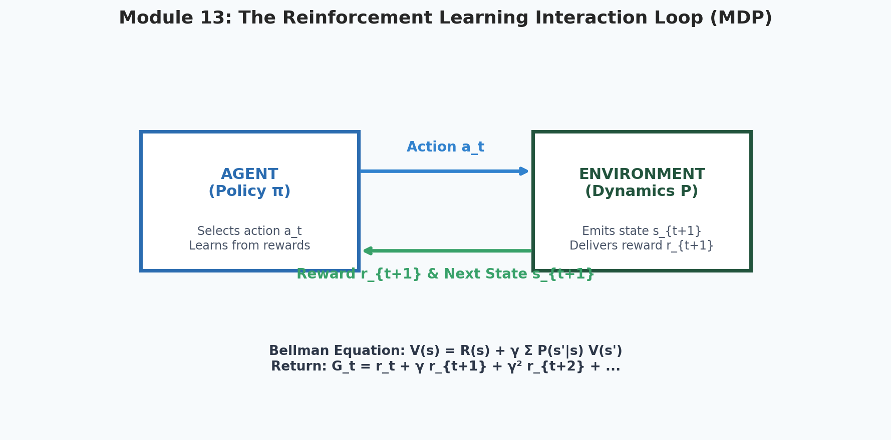
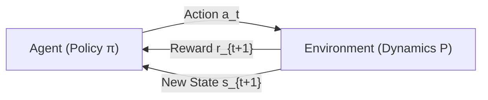
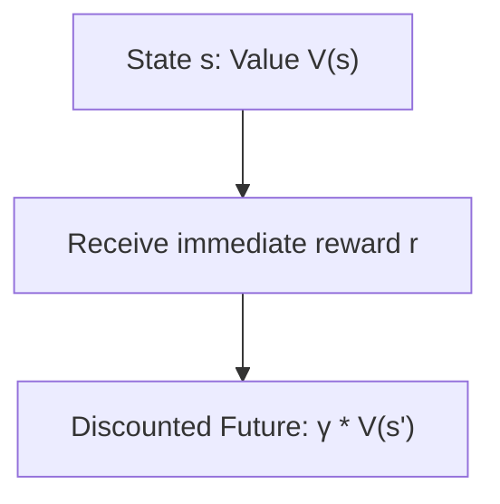

# 13. Foundations of Reinforcement Learning

<p align="center">
  
</p>

> [!NOTE]
> ⏱️ **Estimated Study Time**: ~3 hours reading + ~2 hours exercises  
> 🎯 **What "Done" Looks Like**:
> - [ ] You can define states, actions, transitions, and the discount factor $\gamma$ in an MDP.
> - [ ] You understand the Bellman Optimality Equation and why bootstrapping enables tabular Q-learning.
> - [ ] You ran `python3 13_Foundations_of_Reinforcement_Learning/tabular_q_learning.py` and solved the GridWorld navigation task.
> - [ ] You attempted the Level 1 & Level 2 exercises.


Welcome to Module 13 of **AI Research Foundations**. Up to this point, our models learned from fixed datasets *(supervised learning)*. In **Reinforcement Learning (RL)**, an agent learns by interacting directly with a dynamic environment through **trial, error, and delayed rewards**. RL is the mathematical foundation for game-playing agents, robotics, and frontier post-training *(RLHF and GRPO reasoning models)*.

---

## 🎯 Learning Objectives

By the end of this module, you will:
- Frame problems using the **Agent-Environment interaction loop**.
- Understand the **Markov Property** and formalize problems as **Markov Decision Processes (MDPs)**.
- Internalize the **Discount Factor** $\gamma$ and cumulative return $G_t$.
- Derive the **Bellman Expectation Equation** from first principles.
- Understand the **Exploration vs. Exploitation** dilemma and $\epsilon$-greedy strategies.
- Implement **Tabular Q-Learning** from scratch in Python to solve a grid-world environment.

---

## 🔄 The Agent-Environment Loop



1. At time step $t$, the **Agent** observes state $s_t \in \mathcal{S}$.
2. The agent selects an **Action** $a_t \in \mathcal{A}$ according to its **Policy** $\pi(a_t \mid s_t)$.
3. The **Environment** transitions to a new state $s_{t+1}$ and delivers a scalar **Reward** $r_{t+1} \in \mathbb{R}$.
4. The cycle repeats until a terminal state is reached.

---

## 🎲 The Markov Decision Process (MDP)

An environment satisfies the **Markov Property** if:
$$P(s_{t+1} \mid s_t, a_t, s_{t-1}, a_{t-1}, \dots, s_0, a_0) = P(s_{t+1} \mid s_t, a_t)$$
*"The future depends only on the present state, not on the entire historical path that led here."*

An MDP is defined by the 5-tuple $\langle \mathcal{S}, \mathcal{A}, \mathcal{P}, \mathcal{R}, \gamma \rangle$:
- $\mathcal{S}$: The set of all valid states.
- $\mathcal{A}$: The set of all valid actions.
- $\mathcal{P}(s' \mid s, a)$: State transition probability function.
- $\mathcal{R}(s, a, s')$: Reward function.
- $\gamma \in [0, 1)$: **Discount Factor** *(a multiplier that down-weights future rewards relative to immediate rewards)*.

### Cumulative Return ($G_t$)
The agent's objective is to maximize the expected discounted return:
$$G_t = r_{t+1} + \gamma r_{t+2} + \gamma^2 r_{t+3} + \dots = \sum_{k=0}^\infty \gamma^k r_{t+k+1}$$
- If $\gamma = 0$, the agent is completely shortsighted, caring only about immediate reward.
- If $\gamma \to 1$, the agent is farsighted, valuing distant future rewards nearly as much as today.

---

## 🔮 Value Functions & The Bellman Equation

How good is it to be in a particular state?

1. **State-Value Function ($V^\pi(s)$)**: Expected return starting from state $s$ following policy $\pi$:
   $$V^\pi(s) = \mathbb{E}_\pi [G_t \mid s_t = s]$$
2. **Action-Value Function ($Q^\pi(s, a)$)**: Expected return starting from state $s$, taking action $a$, and thereafter following policy $\pi$:
   $$Q^\pi(s, a) = \mathbb{E}_\pi [G_t \mid s_t = s, a_t = a]$$

### The Bellman Equation: The Recursive Core of RL
Richard Bellman observed that the value of your current state equals **the immediate reward plus the discounted value of the next state**:

$$V(s) = \mathcal{R}(s) + \gamma \sum_{s'} \mathcal{P}(s' \mid s) V(s')$$



---

## 🧭 Exploration vs. Exploitation ($\epsilon$-Greedy)

- **Exploitation**: Choosing the action currently known to yield the highest expected return *(cashing in)*.
- **Exploration**: Trying unfamiliar actions to discover whether they yield even better rewards long-term *(learning)*.

The **$\epsilon$-greedy** policy balances this:
$$\pi(a \mid s) = \begin{cases} \arg\max_a Q(s, a) & \text{with probability } 1 - \epsilon \quad \text{(Exploit)} \\ \text{Random action from } \mathcal{A} & \text{with probability } \epsilon \quad \text{(Explore)} \end{cases}$$

---

## ⚡ Tabular Q-Learning

**Q-Learning** (Watkins, 1989) is an **off-policy Temporal Difference (TD)** control algorithm. It updates its $Q$-table directly using the optimal Bellman equation without needing a model of environment transition probabilities:

$$Q(s, a) \leftarrow Q(s, a) + \alpha \underbrace{\left[ r + \gamma \max_{a'} Q(s', a') - Q(s, a) \right]}_{\text{TD Error } \delta}$$

Where $\alpha$ is the learning rate, and the bracketed term is the **Temporal Difference (TD) Error** *(the difference between the new estimated target return and our previous belief)*.

```python
import numpy as np

# A tiny 1D grid: State 0 -> State 1 -> State 2 -> State 3 (Goal! Reward = +10)
num_states = 4
num_actions = 2  # 0: Left, 1: Right
Q_table = np.zeros((num_states, num_actions))

alpha = 0.1   # Learning rate
gamma = 0.9   # Discount factor
epsilon = 0.2 # Exploration probability

def step(state: int, action: int):
    """Simple 1D environment dynamics."""
    if action == 1:  # Move right
        next_state = min(state + 1, num_states - 1)
    else:            # Move left
        next_state = max(state - 1, 0)
    
    reward = 10.0 if next_state == 3 else 0.0
    done = (next_state == 3)
    return next_state, reward, done

# Training loop
for episode in range(100):
    state = 0
    done = False
    while not done:
        # Epsilon-greedy action selection
        if np.random.rand() < epsilon:
            action = np.random.choice(num_actions)
        else:
            action = np.argmax(Q_table[state])

        next_state, reward, done = step(state, action)

        # Q-Learning update rule
        best_next_q = np.max(Q_table[next_state])
        td_target = reward + gamma * best_next_q
        td_error = td_target - Q_table[state, action]
        Q_table[state, action] += alpha * td_error

        state = next_state

print("Learned Q-Table:\n", Q_table)
```

---

## 📚 Curated References

1. **David Silver's UCL Reinforcement Learning Course**: [davidsilver.uk/teaching](https://www.davidsilver.uk/teaching/)
2. **Reinforcement Learning: An Introduction (Sutton & Barto)**: [incompleteideas.net](http://incompleteideas.net/book/the-book-2nd.html)
3. **OpenAI Gymnasium**: [gymnasium.farama.org](https://gymnasium.farama.org)
4. **Lil'Log: Policy Gradient Algorithms**: [lilianweng.github.io](https://lilianweng.github.io/posts/2018-04-08-policy-gradient/)

---

## 🏋️ Revision Exercises

> 💡 **Solutions Available**: Stuck on an exercise or want to verify your code? Check out the complete reference solutions in [`solutions.md`](./solutions.md).

### Level 1: Recall & Conceptual
1. State the **Markov Property** in plain English. Give one example of a real-world scenario that is strictly Markovian and one that is not.
2. What happens to an RL agent's behavior if $\gamma = 0$? What happens if $\gamma = 0.999$?
3. In Q-learning, what is the **Temporal Difference (TD) Error** measuring?

### Level 2: Hands-On Implementation
1. Expand the companion 1D environment into a $4 \times 4$ GridWorld:
   - Start at $(0, 0)$, goal at $(3, 3)$ with reward $+10$.
   - Add a "cliff" trap at $(1, 1)$ with reward $-10$ that terminates the episode.
   - Train tabular Q-learning for 500 episodes and display the optimal policy path arrows $(\leftarrow, \rightarrow, \uparrow, \downarrow)$.

### Level 3: Research Deep Dive
1. **The Curse of Dimensionality & Deep Q-Networks (DQN)**:
   Tabular Q-learning requires storing a table of size $|\mathcal{S}| \times |\mathcal{A}|$.
   - For an Atari game with raw $210 \times 160$ RGB frames, how many possible states exist?
   - How did DeepMind's **Deep Q-Network (Mnih et al., 2015)** solve this using function approximation with neural networks, experience replay buffers, and target networks?
