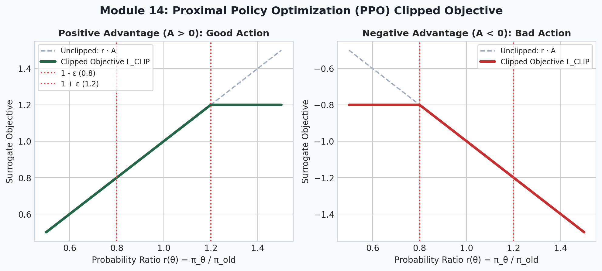
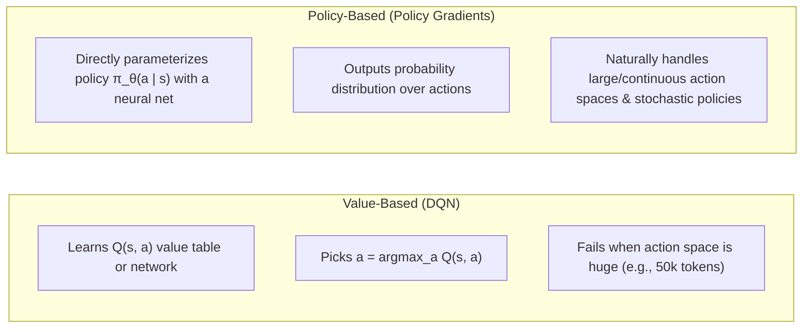
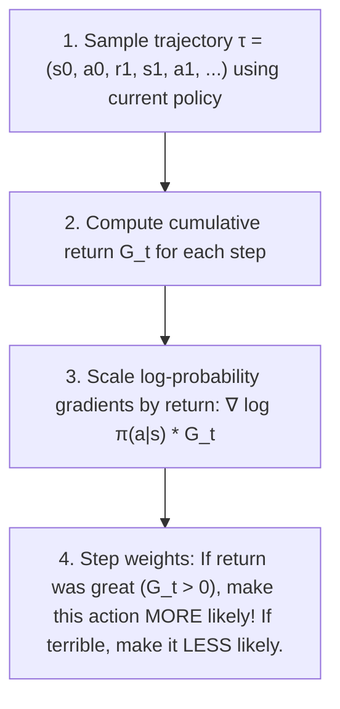
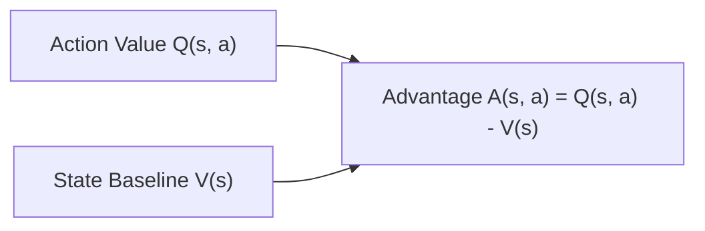
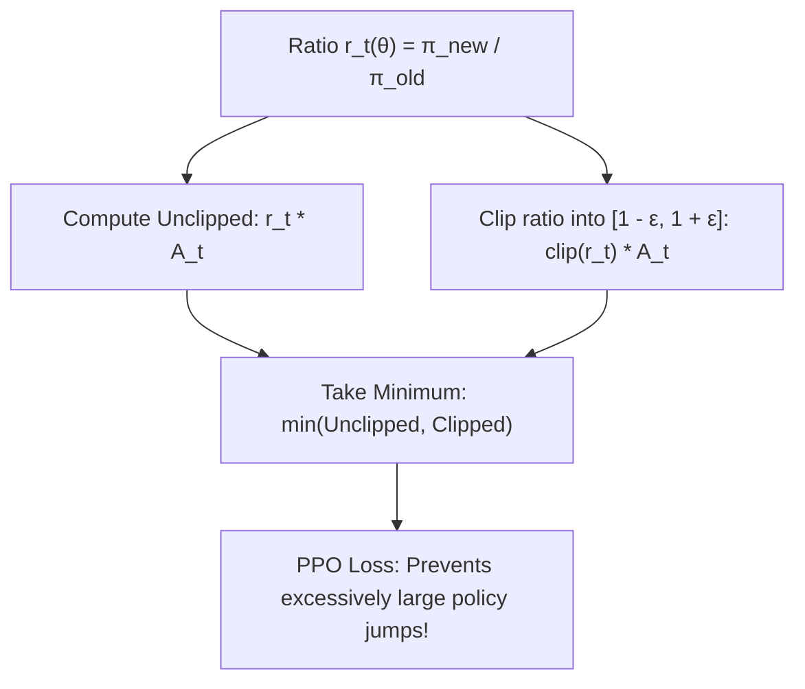

# 14. Deep RL: Policy Gradients & PPO

  

Welcome to Module 14 of **AI Research Foundations**. While value-based methods like Q-Learning work well for small action spaces, language models generate tokens from a massive vocabulary of 50,000+ choices at every position. To train models with large action spaces and continuous trajectories, we turn to **Policy Gradient methods**, culminating in **Proximal Policy Optimization (PPO)**.

---

## 🎯 Learning Objectives

By the end of this module, you will:
- Differentiate between **Value-Based** and **Policy-Based** reinforcement learning.
- Derive the **Policy Gradient Theorem** and implement the classic **REINFORCE** algorithm.
- Understand the role of the **Baseline** and **Advantage Function** $A(s, a)$ in slashing variance.
- Master the **Actor-Critic** architecture.
- Dissect the **PPO Clipped Surrogate Objective** that powers modern LLM post-training.

---

## 🧭 Value-Based vs. Policy-Based RL

---

## 🎯 The Policy Gradient Theorem & REINFORCE

Suppose our neural network policy $\pi_\theta(a \mid s)$ outputs probabilities for actions. We want to maximize total expected trajectory return $J(\theta) = \mathbb{E}_{\tau \sim \pi_\theta} [R(\tau)]$.

The **Policy Gradient Theorem** reveals a beautiful mathematical shortcut: we do not need to differentiate through complex, unknown environment dynamics!

$$\nabla_\theta J(\theta) = \mathbb{E}_{\tau \sim \pi_\theta} \left[ \sum_{t=0}^T \nabla_\theta \log \pi_\theta(a_t \mid s_t) \cdot G_t \right]$$

### The "Log-Derivative" Trick:
Why does $\log \pi(a \mid s)$ appear?
$$\nabla_\theta \pi_\theta = \pi_\theta \frac{\nabla_\theta \pi_\theta}{\pi_\theta} = \pi_\theta \nabla_\theta \log \pi_\theta$$
This allows us to replace an intractable expectation over all possible futures with an empirical sample average over trajectories we actually experienced!

---

## ⚖️ Baselines & The Advantage Function

In basic REINFORCE, $G_t$ is always positive in environments where rewards are non-negative. This pushes **all** action probabilities upward, only differing by how much!

To fix this high-variance issue, we subtract a **Baseline** $V(s)$ *(an estimate of the average return expected from state $s$)*. This defines the **Advantage Function**:

$$A(s_t, a_t) = Q(s_t, a_t) - V(s_t)$$

- If $A(s, a) > 0$: The chosen action performed **better than average** $\to$ increase probability.
- If $A(s, a) < 0$: The chosen action performed **worse than average** $\to$ decrease probability.

---

## 🎭 The Actor-Critic Architecture

To compute advantages, modern algorithms use two networks (or a shared network with two heads):
1. **The Actor** ($\pi_\theta$): Chooses actions *(outputs action distribution)*.
2. **The Critic** ($V_\phi$): Evaluates states *(outputs scalar baseline estimate to compute TD error / advantage)*.

$$\hat{A}_t = r_{t+1} + \gamma V_\phi(s_{t+1}) - V_\phi(s_t)$$

---

## 🛡️ Proximal Policy Optimization (PPO)

A major flaw of basic policy gradients is **policy collapse**: a single bad gradient update with a large step size can destroy a working policy, causing performance to drop to zero with no way to recover.

John Schulman et al. (OpenAI, 2017) introduced **PPO**, the workhorse algorithm behind early ChatGPT and RLHF.

### 1. The Probability Ratio:
$$r_t(\theta) = \frac{\pi_\theta(a_t \mid s_t)}{\pi_{\theta_{\text{old}}}(a_t \mid s_t)}$$
- If $r_t(\theta) = 1.0$: The new policy assigns the exact same probability as before.
- If $r_t(\theta) > 1.0$: The action has become more likely under the updated policy.

### 2. The Clipped Surrogate Objective:
$$L^{\text{CLIP}}(\theta) = \hat{\mathbb{E}}_t \left[ \min\left( r_t(\theta) \hat{A}_t, \, \text{clip}(r_t(\theta), 1 - \epsilon, 1 + \epsilon) \hat{A}_t \right) \right]$$
Where clipping parameter $\epsilon \approx 0.2$.

> [!NOTE]
> **Why the `min()` matters**:
> If the advantage is positive ($\hat{A}_t > 0$), we want to increase action probability, but the clip stops rewarding updates once $r_t(\theta) > 1 + \epsilon$.
> If the advantage is negative ($\hat{A}_t < 0$), the clip stops penalizing once $r_t(\theta) < 1 - \epsilon$.
> This creates a pessimistic lower bound that guarantees stable, monotonic policy improvements!

---

## 📚 Curated References

1. **Proximal Policy Optimization Algorithms (Schulman et al., 2017)**: [arxiv.org/abs/1707.06347](https://arxiv.org/abs/1707.06347)
2. **CleanRL: High-Quality Single-File Implementations**: [github.com/vwxyzjn/cleanrl](https://github.com/vwxyzjn/cleanrl)
3. **OpenAI Spinning Up in Deep RL**: [spinningup.openai.com](https://spinningup.openai.com/en/latest/)
4. **Lil'Log: Policy Gradient Algorithms**: [lilianweng.github.io/posts/2018-04-08-policy-gradient/](https://lilianweng.github.io/posts/2018-04-08-policy-gradient/)

---

## 🏋️ Revision Exercises

### Level 1: Recall & Conceptual
1. Why is the log-derivative trick $\nabla_\theta \log \pi_\theta(a \mid s)$ essential for executing policy gradients on computers?
2. What is the role of the **Critic** in an Actor-Critic architecture, and how does it reduce the variance of the gradient estimates?
3. Explain why PPO clips the probability ratio $r_t(\theta)$ between $1 - \epsilon$ and $1 + \epsilon$.

### Level 2: Hands-On Implementation
1. Write a standalone Python function `ppo_clip_objective(logprobs_new, logprobs_old, advantages, eps=0.2)` in PyTorch:
   - Compute ratio $r = \exp(\text{logprobs\_new} - \text{logprobs\_old})$.
   - Compute unclipped and clipped surrogate objectives.
   - Return the scalar loss $-\text{mean}(\min(\dots))$.
2. Run the companion script `clean_ppo.py` and verify that the Actor-Critic network stabilizes training loss.

### Level 3: Research Deep Dive
1. **Generalized Advantage Estimation (GAE) (Schulman et al., 2015)**:
   PPO implementations almost always use GAE($\lambda$) to calculate advantages:
   $$\hat{A}_t^{\text{GAE}(\gamma, \lambda)} = \sum_{l=0}^\infty (\gamma \lambda)^l \delta_{t+l}^V$$
   - How does parameter $\lambda \in [0, 1]$ interpolate between high-bias, low-variance TD(0) and low-bias, high-variance Monte Carlo returns?
   - What happens when $\lambda = 0$ versus when $\lambda = 1$?
