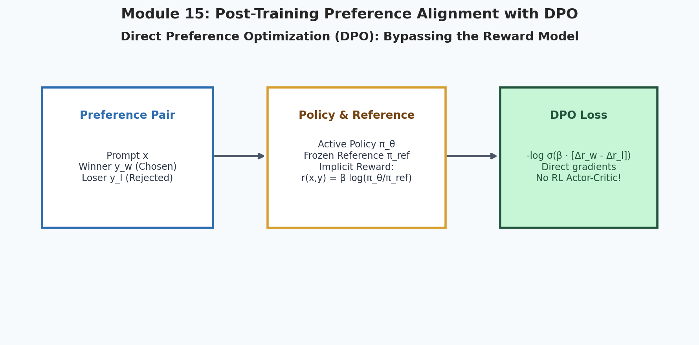
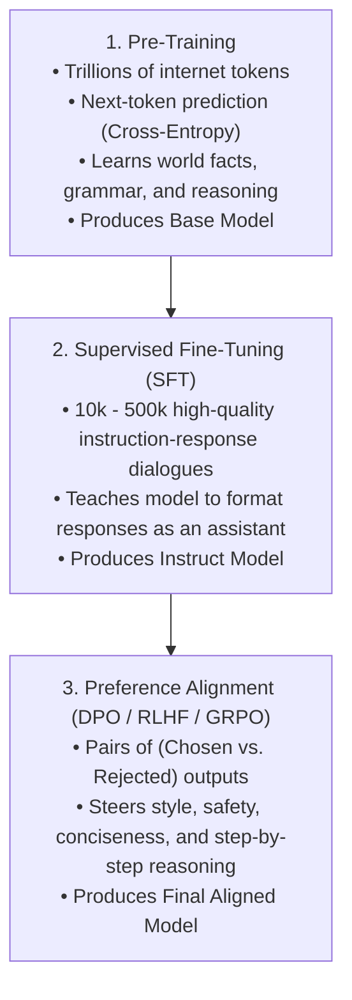
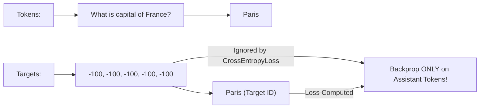
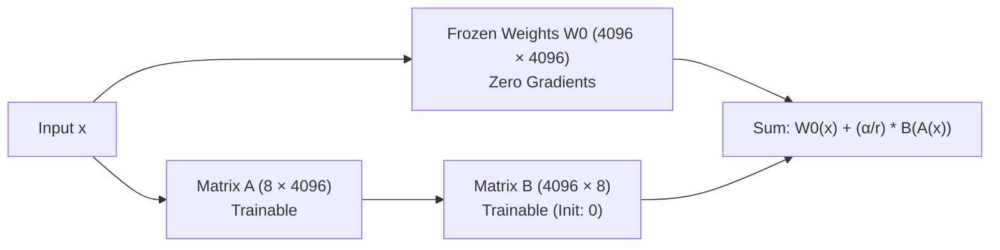
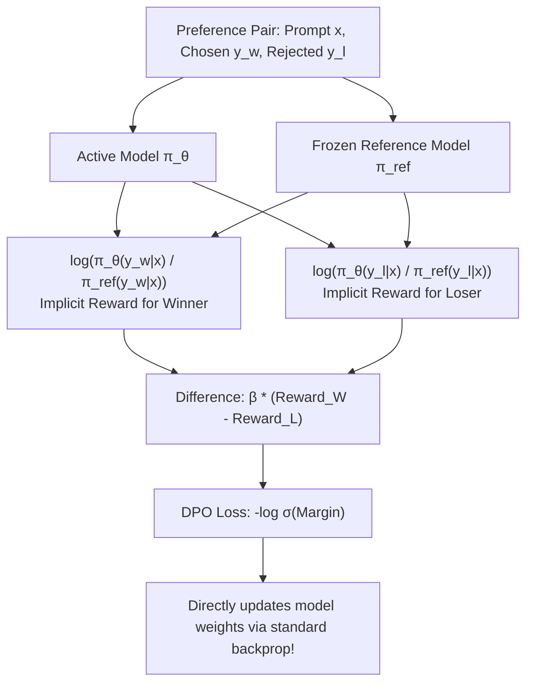

# 15. Post-Training: SFT & Direct Preference Optimization (DPO)

<p align="center">
  
</p>

> [!NOTE]
> ⏱️ **Estimated Study Time**: ~3 hours reading + ~2 hours exercises  
> 🎯 **What "Done" Looks Like**:
> - [ ] You can structure multi-turn chat templates with special control tokens (`<|im_start|>`, `<|im_end|>`).
> - [ ] You understand how LoRA compresses parameter updates into rank-$r$ matrices ($W + \frac{\alpha}{r} BA$).
> - [ ] You understand how DPO mathematically bypasses the reward model to optimize preference directly via implicit reward formulation.
> - [ ] You ran `python3 15_Post_Training_and_Alignment_SFT_and_DPO/dpo_loss.py` and saw DPO loss decrease on winning completions.


Welcome to Module 15 of **AI Research Foundations**. A raw pre-trained foundation model is essentially an internet document completion simulator. If you prompt it with *"How do I bake bread?"*, it might reply with *"Chapter 2: Yeast and Flour"* instead of an answer! 

**Post-training** is the critical stage that transforms raw base models into helpful, obedient, and aligned AI assistants.

---

## 🎯 Learning Objectives

By the end of this module, you will:
- Understand the 3-stage lifecycle of modern LLMs: **Pre-training**, **Supervised Fine-Tuning (SFT)**, and **Preference Alignment**.
- Format instruction datasets using **ChatML** and masked loss computation.
- Implement **LoRA** *(Low-Rank Adaptation)* parameter-efficient fine-tuning.
- Understand the **Bradley-Terry preference model**.
- Master **Direct Preference Optimization (DPO)**, which aligns models to human preferences without training a separate reward model or RL loop.

---

## 🏗️ The 3 Stages of Modern LLMs



---

## 💬 Supervised Fine-Tuning (SFT) & Loss Masking

In SFT, conversations are formatted using special markup tags like **ChatML**:

```
<|im_start|>user
What is the capital of France?<|im_end|>
<|im_start|>assistant
The capital of France is Paris.<|im_end|>
```

### Masked Cross-Entropy Loss:
We do **not** want the model to learn how to predict the user's prompt! We only want to compute loss on the **assistant's response tokens**.
In PyTorch, we mask the user prompt token labels by setting their target value to `-100`. `nn.CrossEntropyLoss(ignore_index=-100)` automatically skips those tokens during backpropagation!



---

## 🪶 Parameter-Efficient Fine-Tuning: LoRA

Fine-tuning all 70 billion parameters of an LLM requires massive GPU clusters.  
**LoRA (Low-Rank Adaptation)** freezes the original weight matrix $W_0 \in \mathbb{R}^{d \times k}$ and injects two tiny trainable matrices $A$ and $B$:

$$W = W_0 + \frac{\alpha}{r} (B \cdot A)$$

Where:
- $A \in \mathbb{R}^{r \times k}$ is initialized with Gaussian noise.
- $B \in \mathbb{R}^{d \times r}$ is initialized to all **zeros** *(so initially $B \cdot A = 0$, meaning the model begins identically to the base model)*.
- $r$ is the rank (typically $8$ or $16$).
- $\alpha$ is a scaling hyperparameter.



---

## ⚖️ The Preference Problem: Bradley-Terry Model

Given a prompt $x$ and two candidate responses:
- $y_w$: The **winning / chosen** response *(helpful, clear, accurate)*.
- $y_l$: The **losing / rejected** response *(lazy, incorrect, or harmful)*.

The **Bradley-Terry model** defines the probability that a human prefers $y_w$ over $y_l$ given a scalar reward function $r(x, y)$:

$$P(y_w \succ y_l \mid x) = \sigma(r(x, y_w) - r(x, y_l)) = \frac{1}{1 + e^{-(r(x, y_w) - r(x, y_l))}}$$

---

## 🎯 Direct Preference Optimization (DPO)

In 2023, Rafailov et al. (Stanford) made a breakthrough: **we do not need to train a separate reward model or run an unstable PPO reinforcement learning loop!**

They proved mathematically that the latent reward $r(x, y)$ can be extracted directly from the ratio between the active policy $\pi_\theta$ and the frozen reference model $\pi_{\text{ref}}$:

$$r(x, y) = \beta \log \frac{\pi_\theta(y \mid x)}{\pi_{\text{ref}}(y \mid x)}$$

Substituting this directly into the Bradley-Terry preference objective yields the **DPO Loss**:

$$\mathcal{L}_{\text{DPO}}(\pi_\theta; \pi_{\text{ref}}) = -\mathbb{E}_{(x, y_w, y_l)} \left[ \log \sigma \left( \beta \log \frac{\pi_\theta(y_w \mid x)}{\pi_{\text{ref}}(y_w \mid x)} - \beta \log \frac{\pi_\theta(y_l \mid x)}{\pi_{\text{ref}}(y_l \mid x)} \right) \right]$$



### What DPO Does Mechanistically:
1. **Increases the probability** of tokens in the preferred response $y_w$.
2. **Decreases the probability** of tokens in the rejected response $y_l$.
3. **Penalizes drift** from the base reference model via the $\beta$ coefficient *(preventing the model from destroying its language capabilities)*.

---

## 📚 Curated References

1. **Direct Preference Optimization: Your Language Model is Secretly a Reward Model (Rafailov et al., 2023)**: [arxiv.org/abs/2305.18290](https://arxiv.org/abs/2305.18290)
2. **LoRA: Low-Rank Adaptation of Large Language Models (Hu et al., 2021)**: [arxiv.org/abs/2106.09685](https://arxiv.org/abs/2106.09685)
3. **The RLHF Book (Nathan Lambert) - Preference Alignment Chapters**: [rlhfbook.com](https://rlhfbook.com/)
4. **Hugging Face smol-course (Practical SFT & DPO)**: [huggingface.co/learn/smol-course](https://huggingface.co/learn/smol-course)

---

## 🏋️ Revision Exercises

> 💡 **Solutions Available**: Stuck on an exercise or want to verify your code? Check out the complete reference solutions in [`solutions.md`](./solutions.md).

### Level 1: Recall & Conceptual
1. Why must we mask user prompt tokens with target value `-100` during Supervised Fine-Tuning?
2. In LoRA, why is matrix $B$ initialized to all zeros while matrix $A$ is initialized with random Gaussian values?
3. What was the primary motivation for creating DPO to replace PPO in preference alignment?

### Level 2: Hands-On Implementation
1. Write a PyTorch function `dpo_loss(policy_chosen_logps, policy_rejected_logps, reference_chosen_logps, reference_rejected_logps, beta=0.1)`:
   - Calculate winning ratio: `pi_w - ref_w`.
   - Calculate losing ratio: `pi_l - ref_l`.
   - Compute logits margin: `beta * (winning_ratio - losing_ratio)`.
   - Return `-F.logsigmoid(logits_margin).mean()`.
2. Run the companion script `dpo_loss.py` and inspect how changing $\beta$ affects the gradients.

### Level 3: Research Deep Dive
1. **DPO Overfitting & Length Bias**:
   Empirical studies have shown that DPO can inadvertently favor longer responses simply because longer texts accumulate more token-level log probabilities.
   - Explain how length bias arises in the DPO objective.
   - Investigate proposed solutions such as **IPO** *(Identity Preference Optimization)* or **SimPO** *(Simple Preference Optimization with length normalization)*.
