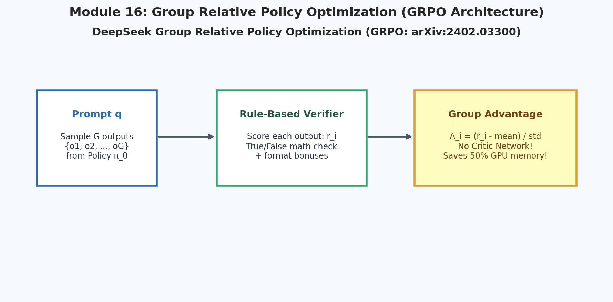
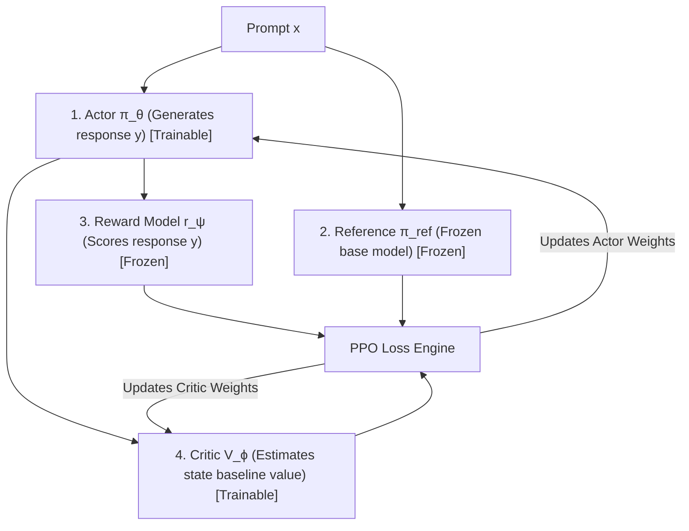
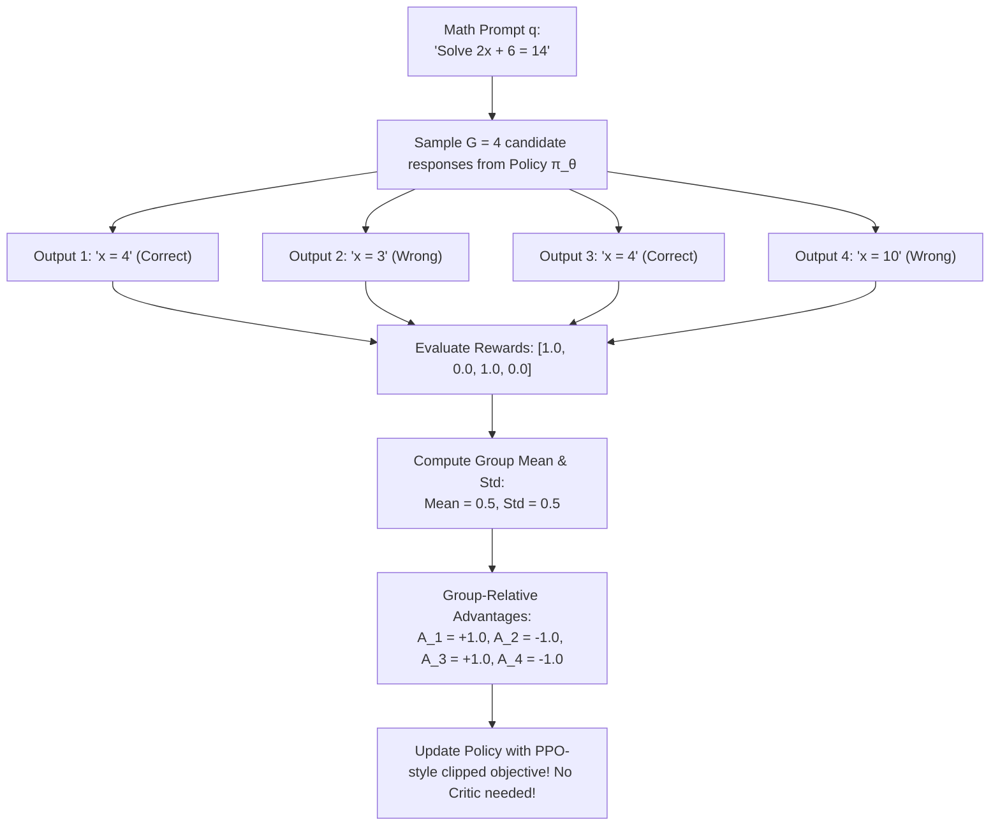

# 16. RLHF & Group Relative Policy Optimization (GRPO)

  

> [!NOTE]
> ⏱️ **Estimated Study Time**: ~3.5 hours reading + ~2.5 hours exercises  
> 🎯 **What "Done" Looks Like**:
> - [ ] You understand why traditional PPO's Critic model caused a severe GPU memory bottleneck during RLHF.
> - [ ] You can implement the GRPO group advantage normalization formula $\hat{A}_i = \frac{r_i - \text{mean}(r)}{\text{std}(r) + \epsilon}$.
> - [ ] You understand why rule-based verifiers eliminate reward hacking on reasoning tasks.
> - [ ] You solved Level 1 & Level 2 exercises and verified them against [`solutions.md`](solutions.md).
>
> 🔬 **Scope Note**: Numerical illustration of the loss on synthetic tensors — no neural network model is trained here. Focuses strictly on verifying the loss equations and gradient dynamics.

Welcome to Module 16 of **AI Research Foundations**. In this module, we examine the reinforcement learning methods that align foundation models and unlock reasoning: the traditional **RLHF** pipeline and DeepSeek's breakthrough algorithm: **Group Relative Policy Optimization (GRPO)**.

---

## 🎯 Learning Objectives

By the end of this module, you will:
- Deconstruct the traditional **3-stage RLHF pipeline** *(Pretraining $\to$ SFT $\to$ Reward Modeling $\to$ PPO)*.
- Identify the **Critic Memory Bottleneck** that makes traditional PPO expensive and complex to scale.
- Understand how **GRPO** eliminates the critic model completely by normalizing rewards across sampled output groups.
- Dissect the mathematical objective of **DeepSeekMath (arXiv:2402.03300)**.
- Implement group-relative advantage normalization and KL penalty regularization.

---

## 🏛️ Traditional RLHF & The 4-Model Memory Crisis

The classic RLHF pipeline *(used in InstructGPT and early ChatGPT)* requires orchestrating **four separate neural networks** in GPU memory simultaneously during training:

### The Problem: The Critic Bottleneck
To compute accurate value baselines $V(s)$, the **Critic** network must be roughly as large as the Actor.
If your Actor has 70 billion parameters, your Critic also requires 70 billion parameters!
This means:
- Massive GPU VRAM consumption.
- Complicated distributed training configurations.
- Unstable training dynamics when the Critic fails to predict reward accurately.

---

## 🚀 Enter GRPO: Eliminating the Critic

In February 2024, DeepSeek published **DeepSeekMath: Pushing the Limits of Mathematical Reasoning in Open Language Models (arXiv:2402.03300)**, introducing **Group Relative Policy Optimization (GRPO)**.

### The Big Idea:
**Why train a separate trillion-parameter Critic network when we can simply compare multiple answers from the Actor itself?**

---

## 📐 The Mathematics of GRPO

For each prompt $q$ sampled from the dataset:
1. The policy $\pi_{\theta_{\text{old}}}$ samples a group of $G$ outputs: $\{o_1, o_2, \dots, o_G\}$.
2. A reward function *(either a rule-based math verifier or a reward model)* assigns scalar scores $\{r_1, r_2, \dots, r_G\}$.
3. The **Group-Relative Advantage** $\hat{A}_i$ for output $o_i$ is computed by standardizing rewards across the group:

$$\hat{A}_i = \frac{r_i - \text{mean}(\{r_1, \dots, r_G\})}{\text{std}(\{r_1, \dots, r_G\}) + \epsilon}$$

4. The policy parameters $\theta$ are updated by maximizing the objective:

$$\mathcal{J}_{\text{GRPO}}(\theta) = \mathbb{E}_{q, \{o_i\}} \left[ \frac{1}{G} \sum_{i=1}^G \frac{1}{|o_i|} \sum_{t=1}^{|o_i|} \left( \min\left( \frac{\pi_\theta(o_{i,t} \mid \dots)}{\pi_{\theta_{\text{old}}}(o_{i,t} \mid \dots)} \hat{A}_i, \, \text{clip}\left( \frac{\pi_\theta}{\pi_{\theta_{\text{old}}}}, 1-\epsilon, 1+\epsilon \right) \hat{A}_i \right) - \beta D_{KL}(\pi_\theta \parallel \pi_{\text{ref}}) \right) \right]$$

### Analytical KL Penalty Approximation:
In DeepSeekMath, the KL divergence between $\pi_\theta$ and $\pi_{\text{ref}}$ is approximated analytically using the estimator:
$$D_{KL}(\pi_\theta \parallel \pi_{\text{ref}}) = \frac{\pi_{\text{ref}}(o_{i,t} \mid \dots)}{\pi_\theta(o_{i,t} \mid \dots)} - \log \frac{\pi_{\text{ref}}(o_{i,t} \mid \dots)}{\pi_\theta(o_{i,t} \mid \dots)} - 1$$
This is always non-negative and directly penalizes the active policy whenever it deviates from the reference model.

---

## 🏆 Why GRPO Unlocked Reasoning (DeepSeek-R1)

GRPO has three major advantages:
1. **Saves Massive Compute & Memory**: Without a Critic, all GPU memory is dedicated to the Actor, allowing training on much longer reasoning sequences (up to 32,000+ tokens!).
2. **Rule-Based Verifiers**: For math and coding, we don't need a noisy neural reward model. A simple Python script checking whether the final answer equals `42` provides a ground-truth, unhackable reward signal!
3. **Exploration of Reasoning Chains**: By sampling $G$ diverse reasoning traces (e.g., $G = 16$), the model explores multiple problem-solving angles, reinforcing the chains that reached the correct solution.

---

## 📚 Curated References

1. **DeepSeekMath: Pushing the Limits of Mathematical Reasoning in Open Language Models (Shao et al., 2024)**: [arxiv.org/abs/2402.03300](https://arxiv.org/abs/2402.03300)
2. **DeepSeek-R1: Incentivizing Reasoning Capability in LLMs via Reinforcement Learning (2025)**: [arxiv.org/abs/2501.12948](https://arxiv.org/abs/2501.12948)
3. **The RLHF Book (Nathan Lambert) - Chapter on GRPO & Reasoning**: [rlhfbook.com](https://rlhfbook.com/)
4. **Hugging Face: Illustrating RLHF**: [huggingface.co/blog/rlhf](https://huggingface.co/blog/rlhf)

---

## 🏋️ Revision Exercises

> [!TIP]
> **Worked Solutions**: Once you've attempted these exercises, check your group advantage implementations and leave-one-out comparison in [`solutions.md`](solutions.md).

### Level 1: Recall & Conceptual
1. Why does traditional PPO require maintaining a Critic network alongside the Actor?
2. In GRPO, how is the baseline computed without a Critic network?
3. What is the mathematical effect of dividing by $\text{std}(\{r_1, \dots, r_G\}) + \epsilon$? What happens if all $G$ outputs receive the exact same reward?

### Level 2: Hands-On Implementation
1. Write a function `compute_group_advantages(rewards: torch.Tensor, eps: float = 1e-8) -> torch.Tensor` that takes a 1D tensor of rewards of length $G$ and returns standardized advantages.
   - If rewards are `[1.0, 0.0, 1.0, 0.0]`, verify the advantages are `[1.0, -1.0, 1.0, -1.0]`.
   - If rewards are `[1.0, 1.0, 1.0, 1.0]`, verify advantages are all `0.0`.
2. Run the companion script `grpo_core.py` and inspect how GRPO computes policy gradients across sampled candidate outputs.

### Level 3: Research Deep Dive
1. **GRPO vs. REINFORCE with Leave-One-Out Baseline**:
   Kool et al. (2019) previously proposed a leave-one-out baseline for combinatorial optimization where baseline for sample $i$ is the average of all other $G-1$ samples.
   - Compare the variance and bias of the leave-one-out advantage versus GRPO's group standardization.
   - Why is group standardization particularly effective when rewards are binary ($0$ or $1$) in mathematical reasoning benchmarks?
