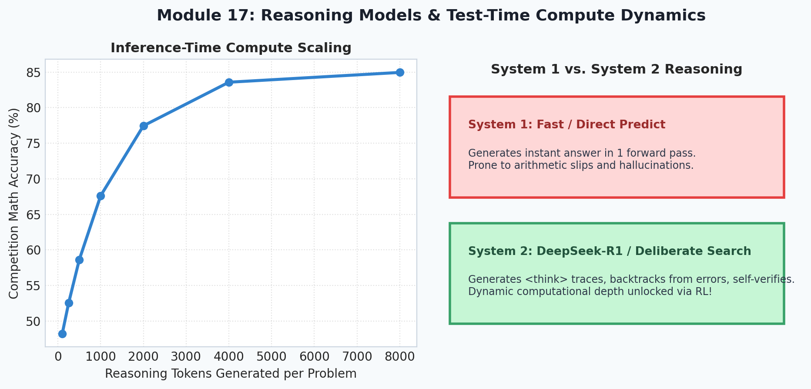
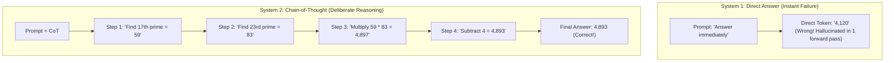
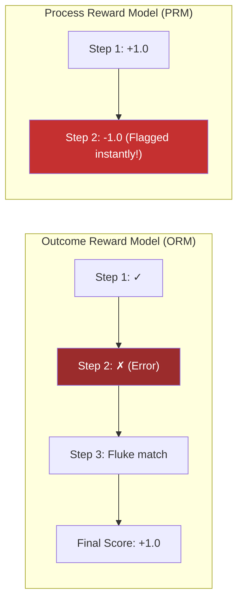
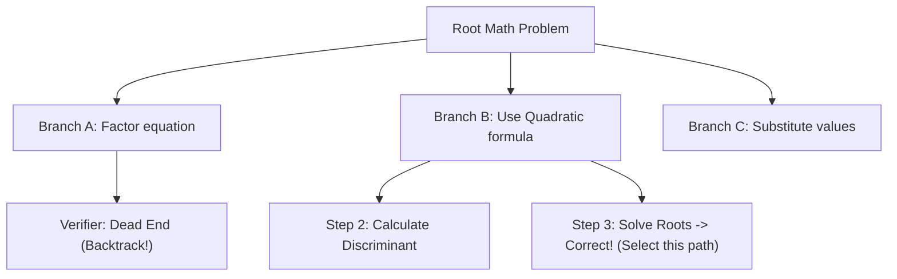

# 17. Reasoning Models & Test-Time Compute

  

Welcome to Module 17 of **AI Research Foundations**. In traditional NLP, models operated like Daniel Kahneman's **System 1**: fast, intuitive, instantaneous pattern recognition. The frontier of modern AI has shifted to **System 2 reasoning**: deliberate, step-by-step thinking, self-correction, backtracking, and test-time compute scaling.

---

## 🎯 Learning Objectives

By the end of this module, you will:
- Understand the distinction between **System 1 (intuitive)** and **System 2 (deliberative)** AI.
- Explain why **Chain-of-Thought (CoT)** expands the effective computational capacity of transformers.
- Compare **Outcome Reward Models (ORMs)** with **Process Reward Models (PRMs)**.
- Explore inference-time search algorithms: **Best-of-N**, **Tree of Thoughts (ToT)**, and **Beam Search**.
- Dissect the breakthrough findings of **DeepSeek-R1** and the emergence of self-correction behaviors under pure RL.
- Understand the new **Inference-Time Compute Scaling Laws**.

---

## 🧠 System 1 vs. System 2: Thinking in Tokens

A standard autoregressive transformer performs a fixed amount of computation per generated token *(a forward pass through its layers)*.

If you give a model the problem:  
*"What is the 17th prime number multiplied by the 23rd prime number minus 4?"*

> [!NOTE]
> **Why Chain-of-Thought Works Mechanistically**:
> Each intermediate token written into the context window becomes an external **working memory cache**. In subsequent forward passes, the attention mechanism can attend back to those intermediate calculations, providing the model with $O(\text{Tokens})$ dynamic depth!

---

## 🎯 ORM vs. PRM: Rewarding the Steps

How do we train models to reason accurately?

1. **Outcome Reward Model (ORM)**: Evaluates only the final answer at the very end *(binary correct/incorrect)*.
   - *Limitation*: Can reward correct answers that were arrived at through flawed, hallucinated steps!
2. **Process Reward Model (PRM)** *(OpenAI, 2023: "Let's Verify Step by Step")*: Evaluates every individual line of reasoning.
   - *Advantage*: Pinpoints the exact mathematical mistake and prevents reward hacking.

---

## 🌳 Inference-Time Search & Test-Time Compute

Instead of sampling a single answer greedily, we can spend more compute at test-time:

### 1. Best-of-N Sampling:
Sample $N$ independent candidate answers at temperature $T=0.7$, evaluate each with a PRM verifier, and select the candidate with the highest cumulative confidence.

### 2. Tree of Thoughts (ToT):
Maintains a tree of potential intermediate reasoning steps, using search algorithms *(Breadth-First Search, Depth-First Search, or MCTS)* to explore, evaluate, and backtrack.

---

## 🌟 DeepSeek-R1 & The Emergence of Self-Correction

In January 2025, DeepSeek released **DeepSeek-R1 (arXiv:2501.12948)**, demonstrating a stunning discovery:

### DeepSeek-R1-Zero:
The researchers applied large-scale reinforcement learning (GRPO) **directly to the base model with ZERO supervised fine-tuning data**! The model was simply rewarded for producing correct math answers and formatting its thoughts inside `<think>...</think>` tags.

### What Emerged Naturally from Pure RL:
As training progressed, the model spontaneously developed human-like reasoning behaviors:
1. **Self-Reflection**: Writing phrases like *"Wait, let me double check that equation. No, that factor is incorrect, let me re-evaluate."*
2. **Backtracking**: Abandoning failed reasoning branches and restarting from an earlier premise.
3. **The "Aha Moment"**: Discovering alternative algebraic transformations after an initial struggle.
4. **Length Scaling**: Output reasoning traces grew from 300 tokens to 8,000+ tokens as the model learned that spending more test-time tokens directly increased its probability of solving the problem!

---

## 📈 Test-Time Compute Scaling Laws

In late 2024, Snell et al. formalized **Test-Time Compute Scaling**:
Rather than spending millions of dollars to pre-train a 400-billion-parameter model, an efficient 8-billion-parameter model given $10\times$ more inference-time reasoning tokens can match or outperform the giant model on challenging reasoning benchmarks *(AIME, MATH, Codeforces)*!

---

## 📚 Curated References

1. **Chain-of-Thought Prompting Elicits Reasoning in Large Language Models (Wei et al., 2022)**: [arxiv.org/abs/2201.11903](https://arxiv.org/abs/2201.11903)
2. **Let's Verify Step by Step (Lightman et al., OpenAI 2023)**: [arxiv.org/abs/2305.20050](https://arxiv.org/abs/2305.20050)
3. **Tree of Thoughts: Deliberate Problem Solving with Large Language Models (Yao et al., 2023)**: [arxiv.org/abs/2305.10601](https://arxiv.org/abs/2305.10601)
4. **DeepSeek-R1: Incentivizing Reasoning Capability in LLMs via RL (2025)**: [arxiv.org/abs/2501.12948](https://arxiv.org/abs/2501.12948)
5. **Scaling LLM Test-Time Compute (Snell et al., 2024)**: [arxiv.org/abs/2408.03314](https://arxiv.org/abs/2408.03314)

---

## 🏋️ Revision Exercises

### Level 1: Recall & Conceptual
1. Why does writing intermediate reasoning tokens allow a fixed-depth transformer to solve problems it cannot solve with a single direct answer?
2. What is the difference between an **Outcome Reward Model (ORM)** and a **Process Reward Model (PRM)**?
3. What is the "Aha moment" documented in the DeepSeek-R1-Zero experiments?

### Level 2: Hands-On Implementation
1. Write a Python script implementing a **Best-of-N inference search**:
   - Given a mock generator that outputs an arithmetic solution along with an estimated per-step confidence score.
   - Generate $N = 10$ solutions.
   - Use a step verifier to filter out any path where an intermediate check fails.
   - Return the majority-vote answer among the verified paths.
2. Run the companion script `reasoning_search_demo.py` and analyze how test-time candidate sampling improves pass@1 accuracy.

### Level 3: Research Deep Dive
1. **Search vs. RL Scaling (The New Bitter Lesson)**:
   Rich Sutton's famous essay *"The Bitter Lesson"* argued that general methods leveraging compute (learning and search) always defeat human-engineered heuristics.
   - How does test-time compute scaling (inference search) embody the search side of the bitter lesson?
   - What are the diminishing returns of test-time search when candidate reasoning paths share identical systematic biases?
