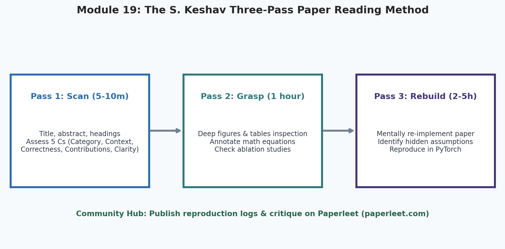
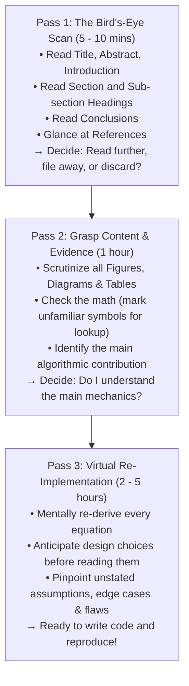
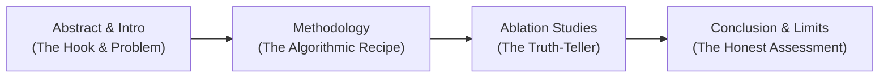

# 19. How to Read, Deconstruct & Critique AI Research Papers

  

Welcome to Module 19 of **AI Research Foundations**. In modern AI, textbooks become outdated within six months. The true living literature of artificial intelligence exists on **arXiv**, where thousands of preprints are uploaded every week. 

To become an effective AI researcher, you must master the art of reading, evaluating, and reproducing scientific papers.

---

## 🎯 Learning Objectives

By the end of this module, you will:
- Master the **S. Keshav Three-Pass Method** to absorb papers in a fraction of the time.
- Deconstruct the structural anatomy of an AI paper: Abstract, Methodology, and Ablation Studies.
- Spot **research red flags**, benchmark leakage, and cherry-picked results like a professional peer reviewer.
- Trace idea lineages forward and backward using **citation graphs** on Semantic Scholar.
- Integrate **[Paperleet](https://paperleet.com)** into your daily research habit to discover, discuss, and track paper reproductions.

---

## 🦅 The S. Keshav Three-Pass Method

Reading an AI paper linearly from top to bottom like a novel is an inefficient waste of time. Instead, use the legendary **Three-Pass Approach** developed by Professor S. Keshav (University of Waterloo):

### The 5 C's of Pass 1:
During your initial 10-minute scan, you must answer:
1. **Category**: What type of paper is this? *(Architectural innovation, empirical scaling law, optimization technique, post-training alignment, or benchmark survey?)*
2. **Context**: Which prior papers does this work build upon?
3. **Correctness**: Do the experimental assumptions seem valid?
4. **Contributions**: What are the paper's 2 or 3 primary novel claims?
5. **Clarity**: Is the paper well-written and logically coherent?

---

## 🔬 Deconstructing Paper Anatomy

Every modern AI research paper follows a standard narrative architecture:

### 1. Abstract & Introduction
Look for the **delta** ($\Delta$): *"Prior methods suffer from X because of Y. In this work, we propose Z, which achieves a 30% improvement while using 50% less compute."*

### 2. Methodology & Equations
Do not let Greek letters intimidate you. Every equation is simply a specification for a tensor operation:
- An expectation ($\mathbb{E}$) is just an average (`torch.mean()`).
- An argmax is just finding the highest logit (`torch.argmax()`).
- A summation ($\sum$) is just a loop or matrix reduction (`torch.sum()`).

### 3. Ablation Studies: The Most Important Section!
An **Ablation Study** *(from the surgical term "ablation": removing a part to observe the effect)* tests what happens when individual components of the proposed method are disabled one by one.

> [!WARNING]
> **If a paper lacks ablation studies, be skeptical!**
> A proposed method might have five complex architectural tricks, but an ablation study might reveal that 95% of the gain came from simply using a larger batch size or better learning rate schedule!

---

## 🚩 Spotting Red Flags & Research Hype

Before believing a sensational claim on Twitter or LinkedIn, check for these red flags:

| Red Flag | Description | What to Look For |
|---|---|---|
| **Weak Baseline Comparison** | Comparing a meticulously tuned new method against an untuned default library baseline. | Did they tune hyperparameters for the competitor models with equal compute? |
| **Confounded Variables** | Introducing a new model architecture *and* a new 10x larger dataset simultaneously. | Did the performance gain come from the new math or just the bigger dataset? |
| **Cherry-Picked Qualitative Outputs** | Displaying 3 gorgeous generation examples while hiding 97 broken failures. | Did they run automated, blind multi-judge evaluations or public benchmarks? |
| **Benchmark Leakage (Data Contamination)** | The test set questions were accidentally included in the web training corpus! | Did the authors run rigorous n-gram or embedding de-contamination checks? |

---

## 🌐 The Modern Research Toolkit

1. **[Paperleet](https://paperleet.com)**:
   - A cool platform (like LeetCode for AI researchers) to browse trending papers, practice reproductions, and check community implementations.
2. **[Hugging Face Daily Papers](https://huggingface.co/papers)**:
   - Daily community-curated feed linking ArXiv preprints directly to model weights and demo spaces.
3. **[Semantic Scholar](https://www.semanticscholar.org)**:
   - Interactive citation trees: inspect **Citations** *(who built on this work?)* and **References** *(whose shoulders does this stand on?)*.
4. **[LabML Annotated Papers](https://nn.labml.ai/)**:
   - Side-by-side PyTorch implementations with line-by-line paper quotes.

---

## 📚 Curated References

1. **How to Read a Paper (S. Keshav, Stanford PDF)**: [web.stanford.edu/class/ee384m/Handouts/HowtoReadPaper.pdf](https://web.stanford.edu/class/ee384m/Handouts/HowtoReadPaper.pdf)
2. **Papers We Love Community**: [paperswelove.org](https://paperswelove.org)
3. **Deep Learning Papers Reading Roadmap (Flood Sung)**: [github.com/floodsung/Deep-Learning-Papers-Reading-Roadmap](https://github.com/floodsung/Deep-Learning-Papers-Reading-Roadmap)
4. **Paperleet Platform**: [paperleet.com](https://paperleet.com)

---

## 🏋️ Revision Exercises

### Level 1: Recall & Conceptual
1. What are the specific objectives and timeframes of **Pass 1**, **Pass 2**, and **Pass 3** in Keshav's method?
2. What is an **Ablation Study**, and why is it often more informative than the main benchmark comparison table?
3. What is **benchmark data contamination**, and why does it invalidate reasoning evaluation results?

### Level 2: Hands-On Implementation
1. Download the paper **[DeepSeekMath (arXiv:2402.03300)](https://arxiv.org/abs/2402.03300)**.
2. Execute **Pass 1** on the paper using a timer set to 10 minutes.
3. Fill out the companion critique sheet `paper_critique_template.md` summarizing the paper's 5 Cs.

### Level 3: Research Deep Dive
1. **Evaluating Evaluation Metrics**:
   On mathematical benchmarks like GSM8K and MATH:
   - What is the difference between **Greedy decoding (pass@1)**, **Maj@K (majority voting consensus)**, and **Pass@K (at least one of K samples is correct)**?
   - How can an unscrupulous author report inflated numbers by quietly switching from pass@1 to pass@16 without highlighting the change?
