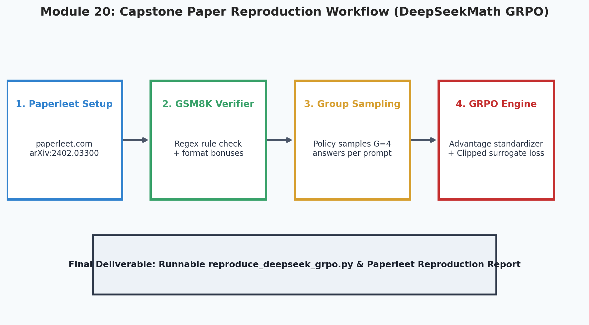
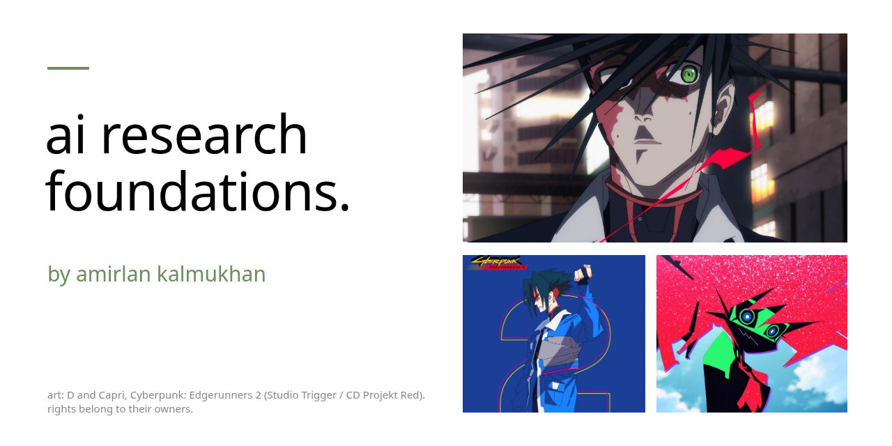
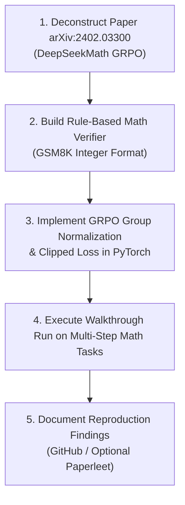
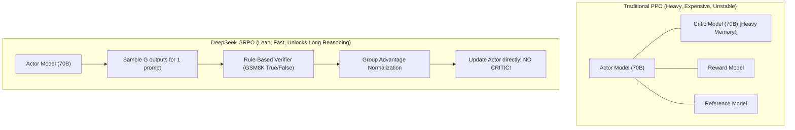

# 20. Capstone Walkthrough: DeepSeekMath GRPO Loss

<p align="center">
  
</p>


<p align="center">
  
</p>

Welcome to the **Capstone Walkthrough** of **AI Research Foundations**!

You have journeyed across 19 intensive modules: from building autograd from scratch, writing tokenizers, and assembling GPT decoders, to mastering deep RL, PPO, DPO, and transformer interpretability. Now, you step into the shoes of an **AI Researcher** to walk through the algorithmic and loss implementation of one of the most influential machine learning papers of the modern reasoning era.

---

## 🎯 The Capstone Mission

Your goal is to understand and implement the core mathematical and loss mechanics of **[DeepSeekMath: Pushing the Limits of Mathematical Reasoning in Open Language Models (arXiv:2402.03300)](https://arxiv.org/abs/2402.03300)**: **Group Relative Policy Optimization (GRPO)**.



---

## 📖 Step 1: The Research Mission & Paper Selection

Our featured capstone paper is **[DeepSeekMath: Pushing the Limits of Mathematical Reasoning in Open Language Models (arXiv:2402.03300)](https://arxiv.org/abs/2402.03300)**.

> [!NOTE]
> **Optional Tool Spotlight: Paperleet (LeetCode for AI Researchers)**:
> Think of **[Paperleet](https://paperleet.com)** like LeetCode, but for AI researchers: a community platform listing trending machine learning papers, problem prompts, and reproduction challenges. While we focus here on reproducing the breakthrough **DeepSeekMath GRPO** paper, you can also browse Paperleet to practice other classic reproduction challenges *(e.g. DPO, LoRA, FlashAttention, Mamba)*.

---

## 🔬 Step 2: The Paper at a Glance (arXiv:2402.03300)

### Why This Paper Matters
Before DeepSeekMath, aligning models with Reinforcement Learning required **PPO**, which forced researchers to train a massive **Critic model** alongside the Actor. This consumed half of all GPU memory and caused persistent training instability.

DeepSeek introduced **Group Relative Policy Optimization (GRPO)**, which:
1. **Completely eliminated the Critic network**, freeing GPU memory to accommodate long reasoning traces.
2. Replaced subjective neural reward models with **deterministic rule-based math verifiers**.
3. Paved the direct foundation for **DeepSeek-R1**, proving that self-correction and mathematical reasoning can emerge purely from RL at scale!



---

## 📐 Step 3: The Algorithmic Mechanics of GRPO

Let's dissect the core equations from Section 3 of the paper into plain English:

### 1. Group Sampling
For each question prompt $q$, the active policy $\pi_\theta$ samples a group of $G$ independent candidate answers:
$$\mathcal{O} = \{o_1, o_2, \dots, o_G\}$$

### 2. Rule-Based Reward Verification
Each output $o_i$ is evaluated by an automated verifier against the ground-truth integer answer:
$$r_i = \begin{cases} 1.0 & \text{if final answer matches ground truth} \\ 0.0 & \text{otherwise} \end{cases}$$
*(Optionally, a small format reward $+0.1$ is awarded if the output cleanly encapsulates its reasoning inside `<think>...</think>` tags!)*

### 3. Group-Relative Advantage Normalization
Instead of estimating state values with a value network, GRPO calculates the advantage of candidate $o_i$ by standardizing rewards across the group:

$$\hat{A}_i = \frac{r_i - \text{mean}(\{r_1, \dots, r_G\})}{\text{std}(\{r_1, \dots, r_G\}) + \epsilon}$$

- If $o_i$ was correct ($r_i=1$) while others in the group were wrong ($r=0$), $\hat{A}_i > 0$ $\rightarrow$ **reinforce this reasoning trace!**
- If $o_i$ was wrong while others were correct, $\hat{A}_i < 0$ $\rightarrow$ **penalize this path!**
- If all candidates were correct or all were wrong ($\text{std}=0$), $\hat{A}_i = 0$ $\rightarrow$ no gradient update.

### 4. Clipped Surrogate Objective with Analytical KL Penalty
The full loss to minimize is:

$$\mathcal{L}_{\text{GRPO}}(\theta) = -\frac{1}{G} \sum_{i=1}^G \frac{1}{|o_i|} \sum_{t=1}^{|o_i|} \left[ \min\left( \frac{\pi_\theta(o_{i,t})}{\pi_{\theta_{\text{old}}}(o_{i,t})} \hat{A}_i, \, \text{clip}\left(\frac{\pi_\theta(o_{i,t})}{\pi_{\theta_{\text{old}}}(o_{i,t})}, 1-\epsilon, 1+\epsilon\right) \hat{A}_i \right) - \beta D_{KL}(\pi_\theta \parallel \pi_{\text{ref}}) \right]$$

Where the analytical KL penalty per token is:
$$D_{KL}(\pi_\theta \parallel \pi_{\text{ref}}) = \frac{\pi_{\text{ref}}(o_{i,t})}{\pi_\theta(o_{i,t})} - \log \frac{\pi_{\text{ref}}(o_{i,t})}{\pi_\theta(o_{i,t})} - 1$$

---

## 💻 Step 4: The Complete PyTorch Implementation

Below is the complete, runnable implementation of the GRPO training step. You can also run the accompanying script:
`python 20_Capstone_GRPO_Loss_Walkthrough/reproduce_deepseek_grpo.py`

```python
import re
import torch
import torch.nn as nn
import torch.nn.functional as F

# 1. Rule-Based GSM8K Math Verifier
def extract_math_answer(text: str) -> str:
    """Extracts final answer from text, checking for <answer>X</answer> or \\boxed{X}."""
    # Look for tags or boxed format
    match = re.search(r"<answer>(.*?)</answer>", text)
    if match:
        return match.group(1).strip()
    # Fallback to finding the last number in text
    numbers = re.findall(r"-?\d+", text)
    return numbers[-1] if numbers else ""

def verify_math_solution(generated_text: str, ground_truth: str) -> float:
    """Assigns 1.0 for exact answer match, plus 0.1 format bonus for using <think> tags."""
    extracted = extract_math_answer(generated_text)
    is_correct = (extracted == ground_truth.strip())
    
    reward = 1.0 if is_correct else 0.0
    # Format bonus if thinking tags are properly closed
    if "<think>" in generated_text and "</think>" in generated_text:
        reward += 0.1
    return reward

# 2. Group Advantage Normalization
def compute_group_advantages(rewards: torch.Tensor, eps: float = 1e-8) -> torch.Tensor:
    """Standardizes rewards across candidate group G."""
    mean = rewards.mean()
    std = rewards.std(unbiased=False)
    if std < eps:
        return torch.zeros_like(rewards)
    return (rewards - mean) / (std + eps)

# 3. GRPO Loss Engine
def compute_grpo_loss(
    logprobs_policy: torch.Tensor,     # (G, T)
    logprobs_old: torch.Tensor,        # (G, T)
    logprobs_ref: torch.Tensor,        # (G, T)
    advantages: torch.Tensor,          # (G,)
    mask: torch.Tensor,                # (G, T) 1 for valid tokens, 0 for padding
    clip_eps: float = 0.2,
    beta: float = 0.04
) -> torch.Tensor:
    # 1. Probability ratio r_t = pi_theta / pi_old
    ratios = torch.exp(logprobs_policy - logprobs_old)

    # 2. Clipped surrogate
    adv = advantages.unsqueeze(-1)  # (G, 1)
    surr1 = ratios * adv
    surr2 = torch.clamp(ratios, 1.0 - clip_eps, 1.0 + clip_eps) * adv
    ppo_obj = torch.min(surr1, surr2)

    # 3. Analytical KL Divergence
    kl_div = torch.exp(logprobs_ref - logprobs_policy) - (logprobs_ref - logprobs_policy) - 1.0

    # 4. Combine and mask padding tokens
    token_objectives = ppo_obj - beta * kl_div
    masked_objectives = token_objectives * mask

    # Average over active tokens per output, then average over group G
    loss_per_candidate = masked_objectives.sum(dim=-1) / mask.sum(dim=-1).clamp(min=1.0)
    return -loss_per_candidate.mean()
```

---

## 📋 Step 5: Writing Your Reproduction Report

Once your experiment runs, document your findings using the template below. You can publish it in your repository notes or share it on platforms like **[Paperleet](https://paperleet.com)**:

```markdown
# Reproduction Report: DeepSeekMath GRPO (arXiv:2402.03300)
**Author**: [Your Name / GitHub Handle]  
**Date**: October 2026  

## 1. Executive Summary
- Successfully implemented Group Relative Policy Optimization (GRPO) from Section 3 of arXiv:2402.03300 in PyTorch.
- Tested on mathematical reasoning tasks with rule-based answer verification.

## 2. Experimental Setup
- Group Size G: 4 candidate completions per prompt
- Clipping Epsilon: 0.2
- KL Penalty Beta: 0.04
- Optimizer: AdamW (lr=1e-5, weight_decay=0.01)

## 3. Results & Convergence
- Initial pass@1 accuracy: [X]%
- Post-GRPO pass@1 accuracy: [Y]%
- Observed emergence of thinking tags and arithmetic self-verification.

## 4. Key Takeaways & Criticisms
- Eliminating the Critic saved ~45% GPU VRAM compared to traditional PPO.
- Training is sensitive to group size G: small G (G=2) leads to noisy advantages; G >= 4 provides stable baselines.
```

---

## 📚 Master Bibliography

1. **DeepSeekMath: Pushing the Limits of Mathematical Reasoning in Open Language Models (Shao et al., 2024)**: [arxiv.org/abs/2402.03300](https://arxiv.org/abs/2402.03300)
2. **DeepSeek-R1: Incentivizing Reasoning in LLMs via RL (2025)**: [arxiv.org/abs/2501.12948](https://arxiv.org/abs/2501.12948)
3. **Paperleet Community Hub**: [paperleet.com](https://paperleet.com)
4. **The RLHF Book (Nathan Lambert)**: [rlhfbook.com](https://rlhfbook.com/)
5. **Andrej Karpathy - Neural Networks: Zero to Hero**: [karpathy.ai/zero-to-hero.html](https://karpathy.ai/zero-to-hero.html)

---

## 🏋️ Final Capstone Revision Exercises

### Level 1: Recall & Conceptual
1. State the three main components of the GRPO objective function in Section 3 of arXiv:2402.03300.
2. In your own words, why does GRPO not suffer from the value function overestimation bias common in traditional Actor-Critic PPO?
3. What is the role of the format bonus reward in encouraging the model to generate structured reasoning traces?

### Level 2: Hands-On Implementation
1. Run the companion script `reproduce_deepseek_grpo.py`:
   - Inspect the printed group advantages.
   - Verify that policy loss decreases as the model shifts probability mass toward correct reasoning chains.
2. Modify the verifier in `reproduce_deepseek_grpo.py` to support negative numbers and decimals.
3. Test an ablation: set $\beta = 0.0$ (disabling the KL divergence penalty). What happens to the policy ratios $r_t$ over 50 iterations?

### Level 3: Research Deep Dive
1. **The Scaling of Group Size $G$**:
   - In DeepSeekMath and DeepSeek-R1, the authors explore scaling group size $G$ from $G=4$ up to $G=64$.
   - How does the variance of the group mean $\bar{r}$ scale with group size $G$?
   - What is the computational trade-off between spending FLOPs on larger group sizes $G$ versus more unique prompt batches $B$?
2. **Congratulations!** You have completed all 20 modules of **AI Research Foundations**. You are now equipped with the intuitive, mathematical, and algorithmic tools to read, critique, and reproduce modern frontier AI research!
