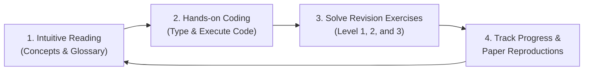

# 🧠 AI Research Foundations: From Python to Frontier Reasoning Models

<p align="center">
  
</p>

<p align="center">
  <strong>A visual, intuition-first curriculum taking you from basic Python foundations to building GPTs and walking through DeepSeekMath GRPO loss.</strong>
</p>

<p align="center">
  <em>Created by Amirlan Kalmukhan</em>
</p>

<p align="center">
  <a href="LICENSE"></a>
  <a href="#-curriculum-overview"></a>
  <a href="GLOSSARY.md"></a>
  <a href="STUCK.md"></a>
  <a href="20_Capstone_GRPO_Loss_Walkthrough/README.md"></a>
</p>

<p align="center">
  
  
  <a href="https://github.com/amirlankalm/ai-research-foundations/actions/workflows/ci.yml"></a>
  
</p>

---

## 🎯 What This Repo Is (and Is Not)

> [!IMPORTANT]
> **Honest Positioning & Portfolio Context**:
> - **What this repo IS**: A self-built, rigorous 20-module foundation curriculum taking a learner from basic Python to modern post-training internals (Micrograd autograd, Pre-LN Transformers, PPO clipped loss, DPO preference margins, and DeepSeekMath GRPO group normalization). It serves as tangible evidence of deep fluency in machine learning fundamentals, clean implementation habits, and clear technical communication. Every core source and intellectual lineage (Andrej Karpathy's Zero to Hero, CleanRL, DeepSeekMath) is credited explicitly.
> - **What this repo IS NOT**: It is **not original research**. Every module here is a guided re-implementation of established, well-known foundational machinery where the ground-truth equations and behaviors are already proven. Original exploratory research and novel benchmarking live in dedicated research projects.

### 📝 What I Learned Building This (Reflections Across the 9 Stages)

1. **Stage 1: Tooling & Data (Mod 01–02)**: *What broke:* NumPy array strides and broadcasting dimensions when batching variable-length sequences. *Surprise:* Vectorized operations in NumPy outperform naive nested Python loops by over 50x purely due to contiguous C memory layouts and SIMD registers.
2. **Stage 2: Intuitive Math (Mod 03–05)**: *What broke:* Rosenbrock gradient descent oscillating in sharp valleys without momentum. *Surprise:* How much geometric intuition demystifies deep learning: self-attention scaling $\frac{1}{\sqrt{d_k}}$ is just variance normalization of dot products under the central limit theorem.
3. **Stage 3: Classical ML (Mod 06)**: *What broke:* Logistic regression exploding on unnormalized features. *Surprise:* Overfitting is not just a parameter count problem—data leakage across train/test splits before imputation is the #1 silent killer in production.
4. **Stage 4: Deep Learning Core (Mod 07–09)**: *What broke:* Autograd gradient overwrite bug when a node fed into multiple branches (needed `+=` instead of `=`). *Surprise:* Pre-LN vs Post-LN: simply moving LayerNorm inside the residual block creates an unimpeded identity highway that completely eliminates the need for delicate warmup heuristics.
5. **Stage 5: Transformers & NanoGPT (Mod 10–12)**: *What broke:* Off-by-one errors in causal masking and target shifting ($x_{t+1}$ vs $x_t$). *Surprise:* Byte-level BPE is genuinely universal: 256 initial bytes completely eliminates Out-Of-Vocabulary `<unk>` tokens forever, even for emojis.
6. **Stage 6: Reinforcement Learning (Mod 13–14)**: *What broke:* Non-stationarity in Q-learning cliff traps. *Surprise:* The log-derivative trick in policy gradients $\nabla \log \pi_\theta(a|s)$ turns an intractable expectation over environment dynamics into a simple weighted cross-entropy loss.
7. **Stage 7: Alignment & Reasoning (Mod 15–17)**: *What broke:* DPO loss length exploitation (longer generations accumulating larger reward margins). *Surprise:* Bradley-Terry preference modeling can be solved analytically—we don't need a critic network or an online RL loop to align an LLM with human preferences.
8. **Stage 8: Interpretability & Safety (Mod 18)**: *What broke:* SAE dictionary collapse with too small an L1 penalty. *Surprise:* Induction heads ($[A][B] \dots [A] \to [B]$) explain in-context few-shot learning across just two attention layers without any parameter updates.
9. **Stage 9 & Capstone: Paper Walkthrough (Mod 19–20)**: *What broke:* Naive format rewards paying for `<think>` tags without verifying the answer (reward hacking!). *Surprise:* GRPO eliminates the massive Critic network of PPO simply by standardizing rewards across a group of sampled responses for the same prompt, saving ~45% GPU VRAM.

---

## 📖 Welcome to AI Research Foundations

> [!NOTE]
> **Prerequisites**: This curriculum is designed to be started **after** completing basic Python foundations (variables, functions, lists/dictionaries, control flow — such as [30 Days of Python](https://github.com/Asabeneh/30-Days-Of-Python) or [Harvard CS50P](https://cs50.harvard.edu/python/)). No prior machine learning, advanced calculus, or PyTorch background is required — everything from vector broadcasting to transformer decoders and RLHF is taught from intuition up.

Most resources for learning AI either drown you in dry academic equations without explaining **why** things work, or hand you high-level black-box libraries (`model.fit()`) without showing you the internal machinery.

Inspired by the structured, hands-on, community-driven spirit of **[30 Days of Python](https://github.com/Asabeneh/30-Days-Of-Python)**, this repository provides a complete, progressive path designed for anyone who wants to understand and build modern foundation models.

### ✨ Core Principles of this Guidebook

1. **💡 Intuition First, Zero Math Panic**: Every mathematical equation is grounded in visual spatial intuition and plain-English analogies before any formal symbols are introduced.
2. **📖 Every Jargon Term Defined**: Whenever a technical term appears *(like latent vector, autograd, or KL divergence)*, a clear, plain-English definition is provided right next to it. You can also search the centralized [`GLOSSARY.md`](GLOSSARY.md).
3. **🛠️ Build From Scratch Before Using Libraries**: You will hand-code a scalar autograd engine (micrograd style), build a byte-pair tokenizer, construct self-attention, and assemble a GPT decoder from raw tensor operations before touching pre-built library abstractions.
4. **🧠 Frontier Post-Training & Reasoning**: Unlike outdated courses that stop at 2017 transformers, this curriculum carries you directly through **Direct Preference Optimization (DPO)**, **Group Relative Policy Optimization (GRPO)**, and **Reasoning Models (DeepSeek-R1, test-time compute)**.
5. **🎯 Real Paper Walkthrough Capstone**: In the final module, you will implement the algorithmic core and loss function of the breakthrough paper **[DeepSeekMath: Pushing the Limits of Mathematical Reasoning in Open Language Models (arXiv:2402.03300)](https://arxiv.org/abs/2402.03300)** from scratch in PyTorch.

---

## 🗺️ Curriculum Overview

Follow the modules sequentially. Each folder contains a detailed, beautifully illustrated guide (`README.md`) complete with theory, term definitions, runnable Python code in every module, interactive **Google Colab** notebooks for 7 core modules (01, 02, 03, 07, 11, 12, 20), graded **revision exercises** at three difficulty levels, and complete worked reference **solutions** (`solutions.md`) across all 20 modules.

| # | Module Topic | Core Focus | Stage & Tools | Link |
|---|---|---|---|---|
| **01** | **Python & Research Tooling** | Virtual environments, modern CLI (`ghostty`/`zsh`), Git for experiments, Jupyter & debugging | Stage 1: Tooling | [Module 01](01_Python_and_Research_Tooling/README.md) |
| **02** | **NumPy, Vectorization & Data** | N-dimensional arrays, broadcasting, vectorization vs loops, Pandas & Matplotlib | Stage 1: Libraries | [Module 02](02_NumPy_Vectorization_and_Data/README.md) |
| **03** | **Intuitive Linear Algebra for AI** | Geometric intuition, dot products as similarity, matrix transformations, eigenvalues | Stage 2: Math | [Module 03](03_Intuitive_Linear_Algebra/README.md) |
| **04** | **Intuitive Calculus & Optimization** | Derivatives, computational graphs, chain rule, gradient descent, Adam optimizer | Stage 2: Math | [Module 04](04_Intuitive_Calculus_and_Optimization/README.md) |
| **05** | **Intuitive Probability & Information** | Distributions, Bayes theorem, Maximum Likelihood, Cross-Entropy, KL Divergence | Stage 2: Math | [Module 05](05_Intuitive_Probability_and_Information_Theory/README.md) |
| **06** | **Classical Machine Learning** | Supervised vs Unsupervised, Regression, Decision Trees, Overfitting, Kaggle Titanic | Stage 3: Classical ML | [Module 06](06_Classical_Machine_Learning/README.md) |
| **07** | **Neural Networks & Autograd (Micrograd)** | Biological vs artificial neurons, reverse-mode autodiff, building a scalar engine | Stage 4: DL Core | [Module 07](07_Neural_Networks_and_Autograd_From_Scratch/README.md) |
| **08** | **PyTorch Deep Learning Core** | `torch.Tensor`, GPU/MPS accelerators, `nn.Module`, DataLoaders, standard training loop | Stage 4: DL Core | [Module 08](08_PyTorch_Deep_Learning_Core/README.md) |
| **09** | **Deep Learning Dynamics & Architectures** | Vanishing gradients, ReLU/GELU/SwiGLU, BatchNorm vs LayerNorm, ResNets & WaveNet | Stage 4: DL Core | [Module 09](09_Deep_Learning_Dynamics_and_Architectures/README.md) |
| **10** | **Tokenization & Byte-Pair Encoding (BPE)** | Character vs subword tokens, building BPE from scratch, token embeddings, vocabularies | Stage 5: Transformers | [Module 10](10_Tokenization_and_Byte_Pair_Encoding/README.md) |
| **11** | **Attention & The Transformer Architecture** | Scaled dot-product attention, Query/Key/Value database intuition, Multi-Head Attention, RoPE, KV Cache | Stage 5: Transformers | [Module 11](11_Attention_and_The_Transformer/README.md) |
| **12** | **Building GPT From Scratch (nanoGPT)** | Decoder-only causal transformer, autoregressive generation, temperature sampling, training loop | Stage 5: Transformers | [Module 12](12_Building_GPT_From_Scratch/README.md) |
| **13** | **Foundations of Reinforcement Learning** | MDPs, states, actions, rewards, discount factor $\gamma$, Bellman equation, Q-Learning | Stage 6: RL | [Module 13](13_Foundations_of_Reinforcement_Learning/README.md) |
| **14** | **Deep RL: Policy Gradients & PPO** | Policy gradient theorem, REINFORCE, Actor-Critic, clipped surrogate objective, CleanRL style | Stage 6: RL | [Module 14](14_Deep_RL_Policy_Gradients_and_PPO/README.md) |
| **15** | **Post-Training: SFT & DPO** | Instruction tuning (ChatML format), LoRA parameter-efficient adaptation, Direct Preference Optimization | Stage 7: Alignment | [Module 15](15_Post_Training_and_Alignment_SFT_and_DPO/README.md) |
| **16** | **RLHF & Group Relative Policy Optimization (GRPO)** | Traditional 3-stage RLHF, Critic bottleneck, GRPO group reward normalization, DeepSeek formulation | Stage 7: Alignment | [Module 16](16_RLHF_and_Group_Relative_Policy_Optimization_GRPO/README.md) |
| **17** | **Reasoning Models & Test-Time Compute** | Chain-of-Thought, Process Reward Models (PRMs), Search & MCTS, DeepSeek-R1 emergent reasoning | Stage 7: Reasoning | [Module 17](17_Reasoning_Models_and_Test_Time_Compute/README.md) |
| **18** | **Mechanistic Interpretability & AI Safety** | Reverse-engineering weights, induction heads, superposition, Sparse Autoencoders (SAEs), red-teaming | Stage 8: Safety & Interp | [Module 18](18_Mechanistic_Interpretability_and_AI_Safety/README.md) |
| **19** | **How to Read & Critique AI Research Papers** | S. Keshav 3-pass method, anatomy of an ML paper, spotting benchmark hype, Paperleet workflow | Stage 9: Paper Reading | [Module 19](19_Reading_and_Deconstructing_AI_Papers/README.md) |
| **20** | **Capstone: GRPO Loss Walkthrough** | Complete PyTorch walkthrough of Group Relative Policy Optimization (DeepSeekMath arXiv:2402.03300) loss, group normalization, and rule-based math verification | Final Capstone | [Module 20](20_Capstone_GRPO_Loss_Walkthrough/README.md) |

---

## 🚀 Environment Setup

To get started, prepare your local development environment. We recommend **Python 3.10+**.

```bash
# 1. Clone the repository
git clone https://github.com/amirlankalm/ai-research-foundations.git
cd ai-research-foundations

# 2. Create a clean virtual environment
python3 -m venv .venv
source .venv/bin/activate    # On Windows: .venv\Scripts\activate

# 3. Upgrade pip
pip install --upgrade pip

# Choose your track:
# Option A: Core math & classical ML only (lightweight, no PyTorch needed):
pip install -r requirements-core.txt

# Option B: Full deep learning & LLM stack:
pip install -r requirements-torch.txt

# 4. Verify your installation by running the test suite
# If you chose Option A (Core track, 14 passing tests without PyTorch):
python3 -m pytest tests/test_core.py -v

# If you chose Option B (Full Deep Learning track, 25 passing tests):
python3 -m pytest tests/ -v
```

> [!TIP]
> - Search terms at any time in [`GLOSSARY.md`](GLOSSARY.md).
> - Encountered an error? Consult [`STUCK.md`](STUCK.md) for solutions to the 15 most common beginner pitfalls.

---

## 📚 Study Strategy: The 3-Step Research Loop

To get the most out of every module:



1. **Step 1: Read the Theory & Mental Models**
   - Read the concept explanations and note the definitions in parenthesis.
   - Look closely at the visual diagrams and architecture schematics.
2. **Step 2: Run the Companion Code**
   - Don't just copy-paste: type out the code snippets or execute the provided scripts.
   - Add `print()` statements to inspect tensor shapes (`tensor.shape`) at every intermediate step.
3. **Step 3: Solve the Revision Exercises**
   - **Level 1 (Recall & Concept Checks)**: Quick knowledge verification.
   - **Level 2 (Implementation Challenges)**: Code tasks to cement the algorithms.
   - **Level 3 (Research Deep Dive)**: Deep exploration, mathematical proofs, and ablation studies.

---

## 🏆 Capstone Walkthrough: DeepSeekMath GRPO Loss

In [Module 20](20_Capstone_GRPO_Loss_Walkthrough/README.md), you will integrate what you have learned by implementing and executing the core mathematical and loss mechanics of modern reasoning AI: **Group Relative Policy Optimization (GRPO)** from [DeepSeekMath (arXiv:2402.03300)](https://arxiv.org/abs/2402.03300).

You will:
1. Deconstruct the DeepSeekMath paper mechanics (arXiv:2402.03300).
2. Build a rule-based math verifier for GSM8K problems with `<think>` tag checking.
3. Implement the GRPO group reward normalizer:
   $$\hat{A}_{i,t} = \frac{r_i - \text{mean}(\{r_1, \dots, r_G\})}{\text{std}(\{r_1, \dots, r_G\}) + \epsilon}$$
4. Implement the clipped surrogate objective with analytical KL divergence penalty ($k_3$ estimator).
5. Execute a standalone PyTorch loss walkthrough that runs cleanly on CPU in seconds.

---

## 🔗 Master Resource Collection

This curriculum synthesizes the finest open educational resources in computer science and machine learning:

### 📺 Video Series & Interactive Courses
- **Andrej Karpathy - Neural Networks: Zero to Hero**: [karpathy.ai/zero-to-hero.html](https://karpathy.ai/zero-to-hero.html)
- **3Blue1Brown - Essence of Linear Algebra**: [YouTube Playlist](https://www.youtube.com/playlist?list=PLZHQObOWTQDPD3MizzM2xVFitgF8hE_ab)
- **3Blue1Brown - Essence of Calculus & Neural Networks**: [YouTube Playlist](https://www.youtube.com/playlist?list=PLZHQObOWTQDNU6R1_67000Dx_ZCJB-3pi)
- **David Silver - Reinforcement Learning (UCL)**: [davidsilver.uk/teaching](https://www.davidsilver.uk/teaching/)
- **StatQuest with Josh Starmer**: [statquest.org](https://www.statquest.org)
- **Harvard CS50P**: [cs50.harvard.edu/python](https://cs50.harvard.edu/python/)
- **MIT Missing Semester of Your CS Education**: [missing.csail.mit.edu](https://missing.csail.mit.edu)

### 📖 Classic Books & Reference Material
- **Mathematics for Machine Learning (Deisenroth, Faisal, Ong)**: [mml-book.github.io](https://mml-book.github.io/)
- **Deep Learning (Goodfellow, Bengio, Courville)**: [deeplearningbook.org](https://www.deeplearningbook.org/)
- **Reinforcement Learning: An Introduction (Sutton & Barto)**: [incompleteideas.net](http://incompleteideas.net/book/the-book-2nd.html)
- **Dive into Deep Learning (D2L.ai)**: [d2l.ai](https://d2l.ai/)
- **The RLHF Book (Nathan Lambert)**: [rlhfbook.com](https://rlhfbook.com/)
- **Understanding Deep Learning (Simon Prince)**: [udlbook.github.io](https://udlbook.github.io/udlbook/)
- **The Little Book of Deep Learning (François Fleuret)**: [fleuret.org/public/lbdl.pdf](https://fleuret.org/public/lbdl.pdf)

### 🔬 Research Platforms & Papers
- **Paperleet**: [paperleet.com](https://paperleet.com) *(Disclosure: an independent practice platform I am building for paper reproductions)*
- **Hugging Face Daily Papers**: [huggingface.co/papers](https://huggingface.co/papers)
- **Semantic Scholar**: [semanticscholar.org](https://www.semanticscholar.org)
- **LabML Annotated Paper Implementations**: [nn.labml.ai](https://nn.labml.ai/)
- **CleanRL Reference Implementations**: [github.com/vwxyzjn/cleanrl](https://github.com/vwxyzjn/cleanrl)

---

## 🤝 Community & Contributing

Found a typo? Have an idea for a cleaner diagram or a better intuition analogy? Contributions are welcome!
Please read our [Contributing Guide](CONTRIBUTING.md) and [Code of Conduct](CODE_OF_CONDUCT.md) before submitting a Pull Request.

---

## 📜 License & Assets Notice

- **Curriculum & Code**: Released under the [MIT License](LICENSE).
- **Artistic Visuals**: The banner artwork depicts characters from *Cyberpunk: Edgerunners* (Studio Trigger / CD Projekt Red) and is included solely for educational and non-commercial community inspiration under fair use principles. See [`ASSETS_NOTICE.md`](ASSETS_NOTICE.md) for full terms.

---

## 🏷️ Search Topics & Index Keywords

`artificial-intelligence` • `deep-learning` • `machine-learning` • `reinforcement-learning` • `pytorch` • `transformers` • `llm` • `large-language-models` • `deepseek` • `deepseek-r1` • `grpo` • `rlhf` • `dpo` • `paper-walkthrough` • `ai-research` • `python` • `neural-networks` • `reasoning-models` • `interpretability` • `paperleet`
