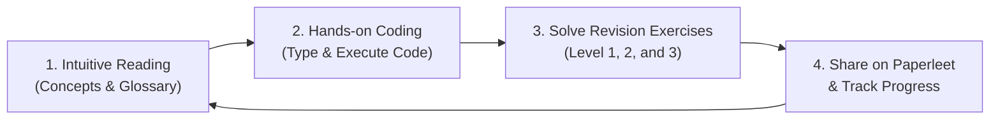

# 🧠 AI Research Foundations: From Zero to Junior AI Researcher

<p align="center">
  
</p>

<p align="center">
  <strong>The definitive visual, intuition-first curriculum taking you from standard Python to building GPTs and reproducing frontier AI reasoning papers.</strong>
</p>

<p align="center">
  <em>Created with ❤️ by Amirlan Kalmukhan</em>
</p>

<p align="center">
  <a href="https://github.com/amirlankalm/ai-research-foundations/stargazers"></a>
  <a href="https://github.com/amirlankalm/ai-research-foundations/network/members"></a>
  <a href="LICENSE"></a>
  <a href="https://paperleet.com"></a>
  <a href="https://arxiv.org/abs/2402.03300"></a>
</p>

<p align="center">
  
  
  
  
</p>

---

> [!TIP]
> ### ⭐ Support This Open-Source Project!
> If this curriculum helps your understanding or serves as a valuable reference for your research, **please give it a Star on GitHub!** It boosts the project's visibility, helping aspiring researchers and students discover it.
> 
> <p align="left">
>   <a href="https://twitter.com/intent/tweet?text=Check%20out%20AI%20Research%20Foundations%3A%20A%20free%2C%20visual%2C%20intuition-first%20guide%20to%20deep%20learning%2C%20transformers%2C%20and%20reproducing%20DeepSeekMath%20GRPO%21%20https%3A%2F%2Fgithub.com%2Famirlankalm%2Fai-research-foundations"></a>
>   <a href="https://www.linkedin.com/sharing/share-offsite/?url=https://github.com/amirlankalm/ai-research-foundations"></a>
>   <a href="https://reddit.com/submit?url=https://github.com/amirlankalm/ai-research-foundations&title=AI%20Research%20Foundations%3A%20From%20Zero%20to%20Junior%20AI%20Researcher"></a>
> </p>

---

## 📖 Welcome to AI Research Foundations

Most resources for learning AI either drown you in dry academic equations without explaining **why** things work, or hand you high-level black-box libraries (`model.fit()`) without showing you the internal machinery.

Inspired by the structured, hands-on, community-driven spirit of **[30 Days of Python](https://github.com/Asabeneh/30-Days-Of-Python)**, this repository provides a complete, progressive path designed for anyone who wants to become a capable **AI Researcher** or **AI Research Engineer**.

### ✨ Core Principles of this Guidebook

1. **💡 Intuition First, Zero Math Panic**: Every mathematical equation is grounded in visual spatial intuition and plain-English analogies before any formal symbols are introduced.
2. **📖 Every Jargon Term Defined**: Whenever a technical term appears *(like latent vector, autograd, or KL divergence)*, a clear, plain-English definition is provided right next to it.
3. **🛠️ Build From Scratch Before Using Libraries**: You will hand-code a scalar autograd engine (micrograd style), build a byte-pair tokenizer, construct self-attention, and assemble a GPT decoder from raw tensor operations before touching pre-built library abstractions.
4. **🧠 Frontier Post-Training & Reasoning**: Unlike outdated courses that stop at 2017 transformers, this curriculum carries you directly through **Direct Preference Optimization (DPO)**, **Group Relative Policy Optimization (GRPO)**, and **Reasoning Models (DeepSeek-R1, test-time compute)**.
5. **🎯 Real Paper Reproduction Capstone**: In the final module, you will set up [Paperleet](https://paperleet.com) and implement the algorithmic core of the breakthrough paper **[DeepSeekMath: Pushing the Limits of Mathematical Reasoning in Open Language Models (arXiv:2402.03300)](https://arxiv.org/abs/2402.03300)**.

---

## 🗺️ Curriculum Overview

Follow the modules sequentially. Each folder contains a detailed, beautifully illustrated guide (`README.md`) complete with theory, term definitions, runnable Python code, and graded **revision exercises** at three difficulty levels.

| # | Module Topic | Core Focus | Stage & Tools | Link |
|---|---|---|---|---|
| **01** | **Python & Research Tooling** | Virtual environments, modern CLI (`ghostty`/`zsh`), Git for experiments, Jupyter & debugging | Stage 1: Tooling | [Module 01](01_Python_and_Research_Tooling/README.md) |
| **02** | **NumPy, Vectorization & Data** | N-dimensional arrays, broadcasting, vectorization vs loops, Pandas & Matplotlib | Stage 1: Libraries | [Module 02](02_NumPy_Vectorization_and_Data/README.md) |
| **03** | **Intuitive Linear Algebra for AI** | Geometric intuition, dot products as similarity, matrix transformations, eigenvalues | Stage 2: Math | [Module 03](03_Intuitive_Linear_Algebra/README.md) |
| **04** | **Intuitive Calculus & Optimization** | Derivatives, computational graphs, chain rule, gradient descent, Adam optimizer | Stage 2: Math | [Module 04](04_Intuitive_Calculus_and_Optimization/README.md) |
| **05** | **Intuitive Probability & Information** | Distributions, Bayes theorem, Maximum Likelihood, Cross-Entropy, KL Divergence | Stage 2: Math | [Module 05](05_Intuitive_Probability_and_Information_Theory/README.md) |
| **06** | **Classical Machine Learning** | Supervised vs Unsupervised, Regression, Decision Trees, Overfitting, Kaggle Titanic | Stage 3: Classical ML | [Module 06](06_Classical_Machine_Learning/README.md) |
| **07** | **Neural Networks & Autograd (Micrograd)** | Biological vs artificial neurons, reverse-mode autodiff, building a scalar engine | Stage 4: DL Core | [Module 07](07_Neural_Networks_and_Autograd_From_Scratch/README.md) |
| **08** | **PyTorch Deep Learning Core** | `torch.Tensor`, GPU/MPS accelerators, `nn.Module`, DataLoaders, standard training loop | Stage 4: DL Core | [Module 08](08_PyTorch_Deep_Learning_Core/README.md) |
| **09** | **Deep Learning Dynamics & Architectures** | Vanishing gradients, ReLU/GELU/SwiGLU, BatchNorm vs LayerNorm, ResNets & WaveNet | Stage 4: DL Core | [Module 09](09_Deep_Learning_Dynamics_and_Architectures/README.md) |
| **10** | **Tokenization & Byte-Pair Encoding (BPE)** | Character vs subword tokens, building BPE from scratch, token embeddings, vocabularies | Stage 5: Transformers | [Module 10](10_Tokenization_and_Byte_Pair_Encoding/README.md) |
| **11** | **Attention & The Transformer Architecture** | Scaled dot-product attention, Query/Key/Value database intuition, Multi-Head Attention, RoPE, KV Cache | Stage 5: Transformers | [Module 11](11_Attention_and_The_Transformer/README.md) |
| **12** | **Building GPT From Scratch (nanoGPT)** | Decoder-only causal transformer, autoregressive generation, temperature sampling, training loop | Stage 5: Transformers | [Module 12](12_Building_GPT_From_Scratch/README.md) |
| **13** | **Foundations of Reinforcement Learning** | MDPs, states, actions, rewards, discount factor $\gamma$, Bellman equation, Q-Learning | Stage 6: RL | [Module 13](13_Foundations_of_Reinforcement_Learning/README.md) |
| **14** | **Deep RL: Policy Gradients & PPO** | Policy gradient theorem, REINFORCE, Actor-Critic, clipped surrogate objective, CleanRL style | Stage 6: RL | [Module 14](14_Deep_RL_Policy_Gradients_and_PPO/README.md) |
| **15** | **Post-Training: SFT & DPO** | Instruction tuning (ChatML format), LoRA parameter-efficient adaptation, Direct Preference Optimization | Stage 7: Alignment | [Module 15](15_Post_Training_and_Alignment_SFT_and_DPO/README.md) |
| **16** | **RLHF & Group Relative Policy Optimization (GRPO)** | Traditional 3-stage RLHF, Critic bottleneck, GRPO group reward normalization, DeepSeek formulation | Stage 7: Alignment | [Module 16](16_RLHF_and_Group_Relative_Policy_Optimization_GRPO/README.md) |
| **17** | **Reasoning Models & Test-Time Compute** | Chain-of-Thought, Process Reward Models (PRMs), Search & MCTS, DeepSeek-R1 emergent reasoning | Stage 7: Reasoning | [Module 17](17_Reasoning_Models_and_Test_Time_Compute/README.md) |
| **18** | **Mechanistic Interpretability & AI Safety** | Reverse-engineering weights, induction heads, superposition, Sparse Autoencoders (SAEs), red-teaming | Stage 8: Safety & Interp | [Module 18](18_Mechanistic_Interpretability_and_AI_Safety/README.md) |
| **19** | **How to Read & Critique AI Research Papers** | S. Keshav 3-pass method, anatomy of an ML paper, spotting benchmark hype, Paperleet workflow | Stage 9: Paper Reading | [Module 19](19_Reading_and_Deconstructing_AI_Papers/README.md) |
| **20** | **Capstone Project: DeepSeekMath & GRPO** | Full reproduction of Group Relative Policy Optimization (arXiv:2402.03300) in PyTorch on GSM8K math reasoning | Final Capstone | [Module 20](20_Capstone_Paper_Reproduction_DeepSeekMath_GRPO/README.md) |

---

## 🚀 Environment Setup

To get started, prepare your local development environment. We recommend **Python 3.10+**.

```bash
# 1. Clone the repository
git clone https://github.com/amirlankalm/ai-research-foundations.git
cd ai-research-foundations

# 2. Create a clean virtual environment
python3 -m venv .venv
source .venv/bin/activate    # On Windows: .venv\Scripts\activate

# 3. Upgrade pip and install all dependencies
pip install --upgrade pip
pip install -r requirements.txt

# 4. Verify your installation
python3 -c "import torch; print('PyTorch Version:', torch.__version__); print('Device Available:', 'CUDA' if torch.cuda.is_available() else ('MPS (Apple Silicon)' if torch.backends.mps.is_available() else 'CPU'))"
```

---

## 📚 Study Strategy: The 3-Step Research Loop

To get the most out of every module:



1. **Step 1: Read the Theory & Mental Models**
   - Read the concept explanations and note the definitions in parenthesis.
   - Look closely at the visual diagrams and architecture schematics.
2. **Step 2: Run the Companion Code**
   - Don't just copy-paste: type out the code snippets or execute the provided scripts.
   - Add `print()` statements to inspect tensor shapes (`tensor.shape`) at every intermediate step.
3. **Step 3: Solve the Revision Exercises**
   - **Level 1 (Recall & Concept Checks)**: Quick knowledge verification.
   - **Level 2 (Implementation Challenges)**: Code tasks to cement the algorithms.
   - **Level 3 (Research Deep Dive)**: Deep exploration, mathematical proofs, and ablation studies.

---

## 🏆 The Final Capstone: DeepSeekMath GRPO Reproduction

In [Module 20](20_Capstone_Paper_Reproduction_DeepSeekMath_GRPO/README.md), you will integrate everything you have learned by reproducing the core algorithmic innovation of modern reasoning AI: **Group Relative Policy Optimization (GRPO)** from [DeepSeekMath (arXiv:2402.03300)](https://arxiv.org/abs/2402.03300).

You will:
1. Create an account on **[Paperleet](https://paperleet.com)** to follow paper discussions and share research notes.
2. Build a rule-based math verifier for GSM8K problems.
3. Implement the GRPO group reward normalizer:
   $$\hat{A}_{i,t} = \frac{r_i - \text{mean}(\{r_1, \dots, r_G\})}{\text{std}(\{r_1, \dots, r_G\}) + \epsilon}$$
4. Implement the clipped surrogate objective with reference-model KL penalty.
5. Train a model to solve math problems through pure policy optimization without a critic!

---

## 🌟 Star History

[](https://star-history.com/#amirlankalm/ai-research-foundations&Date)

---

## 🔗 Master Resource Collection

This curriculum synthesizes the finest open educational resources in computer science and machine learning:

### 📺 Video Series & Interactive Courses
- **Andrej Karpathy - Neural Networks: Zero to Hero**: [karpathy.ai/zero-to-hero.html](https://karpathy.ai/zero-to-hero.html)
- **3Blue1Brown - Essence of Linear Algebra**: [YouTube Playlist](https://www.youtube.com/playlist?list=PLZHQObOWTQDPD3MizzM2xVFitgF8hE_ab)
- **3Blue1Brown - Essence of Calculus & Neural Networks**: [YouTube Playlist](https://www.youtube.com/playlist?list=PLZHQObOWTQDNU6R1_67000Dx_ZCJB-3pi)
- **David Silver - Reinforcement Learning (UCL)**: [davidsilver.uk/teaching](https://www.davidsilver.uk/teaching/)
- **StatQuest with Josh Starmer**: [statquest.org](https://www.statquest.org)
- **Harvard CS50P**: [cs50.harvard.edu/python](https://cs50.harvard.edu/python/)
- **MIT Missing Semester of Your CS Education**: [missing.csail.mit.edu](https://missing.csail.mit.edu)

### 📖 Classic Books & Reference Material
- **Mathematics for Machine Learning (Deisenroth, Faisal, Ong)**: [mml-book.github.io](https://mml-book.github.io/)
- **Deep Learning (Goodfellow, Bengio, Courville)**: [deeplearningbook.org](https://www.deeplearningbook.org/)
- **Reinforcement Learning: An Introduction (Sutton & Barto)**: [incompleteideas.net](http://incompleteideas.net/book/the-book-2nd.html)
- **Dive into Deep Learning (D2L.ai)**: [d2l.ai](https://d2l.ai/)
- **The RLHF Book (Nathan Lambert)**: [rlhfbook.com](https://rlhfbook.com/)
- **Understanding Deep Learning (Simon Prince)**: [udlbook.github.io](https://udlbook.github.io/udlbook/)
- **The Little Book of Deep Learning (François Fleuret)**: [fleuret.org/public/lbdl.pdf](https://fleuret.org/public/lbdl.pdf)

### 🔬 Research Platforms & Papers
- **Paperleet**: [paperleet.com](https://paperleet.com)
- **Hugging Face Daily Papers**: [huggingface.co/papers](https://huggingface.co/papers)
- **Semantic Scholar**: [semanticscholar.org](https://www.semanticscholar.org)
- **LabML Annotated Paper Implementations**: [nn.labml.ai](https://nn.labml.ai/)
- **CleanRL Reference Implementations**: [github.com/vwxyzjn/cleanrl](https://github.com/vwxyzjn/cleanrl)

---

## 🤝 Community & Contributing

Found a typo? Have an idea for a cleaner diagram or a better intuition analogy? Contributions are welcome!
Please read our [Contributing Guide](CONTRIBUTING.md) and [Code of Conduct](CODE_OF_CONDUCT.md) before submitting a Pull Request.

---

## 🏷️ Search Topics & Index Keywords

`artificial-intelligence` • `deep-learning` • `machine-learning` • `reinforcement-learning` • `pytorch` • `transformers` • `llm` • `large-language-models` • `deepseek` • `deepseek-r1` • `grpo` • `rlhf` • `dpo` • `paper-reproduction` • `ai-research` • `python` • `neural-networks` • `reasoning-models` • `interpretability` • `paperleet`

---

*Art credit: D and Capri, Cyberpunk: Edgerunners 2 (Studio Trigger / CD Projekt Red). Rights belong to their respective owners.*
